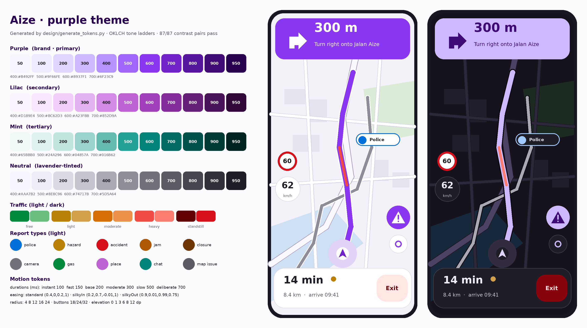
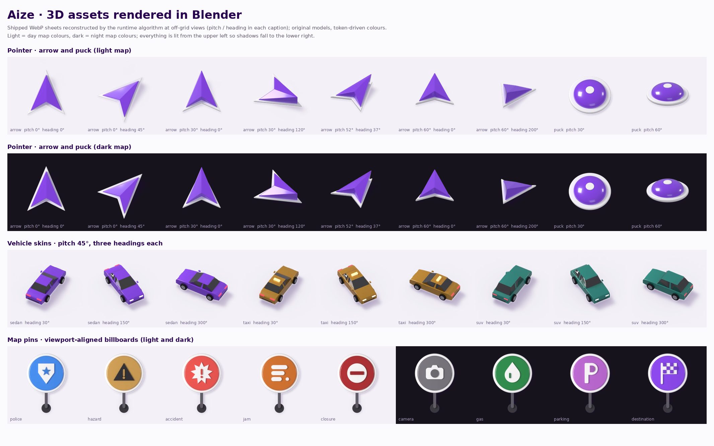

# Aize

**Aize** is a fast, community-driven, voice-guided navigation app for Android — purple identity, Waze-class interaction model, engineered so it never feels laggy.

> **Status (2026-10-22): research, planning and the 3D asset pipeline are complete — app implementation starts at phase P0.**  
> This repository contains the reverse-engineering report, the build plan, the design tokens, a reproducible analysis pipeline, and **the pointer, vehicle skins and map pins rendered in Blender and verified against ground truth** ([`assets3d/`](assets3d/README.md)). **No app code exists yet** (nothing has been compiled or tested because there is none) — see [`docs/02-aize-build-plan.md`](docs/02-aize-build-plan.md) §10 and §16 for how it starts.





## The two documents

| # | Document | What it answers |
|---|---|---|
| 1 | [`docs/01-waze-apk-structure-report.md`](docs/01-waze-apk-structure-report.md) | **What is inside the Waze APK (5.22.90.123) and how is it structured?** Manifest, code, native core, JNI boundary, rendering stack (Lua skin + embedded Godot overlays), UI/motion system, voice, network surface, performance signals — with evidence IDs |
| 2 | [`docs/02-aize-build-plan.md`](docs/02-aize-build-plan.md) | **How do we build Aize from that?** Decisions (Kotlin + Compose, Rust core, MapLibre Native, Valhalla…), architecture, purple design system, the "Waze API" policy, voice system, performance budgets, a **100-task / 653 person-day** work breakdown (MVP 337 pd), risks, first ten days |

Importable backlog: [`docs/backlog.csv`](docs/backlog.csv).

## The headline findings

1. Waze is a **thin Kotlin shell around a 73 MB C++ core** (PGO + BOLT + LTO), drawing the map on its own render thread from a raw `Surface`, rendering **on demand**, with **protobuf** across a coarse JNI boundary and an ART **baseline profile**. Aize copies that architecture of speed — not its assets.
2. Its map overlays (alert pins, user puck, route shaders, pulses) live in an **embedded Godot 4 pack**; its map style is a **Lua skin with 49 layer categories**; its UI is **hybrid Views + Compose**; its motion uses a handful of **duration tokens (100–700 ms) and two custom "silky" easing curves**.
3. The app talks to **private, authenticated** services. Aize does **not** use them: it implements the same *capabilities* with open data and its own API, and only touches Waze's *public* interfaces (deep links).

## Repository layout

| Path | Contents | Status |
|---|---|---|
| `docs/` | the two documents, `backlog.csv`, generators (`_src/`) | ✅ |
| `analysis/tools/` | static-analysis pipeline (`run_all.sh`), AXML/DEX/ELF/PCK scanners | ✅ reproducible (16/16 data files re-generate identically) |
| `analysis/data/` | derived structure data (JSON/CSV) — **no Waze media or code** | ✅ |
| `analysis/rea-skill/` | REA skill wrapper + install notes | ✅ |
| `design/` | purple tokens (+ WCAG audit: all 87 pairs pass), specimen renderer | ✅ |
| `assets3d/` | Blender pipeline (headless, pinned 4.5 LTS) → sprite sheets + manifests + glTF for the **pointer**, **3 vehicle skins** and **9 map pins**; every asset gated by measured error against true renders — [`README`](assets3d/README.md), [`RESULTS`](assets3d/RESULTS.md) | ✅ rendered and verified; not yet on a phone |
| `android/ core/ backend/ proto/ data/` | the app, Rust core, backend, schemas, data pipelines | ⏳ phases P0–P9 |

## Reproduce / regenerate

```bash
# analysis (needs python3, aapt2; optional: rea CLI)
AAPT2=/path/to/build-tools/34.0.0/aapt2 bash analysis/tools/run_all.sh /path/to/waze.apk analysis/data --no-rea

# documents
python3 analysis/tools/render_structure_report.py analysis/data docs/01-waze-apk-structure-report.md
python3 docs/_src/plan_wbs.py docs/_src/02-aize-build-plan.md.tmpl docs/02-aize-build-plan.md docs/backlog.csv \
        design/tokens/aize-purple.tokens.json design/tokens/CONTRAST.md

# design tokens + contrast audit (+ specimen; needs Pillow)
python3 design/generate_tokens.py && python3 design/render_preview.py

# 3D assets (downloads a checksum-verified Blender 4.5 LTS; CPU only; see assets3d/README.md)
bash assets3d/build_all.sh pointer     # also: pins, vehicles, all; QUICK=1 for a smoke test
python3 assets3d/tests/test_warp.py    # the runtime warp, proven against independent vector maths
```

Details and the REA/JADX notes (including why the whole APK does not fit a 1 GiB VM) are in [`analysis/README.md`](analysis/README.md).

## Legal and IP

Aize uses **original code and assets only**. The APK, decompiled source, images, sounds, fonts, animations and translations of Waze are **not** in this repository; a CI check (plan task P0-06) will keep it that way. "Waze" is a trademark of its owner; Aize is not affiliated with or endorsed by Waze/Google. The reverse engineering here is static analysis of an APK for interoperability and learning; the derived data lists names, counts and numeric design parameters only. See [`NOTICE.md`](NOTICE.md).

**Licence:** none chosen yet — all rights reserved by default until the owner decides (plan decision D5).

## Next steps

1. Answer the nine decisions in plan §0 (pilot region, team, MVP scope, licence, brand…).
2. Start phase **P0** (plan §10): monorepo scaffold, CI, data stack, walking skeleton — ten working days (plan §16).
3. Optional: run the deeper full-APK reverse-engineering pass on a ≥ 3 GiB machine (plan §10, RE-01).
