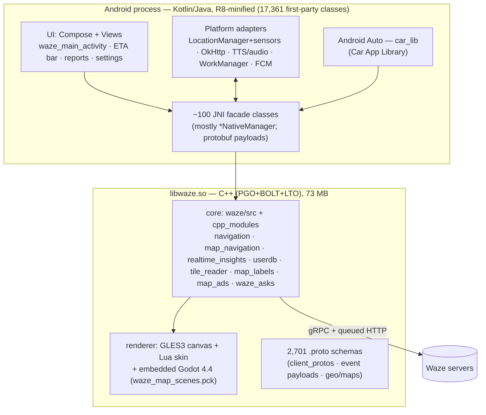

# 01 · Waze Android APK — reverse-engineering structure report

> **Target:** `com.waze` **5.22.90.123** (versionCode 1030811) · universal APK, 131.0 MB · SHA-256 `a45040acce4dbf79c1445a76415b8e3457dd8a720d373f81c8a98c5529f08c80`  
> **Analysed:** 2026-10-22 · **Mode:** static analysis only — the APK was never installed or executed  
> **Companion document:** [`02-aize-build-plan.md`](02-aize-build-plan.md) (what to build from these findings)

This report answers one question: **what is inside the Waze APK and how is it structured?** Every number below was produced by the scripts in [`analysis/tools`](../analysis/tools) and is stored as machine-readable data in [`analysis/data`](../analysis/data). Where REA (Reverse Engineer Anything) produced the evidence, its evidence IDs are quoted so each claim can be re-verified.

**Evidence legend** — **O** = *observed* directly in the artifact · **D** = *derived* by counting/joining observations · **I** = *inferred* (interpretation; confidence stated).

**What is deliberately *not* in this repository:** the APK, decompiled source, Waze images/sounds/fonts/animations, string translations, certificates' private data, or any credential. No credential-shaped string was found in the DEX string pools or the native library (`analysis/data/dex_summary.json → credential_shaped_string_counts` is empty); the signer certificate's personal common name is redacted.

---

## 0 · TL;DR — what Waze is made of

| # | Finding | Evidence | Why it matters for Aize |
|:---:|---|:---:|---|
| 1 | **A thin Kotlin/Java shell around a 73 MB C++ core.** `libwaze.so` holds routing/navigation logic, rendering, networking queues, storage and voice; the Java side reaches it through 102 classes that declare `native` methods (649 in total; most are `*NativeManager` facades). | O/D | Aize must put its hot paths (matching, progress, reroute, voice scheduling) in a native core, not in UI code. |
| 2 | **Structured data crosses JNI as protobuf.** 3,161 generated classes (messages, builders, Kotlin DSL wrappers) live in `com.waze.jni.protos`; a GPS fix is serialised to bytes before it reaches the core. | O | Few, coarse calls with typed payloads beat many small JNI calls. |
| 3 | **The map is drawn by native code on its own render thread** from a raw Android `Surface` (GLES 3 + EGL). Java forwards size/surface events and calls `nativeRender()`, which returns a boolean *frame drawn?* — suggesting frames are produced on demand (inferred; the caller was not decompiled). | O/I (REA/JADX) | Map pan/zoom never touches the UI thread; the same pattern is available with MapLibre Native. |
| 4 | **A custom Godot 4 engine is embedded** (`Godot Engine v4.4.2.rc … waze.custom`) with a 11.9 MB pack `waze_map_scenes.pck` that contains the *map overlay scenes*: alert pins, speed cameras, user-location puck, route-line shaders, pulsing alert glow, speedometer. | O | These are the "animations on the map" Aize must reproduce — with original art and GPU layers instead of a game engine. |
| 5 | **Map style is data, not code:** a Lua skin with **49 layer categories** × 94 zoom overrides, day and night palettes. | O | Aize needs an equivalent zoom-aware style (MapLibre style JSON) in purple. |
| 6 | **UI is hybrid.** 402 layout XMLs (Views) plus Jetpack Compose (13,217 library classes, 140 composable singletons, 16 layouts hosting `ComposeView`). The main screen, ETA bar and control panel are Compose hosted in a Views root. | O/D | Aize can be 100 % Compose and skip the legacy view layer entirely. |
| 7 | **Heavy build-time optimisation:** native code built with Google's LLVM 21 using **PGO + BOLT + LTO + MLGO**; an ART **baseline profile** ships in `assets/dexopt/`; 79.6 % of first-party classes have ≤ 2-character (R8-minified) names. | O | Performance is a build-pipeline feature: Aize needs LTO/PGO, baseline + startup profiles, R8 full mode from day one. |
| 8 | **Voice = recorded prompt sets + TTS + user-recorded packs.** Built-in English/Hebrew sets use exactly the file names of the community voice-pack schema (all 43 names match); 314 TTS phrase keys; a custom-prompt recorder/uploader. | O/D | Aize's voice system should be prompt-ID based, TTS-backed and import-compatible with user-owned packs. |
| 9 | **Android Auto is a first-class surface** (`WazeCarAppService`, ~1,266 `car_lib` classes, Car App Library level 9). | O | Plan a Car App Library module early; it constrains the architecture (headless navigation core). |
| 10 | **Size:** 131.0 MB universal APK — native libs 61.3 MB (zipped, two ABIs), DEX 22.1 MB, PNG resources 14.8 MB, Godot pack 10.1 MB. | D | Aize's budget: per-ABI AAB splits, vector icons, no embedded game engine → a fraction of this. |



---

## 1 · Scope, method and tooling

| Tool | Version / source | Used for |
|---|---|---|
| **REA — Reverse Engineer Anything** | `rea-agents` 6.7.0 (npm) · repo `morluto/rea` @ `933af60` · skill `reverse-engineer-anything` v44 installed into the agent's skills directory | `inspect-artifact` (APK graph, hashes, limitations), `inspect-android-method`, `inspect-android-class` (JADX provider), `doctor` |
| JADX headless MCP | `jadx-headless-mcp` 0.7.1 (supplied jar), heap 300 MiB | Decompilation of selected methods/classes (single-dex slices — see §17) |
| Android `aapt2` | build-tools 34.0.0 | `dump badging`, `dump xmltree` (manifest), `dump resources` (resource table) |
| Aize analysis scripts | [`analysis/tools/*.py`](../analysis/tools) | AXML reader, resource/manifest/DEX/ELF/PCK/asset/feature scanners, APK signing block parser |

REA evidence IDs: whole-APK inventory `ev_f5c7cad2a392d8c804322a75e21e1bff57c513cb4c9d788dd038e985ded79608` (inventory sub-evidence `ev_6d0b1eff8c00369e552c326cb48cacf59aaa609765592077099d2685779feee5`, 6,774 occurrences, 6,555 unique SHA-256 nodes, 0 integrity contradictions).  
The REA skill is an *instruction* skill: it does not register the REA MCP server inside this harness, so the equivalent `rea` CLI commands were used (same tools, kebab-case names). A thin wrapper (`rea_skill.py`) exposes **static-analysis commands only**; commands that launch/instrument a target, touch a device or install packages are refused.

---

## 2 · APK identity and provenance

| Property | Value | Ev. |
|---|---|:---:|
| Package / launcher | `com.waze` / `com.waze.FreeMapAppActivity` ("FreeMap" is Waze's original project name) | O |
| Version | 5.22.90.123 · versionCode 1030811 | O |
| SDK levels | minSdk 29 · targetSdk 36 · compileSdk 37 (`DEV` preview codename) | O |
| Application class | `com.waze.mobile.WazeMobileApplication` | O |
| Application flags | `largeHeap=true` · `hardwareAccelerated=true` · `usesCleartextTraffic=false` · `allowBackup=false` · `supportsRtl=false` · `requestLegacyExternalStorage=true` | O |
| ABIs | `arm64-v8a`, `armeabi-v7a` (no x86) | O |
| Signing | APK Signature Scheme v2 + APK Signature Scheme v3; one signer, self-signed, `C=Israel, ST=Israel, L=Raanana, O=Waze, OU=Waze, CN=<redacted>`, valid Jan 28 14:38:25 2009 GMT → Nov  1 14:38:25 2063 GMT; cert SHA-256 `03637f6c5d8f604e6fdb79a6ffbfa578de4e318f8da22fc6106665247f8807d7` | O |
| Build chain | NDK **r29** (api 24), Google `clang 21.0.0`, **+pgo +bolt +lto +mlgo**, linker `LLD google3-trunk` — built inside Google's monorepo | O |
| Bundle origin | meta-data `com.android.dynamic.apk.fused.modules=base` and `com.android.vending.splits` → a *universal APK fused from an Android App Bundle* (bundletool) | O/I |
| Archive | 6,773 entries · 281.6 MB uncompressed → 130.2 MB zipped · 3,296 entries stored uncompressed | D |

**Observed quirks worth knowing before you extract this APK:**
- Resource files use **shortened, case-sensitive names** (`res/A8b.xml`, `res/-OU.png`). 93 pairs differ only by letter case (e.g. `res/-OU.png` vs `res/-Ou.png`), so extracting on Windows/macOS silently drops files. REA reports the same limitation (inventory evidence).
- 118 groups of byte-identical files (≈1.3 MB redundant) — mostly duplicate voice prompts (`StartDrive3.mp3` ≡ `StartDrive8.mp3`, `400.mp3` ≡ `400meters.mp3`).
- ZIP inventory cannot see the APK Signing Block (outside the ZIP entries); it was parsed separately.

### 2.1 Where the 131 MB goes

| Bucket | Files | Uncompressed | Zipped | Share of zipped |
|---|---:|---:|---:|---:|
| native: lib/arm64-v8a | 9 | 87.6 MB | 31.9 MB | 24.5 % |
| native: lib/armeabi-v7a | 9 | 74.3 MB | 29.4 MB | 22.6 % |
| code: dex | 10 | 60.8 MB | 22.1 MB | 17.0 % |
| res: png | 3,276 | 15.0 MB | 14.8 MB | 11.3 % |
| assets: godot pck | 1 | 11.9 MB | 10.1 MB | 7.8 % |
| assets: skins (png/obj/lua) | 1,203 | 10.5 MB | 8.3 MB | 6.3 % |
| assets: sound prompts (mp3) | 142 | 6.0 MB | 4.7 MB | 3.6 % |
| resources.arsc (table) | 1 | 4.4 MB | 4.4 MB | 3.4 % |
| res: fonts | 23 | 3.2 MB | 1.8 MB | 1.4 % |
| res: compiled xml | 1,926 | 3.3 MB | 1.3 MB | 1.0 % |
| res: other | 7 | 0.7 MB | 0.7 MB | 0.5 % |
| assets: language/tts/search config | 6 | 1.8 MB | 0.4 MB | 0.3 % |
| res: lottie json | 53 | 1.5 MB | 0.1 MB | 0.1 % |
| other (root files, schemas, okhttp list) | 71 | 0.3 MB | 0.1 MB | 0.1 % |

---

## 3 · Archive layout

```text
waze-5.22.90.123.apk
├── AndroidManifest.xml                 binary XML (decoded in §4)
├── classes.dex … classes10.dex          10 DEX files · 60,430 classes · 474,093 methods (§5)
├── lib/{arm64-v8a,armeabi-v7a}/        9 libraries each; libwaze.so = 73.0 MB (arm64) (§6)
├── resources.arsc                       4.4 MB · 16,221 resources · 86 string locales (§9)
├── res/                                 5,303 registered files, flat + shortened names (§9)
├── assets/
│   ├── res/godot/waze_map_scenes.pck    Godot 4.4 scenes: map overlays (§8)
│   ├── res/skins/default/               Lua map skin + 1,173 PNG + 12 .obj 3-D models (§8)
│   ├── res/sound/{common,eng,heb}/      142 mp3 prompts & earcons (§12)
│   ├── res/lang.{eng,heb,chinese}       native-UI translation tables (key=value)
│   ├── res/key_value_tts_strings.txt    314 TTS phrase keys · res/tts/voices_was_tts.csv
│   ├── res/search_conf                  server-generated search config (providers, categories)
│   ├── dexopt/baseline.prof(m)          ART baseline profile
│   └── phenotype/*.binarypb             Google Phenotype (Play services) config
├── schemas/com.waze.stats.storage.StatsDatabase/3.json     Room schema (§14)
├── okhttp3/internal/publicsuffix/…      OkHttp public-suffix list
├── META-INF/services/…                  protobuf, gRPC, kotlinx.coroutines service files
├── WazeTtsPlayerNativeManagerJniMethods.h, WazeTtsStringsProviderNativeManagerJniMethods.h   generated JNI headers
└── car-app-api.level                    `9` (Car App Library API level)
```

**`assets/` in detail** (group, files, uncompressed, zipped):

| Path | Files | Uncompressed | Zipped |
|---|---:|---:|---:|
| assets/res/godot | 1 | 11.86 MB | 10.11 MB |
| assets/res/skins/default | 1,203 | 10.55 MB | 8.25 MB |
| assets/res/sound/heb | 58 | 3.11 MB | 2.41 MB |
| assets/res/sound/eng | 59 | 2.39 MB | 2.00 MB |
| assets/res | 5 | 1.83 MB | 0.43 MB |
| assets/res/sound/common | 25 | 0.47 MB | 0.26 MB |
| assets/res/scripts | 5 | 0.03 MB | 0.01 MB |
| assets/dexopt | 2 | 0.01 MB | 0.01 MB |
| assets/android_common_resources_processed_manifest | 1 | 0.00 MB | 0.00 MB |
| assets/res/tts | 1 | 0.00 MB | 0.00 MB |
| assets/phenotype | 1 | 0.00 MB | 0.00 MB |
| assets/android_common_resources_symbols | 3 | 0.00 MB | 0.00 MB |
| assets | 1 | 0.00 MB | 0.00 MB |

---

## 4 · AndroidManifest

**Totals:** 58 activities · 20 services · 15 receivers · 5 providers · 35 `uses-permission` · 8 `uses-feature` · 16 components with intent filters · exported: 2 activities, 6 services, 7 receivers, 0 providers.

### 4.1 Permissions (grouped; purposes are inferred from the component that needs them)

| Group | # | Permissions | Purpose (inferred) |
|---|---:|---|---|
| Location & driving | 8 | `app.NAVIGATION_TEMPLATES`, `app.ACCESS_SURFACE`, `ACCESS_COARSE_LOCATION`, `ACCESS_FINE_LOCATION`, `ACCESS_BACKGROUND_LOCATION`, `ACCESS_LOCATION_EXTRA_COMMANDS`, `FOREGROUND_SERVICE_LOCATION`, `permission.CAR_INFO` | Fix, background tracking during navigation, foreground service (type `location`), Android Auto surface/template access. |
| Audio & voice | 2 | `MODIFY_AUDIO_SETTINGS`, `RECORD_AUDIO` | Voice commands / custom-prompt recorder; ducking and routing of guidance audio. |
| Camera | 1 | `CAMERA` | Photo reports and place photos (CameraX is bundled). |
| Contacts, calendar, phone | 4 | `READ_PHONE_STATE`, `READ_CONTACTS`, `READ_CALENDAR`, `READ_PROFILE` | Friends/ETA sharing, planned drives from calendar events, call-state aware audio. |
| Bluetooth | 4 | `BLUETOOTH`, `BLUETOOTH_ADMIN`, `BLUETOOTH_CONNECT`, `BLUETOOTH_SCAN` | Car audio and BLE beacon scanning (`BeaconsNativeManager`). |
| Notifications & overlay | 7 | `FOREGROUND_SERVICE`, `WAKE_LOCK`, `SYSTEM_ALERT_WINDOW`, `POST_NOTIFICATIONS`, `RECEIVE_BOOT_COMPLETED`, `VIBRATE`, `BROADCAST_STICKY` | Navigation notification, reminders, over-app alert pop-ups, keep-awake. |
| Network & downloads | 3 | `INTERNET`, `DOWNLOAD_WITHOUT_NOTIFICATION`, `ACCESS_NETWORK_STATE` | API traffic; map/voice downloads. |
| Account sync | 3 | `READ_SYNC_STATS`, `READ_SYNC_SETTINGS`, `WRITE_SYNC_SETTINGS` | Legacy sync-adapter permissions. |
| Ads & push | 2 | `c2dm.RECEIVE (FCM)`, `gms.AD_ID` | Advertising ID; FCM push. |
| Custom | 1 | `mobile.DYNAMIC_RECEIVER_EXPORTED_PERMISSION` | Signature-level guards for dynamically registered receivers. |

**Features:** `wifi` (optional), `screen.portrait` (optional), `screen.landscape` (optional), `camera` (optional), `bluetooth` (optional), `microphone` (optional), `telephony` (optional), `location.gps`.  
**`queries`:** packages `com.google.android.googlequicksearchbox`, `com.spotify.music`, `com.waze`; intents for TTS service, speech recogniser, image capture/crop, share-text, `com.waze.sdk.audio.ACTION_INIT` (Waze Audio Kit), window-extensions engagement mode.  
**Application meta-data:** Car App minimum API level **5** (`androidx.car.app.minCarApiLevel`), Google Mobile Ads application id (value redacted), Wallet API enabled, Crashlytics collection **disabled by default**, Firebase Performance logcat off.

### 4.2 Activities (first-party) grouped by product area

| Area | # | Activities |
|---|---:|---|
| Launch & main | 4 | `~.FreeMapAppActivity`, `~.app_nav.hub.service.WazeServiceHostActivity`, `~.uid.activities.UidFragmentActivity`, `~.MainActivity` |
| Search & destination | 7 | `~.navigate.HistoryActivity`, `~.search.v2.SearchV2Activity`, `~.navigate.location_preview.LocationPreviewActivity`, `~.favorites.AddFavoriteActivity`, `~.favorites.AddHomeWorkActivity`, `~.navigate.AutocompleteSearchActivity`, `~.favorites.FavoritesActivity` |
| Navigation & planning | 7 | `~.share.ViewShareDriveActivity`, `~.reports.ClosureMap`, `~.navigate.social.ShareHelpActivity`, `~.trip_overview.TripOverviewActivity`, `~.CalendarApprovedActivity`, `~.planned_drive.PlannedDriveActivity`, `~.parking.ParkingUpdateLocationActivity` |
| Reports & community | 10 | `~.reports.NearbyGasStationsActivity`, `~.reports.GasPriceReportActivity`, `~.reports.EditPlaceFlowActivity`, `~.reports.AddPlaceFlowActivity`, `~.ifs.ui.OmniSelectionActivity`, `~.rtalerts.RtAlertsComments`, `~.inbox.InboxPreviewActivity`, `~.ifs.ui.EditTextDialogActivity`, `~.ifs.ui.EditMapLocationActivity`, `~.reports.SosProvidersListActivity` |
| Settings & voice | 11 | `~.mywaze.moods.MoodsActivity`, `~.profile.TempUserProfileActivity`, `~.profile.ForgotPasswordActivity`, `~.settings.SettingsNotificationActivity`, `~.settings.SettingsHOVActivity`, `~.settings.SettingsHOVSearchActivity`, `~.settings.CustomVoicesFallbackVoicePickerActivity`, `~.settings.CustomPromptsRecordingActivity`, `~.settings.SettingsCalendarSelectionActivity`, `~.SimpleListMenuActivity`, `~.settings.SettingsMainActivity` |
| Onboarding, permissions, web | 9 | `~.feedback.FeedbackActivity`, `~.google_assistant.SpeechRecognizerActivity`, `~.install.LocationFailedActivity`, `~.install.SelectCountryActivity`, `~.InternalWebBrowser`, `~.sharedui.utils.RequestPermissionActivity`, `~.web.SimpleWebActivity`, `~.location.LocationPermissionActivity`, `~.view.popups.RequestAlwaysLocationDialogActivity` |
| Debug | 1 | `~.config.DebugConfigListActivity` |
| Other | 1 | `~.utils.DismissNotificationActivity` |

Launch modes: `MainActivity` and `LocationPermissionActivity` = **singleTask**, `SettingsMainActivity` = singleTop; Spotify's `LoginActivity` = singleInstance. **No activity pins `screenOrientation`.** `FreeMapAppActivity` is the only launcher and uses `Theme.Splash.Actual` (Android 12 SplashScreen API, V27/V29/V33 variants). Library activities: Play Core, Google sign-in/Credential Manager hidden activities, Car App permission activity, `androidx.compose.ui.tooling.PreviewActivity` (**exported, shipped in release**).

### 4.3 Services, receivers, providers

| Service | exported | fg-type | permission |
|---|:---:|:---:|---|
| `~.car_lib.WazeCarAppService` | true | 0x8 |  |
| `com.google.android.libraries.phenotype.registration.PhenotypeMetadataHolderService` | false |  |  |
| `com.google.android.gms.auth.api.signin.RevocationBoundService` | true |  | com.google.android.gms.auth.api.signin.permission.REVOCATION_NOTIFICATION |
| `com.google.firebase.components.ComponentDiscoveryService` | false |  |  |
| `com.google.firebase.messaging.FirebaseMessagingService` | false |  |  |
| `com.google.firebase.sessions.SessionLifecycleService` | false |  |  |
| `com.google.android.datatransport.runtime.backends.TransportBackendDiscovery` | false |  |  |
| `com.google.android.datatransport.runtime.scheduling.jobscheduling.JobInfoSchedulerService` | false |  | android.permission.BIND_JOB_SERVICE |
| `androidx.camera.core.impl.MetadataHolderService` | false |  |  |
| `androidx.car.app.CarAppMetadataHolderService` | false |  |  |
| `androidx.credentials.playservices.CredentialProviderMetadataHolder` | false |  |  |
| `androidx.room.MultiInstanceInvalidationService` | false |  |  |
| `androidx.work.impl.background.systemjob.SystemJobService` | true |  | android.permission.BIND_JOB_SERVICE |
| `androidx.work.impl.foreground.SystemForegroundService` | false |  |  |
| `~.WazeAppService` | false | 0x8 |  |
| `~.BoundService` | true |  |  |
| `~.AIDLService` | true |  |  |
| `~.sdk.SdkService` | true |  |  |
| `~.push.WazeFirebaseMessagingService` | false |  |  |
| `com.google.android.build.data.PropertiesServiceHolder` | false |  |  |

Receivers (15): `com.google.android.libraries.phenotype.client.stable.AccountRemovedBroadcastReceiver`, `com.google.android.libraries.phenotype.client.stable.PhenotypeUpdateBackgroundBroadcastReceiver`, `com.google.firebase.iid.FirebaseInstanceIdReceiver`, `com.google.android.datatransport.runtime.scheduling.jobscheduling.AlarmManagerSchedulerBroadcastReceiver`, `androidx.car.app.notification.CarAppNotificationBroadcastReceiver`, `androidx.work.impl.utils.ForceStopRunnable$BroadcastReceiver`, `androidx.work.impl.background.systemalarm.RescheduleReceiver`, `androidx.work.impl.diagnostics.DiagnosticsReceiver`, `~.car_lib.assistant.WazeCarAssistantStateReceiver`, `~.push.FeedbackBroadcastReceiver`, `~.AppServiceBroadcastReceiver`, `~.ActionIntent`, `~.CalendarChangeReceiver`, `~.push.DeleteNotificationReceiver`, `~.tide.BluetoothConnectionReceiver`.  
Providers (5): `com.google.firebase.provider.FirebaseInitProvider` (`com.waze.firebaseinitprovider`), `androidx.startup.InitializationProvider` (`com.waze.androidx-startup`), `~.coroutines.CoroutineSetDebugProvider` (`com.waze.CoroutineSetDebugProvider`), `~.sharedui.utils.WazeFileProvider` (`com.waze.provider`), `~.camera.WazeCameraIntentsFileProvider` (`com.waze.camera.WazeCameraIntentsFileProvider`).

### 4.4 Deep links and intent surface (public entry points)

| Component | Schemes | Hosts | Paths | autoVerify |
|---|---|---|---|:---:|
| `~.FreeMapAppActivity` | `http`, `https` | `www.google.com` | `/maps/.*q.*`, `/maps/dir` |  |
| `~.FreeMapAppActivity` | `google.maps` | — | — |  |
| `~.FreeMapAppActivity` | `geo`, `waze` | — | — |  |
| `~.FreeMapAppActivity` | `geo`, `geo.action` | — | — |  |
| `~.FreeMapAppActivity` | `http`, `https` | `assistant-maps.google.com`, `maps.google.com` | `/maps` |  |
| `~.FreeMapAppActivity` | `http`, `https` | `*.gcp.wazestg.com`, `*.waze.com`, `beta.waze.com`, `waze.com`, `www.gcp.wazestg.com`, `www.waze.com` | `/ul.*` | yes |
| `~.FreeMapAppActivity` | `google.navigation` | — | — |  |
| `~.car_lib.WazeCarAppService` | `geo`, `geo.action` | — | — |  |
| `~.car_lib.WazeCarAppService` | `http`, `https` | `www.google.com` | `/maps/.*q.*`, `/maps/dir` |  |
| `~.car_lib.WazeCarAppService` | `google.maps` | — | — |  |
| `~.car_lib.WazeCarAppService` | `geo`, `google.navigation`, `waze` | — | — |  |
| `~.car_lib.WazeCarAppService` | `http`, `https` | `assistant-maps.google.com`, `maps.google.com` | `/maps` |  |

(2 further `VIEW` filters carry only MIME types / non-URL data and are omitted.) The same set is registered on both `FreeMapAppActivity` (phone) and `WazeCarAppService` (car). Verified App Links: `waze.com`, `*.waze.com`, `beta.waze.com`, `*.gcp.wazestg.com` → `/ul*` (the documented **`waze.com/ul`** deep-link format). Waze also claims `geo:`, `google.navigation:`, `google.maps` and `maps.google.com/maps` links — standard behaviour for a navigation app.

---

## 5 · Code structure (DEX)

| DEX | Size | Classes | Methods | Strings | Fields |
|---|---:|---:|---:|---:|---:|
| classes.dex | 8.6 MB | 9,091 | 65,530 | 49,462 | 25,730 |
| classes2.dex | 9.1 MB | 10,009 | 65,418 | 58,071 | 38,719 |
| classes3.dex | 7.6 MB | 7,487 | 65,536 | 59,425 | 36,458 |
| classes4.dex | 8.0 MB | 8,594 | 65,445 | 56,672 | 32,315 |
| classes5.dex | 7.0 MB | 5,503 | 62,125 | 57,216 | 42,091 |
| classes6.dex | 5.8 MB | 6,881 | 63,555 | 31,968 | 18,624 |
| classes7.dex | 7.9 MB | 8,547 | 63,610 | 47,966 | 34,513 |
| classes8.dex | 2.8 MB | 1,493 | 37,012 | 20,779 | 8,179 |
| classes9.dex | 3.5 MB | 2,069 | 45,093 | 22,256 | 11,567 |
| classes10.dex | 0.7 MB | 756 | 6,947 | 3,805 | 1,458 |
| **Total** | 60.8 MB | **60,430** | **474,093** | 407,620 | 239,886 |

Interfaces 5,611 · enums 2,354 · annotations 892 · Kotlin markers (`*Kt`, `$Companion`, `$WhenMappings`) 4,378 · D8 synthetic lambdas 7,392 · API-modelling/backport stubs 503. Seven of the ten DEX files hold 62–65.5 K method ids (the format limit is 65,536) — the signature of an automatic multidex split.

**Minification (D):** 13,818 of 17,361 first-party classes (79.6 %) have ≤ 2-character names, and library code is renamed too (`h.*` ≈ Kotlin stdlib, `org.a.d.*` ≈ DI container, `kotlinx.b.*`). Library prefixes below are therefore a **lower bound**; JNI-bound classes and feature packages keep readable names because the native library looks them up by name.

### 5.1 Library census (by original package prefix)

| Library / area | Classes | Methods |
|---|---:|---:|
| Waze first-party | 17,361 | 121,366 |
| Jetpack Compose (runtime/ui/foundation/material) | 13,217 | 80,626 |
| CameraX | 3,754 | 21,928 |
| Media3 / ExoPlayer | 2,824 | 19,692 |
| Firebase | 804 | 4,920 |
| DataStore / Datastore-Preferences | 788 | 11,021 |
| Android Car App Library (Android Auto) | 779 | 3,907 |
| AndroidX RecyclerView / ConstraintLayout | 757 | 6,717 |
| Google Play services (gms) | 658 | 3,077 |
| WorkManager | 622 | 3,024 |
| Room | 532 | 2,756 |
| AndroidX AppCompat / Fragment / Lifecycle | 437 | 1,626 |
| Glide | 435 | 2,009 |
| kotlinx.coroutines | 386 | 1,868 |
| Material Components / Material 3 (views) | 275 | 1,940 |
| Lottie | 235 | 1,264 |
| OkHttp / Okio | 170 | 1,200 |
| Compose-adjacent: activity-compose / navigation-compose | 165 | 680 |
| Google Play Core / Integrity / In-app review | 40 | 132 |

Present but renamed (inferred, **I**, medium confidence): Kotlin stdlib/coroutines internals, protobuf-lite runtime (`META-INF/services/com.google.protobuf.GeneratedExtensionRegistryLoader` is shipped), grpc-java (`META-INF/services/io.grpc.*` shipped; 13 un-renamed `AppIntegrationServiceGrpc*` classes come from the Google Assistant integration), Jackson (`com.fasterxml.*`, 1,051 classes) and a Koin-shaped DI container (the `Application.onCreate` loads a module array and resolves via `Scope.get(KClass, Qualifier, Function0)`). **Not found:** Retrofit, Gson, Hilt/Dagger, Coil, Picasso.

### 5.2 First-party package map (`com.waze.*`)

| Feature domain | Classes | Methods | Native methods |
|---|---:|---:|---:|
| Other: R8-renamed packages and top-level `com.waze.*` classes | 4,389 | 36,509 | 233 |
| JNI protobuf classes | 3,164 | 33,649 | 0 |
| UI kit (design system, views, popups, main screen) | 2,652 | 12,503 | 1 |
| Android Auto (Car App Library) | 1,266 | 6,093 | 0 |
| Navigation, routing, trip overview | 1,061 | 5,600 | 93 |
| Reports, alerts, community | 744 | 3,980 | 47 |
| Voice, audio, assistants | 711 | 4,197 | 43 |
| Map rendering & canvases | 628 | 3,365 | 100 |
| Settings, config, profile | 625 | 4,582 | 52 |
| Search, places, favorites | 607 | 2,853 | 25 |
| Social & sharing | 546 | 3,223 | 17 |
| SDK & infrastructure | 430 | 2,439 | 2 |
| Network, location, telemetry | 427 | 1,897 | 25 |
| Account, onboarding, consent | 111 | 476 | 11 |

All 17,361 first-party classes are assigned (first matching rule wins; packages are keyed by their first 3–4 segments — see `analysis/data/dex_summary.json → first_party.packages`). Largest readable packages:

| Package | Classes | Methods | Native |
|---|---:|---:|---:|
| `~.jni.protos` | 3,161 | 33,641 | 0 |
| `~.sound` | 331 | 1,820 | 37 |
| `~.map` | 218 | 1,205 | 44 |
| `~.navigate` | 217 | 1,541 | 76 |
| `~.settings` | 215 | 1,205 | 28 |
| `~.reports_v2.presentation` | 161 | 855 | 0 |
| `~.car_lib.screens` | 151 | 734 | 0 |
| `~.uid.state_impl` | 150 | 555 | 0 |
| `~.reports` | 147 | 967 | 4 |
| `~.trip_overview` | 130 | 612 | 0 |
| `~.config` | 124 | 2,115 | 7 |
| `~.settings.tree` | 113 | 457 | 0 |
| `~.app_nav.hub` | 86 | 354 | 0 |
| `~.modules.navigation` | 83 | 354 | 6 |
| `~.planned_drive` | 83 | 483 | 7 |
| `~.navigate.location_preview` | 82 | 452 | 0 |
| `~.view.popups` | 81 | 446 | 0 |
| `~.map.canvas` | 79 | 425 | 31 |
| `~.copilot.data` | 75 | 314 | 1 |
| `~.location` | 74 | 408 | 11 |
| `~.tripoverview.mobile` | 73 | 373 | 0 |
| `~.car_lib` | 72 | 291 | 0 |
| `~.network` | 71 | 275 | 9 |
| `~.sdk` | 71 | 507 | 0 |
| `~.search` | 70 | 302 | 3 |
| `~.asks` | 65 | 332 | 8 |
| `~.map.main` | 62 | 346 | 5 |
| `~.authentication` | 61 | 254 | 5 |

### 5.3 Framework supertype census (direct subclasses; obfuscated bases are not counted)

| Supertype | Direct subclasses |
|---|---:|
| `android.app.Activity` | 7 |
| `androidx.lifecycle.ViewModel` | 59 |
| `android.app.Service` | 27 |
| `android.content.BroadcastReceiver` | 47 |
| `android.content.ContentProvider` | 6 |
| `android.view.View` | 26 |
| `android.view.ViewGroup` | 25 |
| `android.widget.FrameLayout` | 55 |
| `android.widget.LinearLayout` | 26 |
| `androidx.constraintlayout.widget.ConstraintLayout` | 11 |
| `java.lang.Enum` | 2330 |
| `android.os.Binder` | 56 |
| `android.os.AsyncTask` | 9 |
| `android.widget.BaseAdapter` | 13 |

Only 7 activities extend `android.app.Activity` and 4 extend `ComponentActivity` directly — the rest sit behind R8-renamed base classes. 59 direct ViewModels, 9 legacy `AsyncTask` subclasses, `kotlinx.coroutines` pervasive.

---

## 6 · Native layer — `libwaze.so`

| Property | Value | Ev. |
|---|---|:---:|
| File | `lib/arm64-v8a/libwaze.so` · 73.0 MB · ELF64 AArch64 shared object · soname `libwaze.so` (armeabi-v7a twin: 62.7 MB) | O |
| Sections | `.rodata` 35.8 MB · `.text` 23.4 MB · `.eh_frame` 5.1 MB · `.bss` 4.7 MB · `.data.rel.ro` 2.9 MB · `protodesc_cold` 2.4 MB (protobuf descriptors) | O |
| Linked libraries (`DT_NEEDED`) | `libandroid.so`, `libOpenSLES.so`, `libdl.so`, `libm.so`, `libEGL.so`, `libGLESv2.so`, `libGLESv3.so`, `liblog.so`, `libc.so` | O |
| Graphics / audio APIs | OpenGL ES (183 `gl*` imports incl. transform feedback → **GLES 3**), EGL (6), OpenSL ES audio (9), `AAssetManager` (reads assets straight from the APK). **No Vulkan, no AAudio.** | O |
| JNI binding | 716 exported `Java_com_waze_*` symbols, **no `JNI_OnLoad`/`RegisterNatives`** → static, name-based lookup | O |
| Toolchain | Android LLVM `clang 21.0.0` (r563880c) built with **`+pgo +bolt +lto +mlgo`** (a second `dev` toolchain without those flags is also recorded in `.comment`), linker `LLD google3-trunk`, NDK r29 | O |
| Imports | 520 dynamic imports; sockets/DNS (13), pthread (26), dlopen family (4) | O |

### 6.1 Embedded third-party components (string banners)

| Component | Evidence (banner, as found) | Hits |
|---|---|---:|
| SQLite | `SQLite format 3` | 1 |
| libjpeg(-turbo) | `libjpeg-turbo` | 2 |
| HarfBuzz | `HarfBuzz` | 7 |
| ICU | `icudt78` | 4184 |
| Godot Engine | `Godot Engine v4.4.2.rcwaze.custom` | 1 |
| Lua | `Lua 5.3` | 1 |
| abseil | `absl::` | 12 |
| gRPC (C++) | `grpc.publisher.` | 23 |
| WebP | `libwebp` | 2 |
| Brotli | `brotli` | 3 |
| zstd | `zstd` | 8 |
| spirv/glslang | `glslang` | 25 |
| meshoptimizer | `meshopt` | 2 |
| S2 geometry | `s2geometry` | 4 |

Godot's own bundled libraries (glslang/SPIR-V, meshoptimizer, HarfBuzz, libwebp, zstd, brotli, libjpeg-turbo) account for several rows. **S2 geometry** (Google's spherical cell index) is the geo-indexing primitive. ICU 78 data is embedded (`icudt78`, 4,184 hits). BoringSSL, abseil and gRPC-core strings are present.

### 6.2 Native source tree (from embedded `__FILE__` / log paths)

2,375 unique source paths were recovered (.proto: 1124, .cc: 787, .cpp: 337, .h: 127).

| Directory (depth 4–5) | Files | What it is (inferred, **I**) |
|---|---:|---|
| `third_party/waze/client/waze/src` | 520 | Core client — the original RoadMap/FreeMap C/C++ code base (map, navigation, real-time, UI helpers) |
| `third_party/waze/client/cpp_modules/*` | 241 | Newer modular C++: `rendering_layer` 50 · `insights` 31 · `rendering` 24 · `tile_reader` 15 · `map_navigation` 13 · `realtime_insights` 11 · `userdb` 10 · `protobuf` 9 · `map_ads` 7 · `tile` 6 · `config` 6 · `map_labels` 6 · `waze_asks` 5 · `nav_connect` 5 · `navigation` 5 · `dispatch_utils` 4 |
| `third_party/waze/client/android-project/jni-protos` | 208 | `.proto` definitions of every JNI payload (→ `com.waze.jni.protos`) |
| `third_party/waze/client_event_payloads/proto` | 764 | Telemetry/analytics event schemas (`stats` 691, `wrappers` 64) |
| `third_party/waze/client_protos/proto` | 123 | Shared client↔server message schemas (`waze/`, `v2/`: e.g. Inbox, Lanes, Model, Types, Users) |
| `third_party/godot/v4_4_waze/*` | 400 | A **forked Godot 4.4**: `scene` 151 · `core` 121 · `servers` 61 (rendering 35) · `drivers` 28 (GLES3 19) · `modules` 20 · `platform/android` 17 |
| `third_party/{protobuf,openssl/boringssl,absl,gloop}` | ~30 | Protobuf runtime, BoringSSL, abseil, Google-internal util |

### 6.3 C++ namespaces recovered from RTTI (type-info names)

5,626 distinct nested C++ type names. Top namespaces:

| Namespace | Types | Reading (inferred, **I**) |
|---|---|---|
| `linqmap::proto` | 1,106 | **LinQMap** — Waze's map/real-time data model (also `linqmap::geocoding`, 45) |
| `stats::events` | 728 | Telemetry event messages |
| `com::waze` | 658 | Java-facing protobuf messages (JNI) |
| `waze::rendering` | 343 | Renderer, layers, labels |
| `waze::insights` / `insightsserving` / `realtime_insights` | 107 / 99 / 33 | Traffic & road-insight engine |
| `waze::map_ads`, `waze::wazegeoads` | 44 / 13 | Map advertising (branded pins) |
| `waze::graphics`, `gfx_engine`, `canvas`, `generic_canvas`, `layers` | 41 / 27 / 24 / 8 / 13 | 2-D/3-D scene abstraction |
| `waze::userdb`, `waze::tile`, `waze::map`, `waze::map_objects`, `waze::location`, `waze::location_tracker`, `waze::alerts`, `waze::navigation`, `waze::navigate`, `waze::routing`, `waze::reroute_suggestion`, `waze::nav_connect`, `waze::waze_asks`, `waze::beacons`, `waze::replay` | 39 / 26 / 36 / 12 / 26 / 8 / 29 / 18 / 12 / 11 / 14 / 15 / 15 / 8 / 12 | Feature modules — the real navigation product |
| `maps_tactile::directions`, `maps_gmm_snapping`, `pathfinder::crp`, `geostore`, `geo_serving_proto`, `geo_photo_service` | 149 / 103 / 55 / 302 / 117 / 160 | **Google Maps** routing/snapping/geostore message schemas embedded in the client |
| `GLES3`, `RendererSceneCull`, `RendererCanvasRender`, `ShaderLanguage`, `RenderingDevice` | 39 / 15 / 14 / 13 / 10 | Godot rendering server types |
| `icu_78`, `proto2`, `absl`, `spdlog` | 97 / 90 / 14 / 12 | Support libraries (ICU, protobuf, abseil, spdlog logging) |

**Protobuf schema files embedded** (`protodesc_cold`): 2,701 unique `.proto` names — Waze (`third_party/waze/*` ≈ 870), `geostore/base` 155, `geo/serving` 71, `maps/tactile` 66, `geo/photo` 65, `maps/gmm` 31 (snapping 17), `maps/pathfinder/crp` 17, `geo/vms` 11, `location/unified`, `storage/graph/bfg`. This is the vocabulary of the client↔server contract; the field-level definitions were **not** reconstructed.

### 6.4 Other native libraries

| Library | Size (arm64) | Role |
|---|---:|---|
| `libogg_opus_encoder.so` | 677 KB | Ogg/Opus **voice recording** (custom prompts, voice commands) — own build, `src/` paths in the binary |
| `libcrashlytics*.so` (4 files) | ≈13.3 MB | Firebase Crashlytics NDK reporter |
| `libimage_processing_util_jni.so`, `libsurface_util_jni.so` | 32 KB / 5 KB | CameraX image/surface helpers |
| `libandroidx.graphics.path.so` | 10 KB | AndroidX path-measure accelerator |

---

## 7 · The Java ↔ native boundary

102 first-party classes declare **649** `native` methods (676 counting all classes; 716 `Java_*` symbols are exported by the library). Most are `…NativeManager` facades whose methods end in `NTV` (usually with an `initNativeLayerNTV`); the rendering classes use `native…` method names. Largest:

| Class | Native methods | Examples |
|---|---:|---|
| `~.NativeManager` | 145 | `AccessToCalendarAllowedNTV`, `AddPopupNTV`, `AppInitNTV`, `AppStartNTV` |
| `~.navigate.DriveToNativeManager` | 51 | `addDangerZoneStatNTV`, `configGetVehicleTypesNTV`, `convertFavoriteToRecentNTV`, `editFavoritesDoneNTV` |
| `~.settings.SettingsNativeManager` | 28 | `getColorRoadsNTV`, `getCurrentSearchVoiceIsAutoNTV`, `getCurrentSearchVoiceNTV`, `getCurrentVoiceIdNTV` |
| `~.ConfigManager` | 20 | `InitNativeLayerNTV`, `checkConfigDisplayCounterNTV`, `testCounterConfigEnum`, `aboutClickNTV` |
| `~.mywaze.MyWazeNativeManager` | 17 | `getFirstNameNTV`, `getForgotPasswordUrlNTV`, `getLastNameNTV`, `getLastShareDriveURLNTV` |
| `~.sound.SoundNativeManager` | 17 | `downloadPromptSetNTV`, `finishEditCustomPromptSetNTV`, `getCustomPromptSetNTV`, `getCustomPromptsNTV` |
| `~.places.PlacesNativeManager` | 14 | `eraseAddressItemNTV`, `fetchFavoritesNTV`, `fetchFutureEventsNTV`, `fetchRecentsNTV` |
| `~.rtalerts.RtAlertsNativeManager` | 14 | `GetRtAlertsCommentNTV`, `PostCommentNTV`, `PostCommentValidateNTV`, `getMapProblemsNTV` |
| `~.MoodManager` | 13 | `getCustomMoodListNTV`, `getDefaultMoodListNTV`, `getExclusiveMoodLevelNTV`, `getMoodAddonNTV` |
| `~.map.canvas.MainCanvasDelegatorImpl` | 12 | `nativeCenterOnMe`, `nativeCenterOnPosition`, `nativeClearClosurePreview`, `nativeDrawClosurePreview` |
| `~.inbox.InboxNativeManager` | 11 | `registerDataListenerNTV`, `deleteMessagesNTV`, `getCountersNTV`, `getInboxBadgeNTV` |
| `~.map.WazeMapNativeManager` | 11 | `nativeClearDarkWithHighlight`, `nativeGenerateEtaLabelPositions`, `nativeInit`, `nativePerformZoomIn` |
| `~.map.canvas.CanvasDelegatorImpl` | 11 | `nativeHideMapLoader`, `nativeHidePill`, `nativeOnOverlayHidden`, `nativeOnOverlayShown` |
| `~.realtime.RealtimeNativeManager` | 11 | `getCoreVersionAndServerNTV`, `getCoreVersionNTV`, `getServerGeoConfigNTV`, `initNativeLayerNTV` |
| `~.navigate.NavigationInfoNativeManager` | 9 | `forceLanesEarlyDisplayNTV`, `formatEtaClockStringNTV`, `getMetersElapsedSinceSegmentNTV`, `getMetersToCrossSegmentNTV` |
| `~.alerters.AlerterNativeManager` | 8 | `initNativeLayerNTV`, `onAlertActionNTV`, `onAlertEndNTV`, `onAlertRejectedNTV` |
| `~.asks.WazeAsksNativeManager` | 8 | `initNativeLayerNTV`, `onQuestionShownNTV`, `removeReportByIdNTV`, `sendEnrichAlertAnswerNTV` |
| `~.location.LocationSensorListener` | 8 | `initNTV`, `isGpsEnabledNTV`, `notifyLocationNTV`, `notifyRotationVectorsNTV` |
| `~.map.GenericCanvasNativeManager` | 8 | `UpdateMapBoundsNTV`, `cleanupAndCloseNTV`, `generateEtaLabelPositionsNTV`, `initNativeLayerNTV` |
| `~.OfflineNativeManager` | 7 | `HandleCommandNTV`, `InitOfflineNativeManagerNTV`, `accessToCalendarAllowedNTV`, `formatLocationCommandNTV` |
| `~.map.NativeCanvasRenderer` | 7 | `CreateSurfaceNTV`, `DestroySurfaceNTV`, `DrawNTV`, `FlushNTV` |
| `~.map.opengl.WazeRenderer` | 7 | `nativeClearCanvas`, `nativeDone`, `nativeDraw`, `nativeFinalFlush` |
| `~.planned_drive.PlannedDriveNativeManager` | 7 | `createPlannedDriveNTV`, `deletePlannedDriveNTV`, `fetchPlannedDriveTimeNTV`, `getUpcomingDrivesCountNTV` |
| `~.sound.VoicesNativeManager` | 7 | `clearInstructionSegmentToPlayAndThenNTV`, `initNativeLayerNTV`, `setInstructionSegmentToPlayAndThenNTV`, `setTtsIdNTV` |

**JNI surface by product domain:**

| Domain | Native classes | Native methods |
|---|---:|---:|
| Other (core/system) | 26 | 233 |
| Map rendering & canvases | 23 | 100 |
| Navigation, routing, trip overview | 11 | 93 |
| Settings, config, profile | 4 | 52 |
| Reports, alerts, community | 8 | 47 |
| Voice, audio, assistants | 9 | 43 |
| Search, places, favorites | 4 | 25 |
| Network, location, telemetry | 9 | 25 |
| Social & sharing | 3 | 17 |
| Account, onboarding, consent | 2 | 11 |
| SDK & infrastructure | 2 | 2 |
| UI kit (design system, views, popups, main screen) | 1 | 1 |

**Protobuf messages crossing JNI, by domain** (`com.waze.jni.protos.<domain>`): (root) 732, map 585, navigate 566, asks 142, places 109, alerters 106, settings 88, sound 88, planned_drive 86, insights_infra 71, location 71, nav_connect 55, network 43, modules 41, ads 35, favorites 35, rtalerts 35, copilot 34, crash 32, reports 28, canvas 26, common 25.

### 7.1 Verified flows (REA/JADX decompilation, summarised as pseudocode)

**Render tick** — `com.waze.map.opengl.WazeRenderer.l()` (REA evidence `ev_d4e4c2fb896cd9547124c26b9c2b9ccc50323e2c63d72f46239c25b676de6c38`):
```text
tick():
  if stopped.get() or canvasTag.value is null: return false
  renderThreadHost.run(prepare)            # GL-thread helper executes queued prep work
  drawn = nativeRender(canvasTag)          # native engine renders one frame for this canvas
  if drawn: run all one-shot post-frame callbacks under a lock; clear list
  return drawn                             # (inferred) tells the host whether a frame was actually produced
```
**Surface lifecycle** — `h(Surface, w, h, mode)` creates the native surface on the render-thread host and *blocks until it is ready*; `i()` flushes on the render thread and calls `nativeFinalFlush(tag)`; resize and clear are queued the same way (evidence `ev_02cb5bb48c851376bfe4c0ac64b05794ef00f610f1bbdcb21342c57acdae7f7b`, `ev_9aed82d29a7f810f48f30a0b5ebcb5181f550d3c13072d3f1b7989aa747638eb`). Natives: `nativeSurfaceCreated`, `nativeResize`, `nativeDraw`, `nativeRender`, `nativeClearCanvas`, `nativeDone`, `nativeFinalFlush`.

**Location → core** — `LocationSensorListener.sendUpdateToNativeLayer` (evidence `ev_aad12e4b15a9ce9e06f091f6359549aa81bddca6f13111c6d4d3f5bf7024d6d5`) → `createNativeLocationJNI` (`ev_825b18bb6f4e37f22e28036b3bfb448b77888a0fe7442100300f79563ceb201f`):
```text
fix = Android Location (provider GPS|NETWORK) + accelerometer[3] + gyroscope[3] + compass[3]
msg = NativeLocationJNI {
  position: IntPosition{lon, lat, altitude}   # integer fixed-point, not doubles
  gpsTimeMs, accuracyMeters, speedMmSec, speedAccuracyMmSec,
  steeringDegrees (bearing), steeringAccuracyDegrees,
  sourceType: DEVICE | EXTERNAL_DEVICE (car GPS), provider: GPS | NETWORK,
  injectedBySoftware: LocationCompat.isMock(location),   # mock-location flag
  accelerometer, gyroscope, compass }
notifyLocationNTV(msg.toByteArray())                   # one JNI call, one byte[]
```
Raw `LocationManager` + `SensorManager` are used (not the Fused provider); `GeomagneticField` corrects magnetic declination; a watchdog stops updates; there are separate "device filtering" and "non-device filtering" flows; `Car-GPS` is a distinct source.

**Networking** — `NetworkManager` (evidence `ev_3c745ba43453bc3e6c8af0b15b8965f23922042f5338af1423c6c994b67f4071`) owns an OkHttp `CookieJar` and a **prioritised request queue** (queue ids, priorities, auth types, transaction ids, "abort all queue items"); the native core produces requests and Java executes them (transport specifics such as HTTP/2 were not verified). `GrpcCallerNativeManager` + `WazeNetworkGateway` bridge **gRPC** calls the same way. (**I**, medium confidence — the request path itself was not decompiled.)

**Map camera API exposed to the UI** (native methods on `MainCanvasDelegatorImpl`, evidence `ev_36e618204f3275fd691a73d30793ace856ddee27e552d93efba3f3a86eb5b468`, and `WazeMapNativeManager`): `CenterOnMe`, `CenterOnPosition`, `ShowOverview`, `SetCompassFixed`, `UpdateMarginsPixels`, `UpdateUserLocationInsets`, `SetUserLocationOffset`, `ShowNavigationArrowOnSegment`, `ShowDarkOverlay[WithHighlight]`/`ClearDarkWithHighlight`, `DrawClosurePreview`, `PerformZoomIn/Out`, `UpdateMapBounds`, `UpdateMapContent/Configuration`, `GenerateEtaLabelPositions` (ETA labels on alternative routes). Several **canvases** coexist and are addressed by a string tag (`MainCanvasSwapperNativeManager.prepareGenericCanvasForSwappingNTV` / `restoreToMainCanvasNTV`) — main map, closure map, isolated/preview canvases, car display.

**Navigation** — `NavigationServiceNativeManager`: `startNavigation`, `startNavigationOnRouteById`, `selectAlternativeRoute`, `handleRoutingUpdate`, `handleRerouteSuggestion`. `NavigationInfoNativeManager`: `getNavigationItems` (maneuver list), `getNavigationLanes`, `forceLanesEarlyDisplay`, `getMetersToCrossSegment`, `getMetersElapsedSinceSegment`, `isNearingDest`, `formatEtaClockString`, `updateNavigationResult`.

**Voice** — `SoundNativeManager`: `getPromptDefinitions`, `getFileForPromptType`, `getPathForPrompt`, `playSoundFile`, `playTts`, `shouldMute`, `downloadPromptSet`, `getCustomPromptSet`, `prepareEditCustomPromptSet`, `saveCustomPrompt`, `finishEditCustomPromptSet`, `initiateUploadSequence`, `removeSetFromUser`. `TtsNativeManager`: `getSelectedTtsVoice`, `getTTSKeyTranslation`, `onCacheReady`, `onTtsDownloadComplete`.

---

## 8 · Rendering stack

Three layers draw the map (all native, all GLES 3):

1. **Base map canvas** — vector map drawn by Waze's own engine, styled by a **Lua skin** (§8.1).
2. **Overlay scenes** — markers, pucks, route effects drawn by an embedded **Godot 4.4 scene graph** (§8.2).
3. **UI chrome** — Compose/Views *above* the map surface (ETA bar, instruction banner, buttons).

### 8.1 Lua map skin (`assets/res/skins/default`)

1,203 files · 10.5 MB: 1173 PNG (392 `@2x`, 390 `@3x` variants) — 100 alert icons, 131 "mood" avatars, route/pin sprites — plus **12 Wavefront `.obj` 3-D models** (10 vehicle skins + 2 GPS-state arrows) and 15 Lua files (`skin_structure.main.lua`, `skin_values.{day,night}.lua`, editor and experiment variants, five helper scripts for parsing/validation).

`skin_structure.main.lua` (1,290 lines) declares **49 `Category(...)` blocks**, each with a base `MinZoom` style and **94 `Zoom(n)` + 44 `LastZoom(n)` overrides** over 28 zoom breakpoints (20 … 9000; Waze's own scale, larger = further out). Per-category properties: `color`, `thickness`, `border_color/width`, `label_visibility` (`all|shield_only|none`), `label_size/color/bgcolor/bold/uppercase`, `shield_scale_factor`. Global tables: `FontSizes` {'huge': '14', 'big': '12', 'medium': '10', 'small': '8', 'tiny': '6'}, `ShieldScaleFactors` {'big': '1.0', 'medium': '0.8', 'small': '0.6'}. Colour *values* live in `skin_values.day|night.lua` (palette of 80 / 82 named colours).

| Group | Categories |
|---|---|
| Road network | `Freeways`, `Primary`, `Secondary`, `Highways`, `Streets`, `Private`, `4X4 Trails`, `Ramps`, `Alleys` |
| Rail, water, land & labels | `Railroads`, `Ferry`, `Rivers`, `Lakes`, `Sea`, `Islands`, `Parks`, `Cities`, `Stations` |
| Pedestrian & parking | `Pedestrian`, `Trails`, `Walkway`, `Parking`, `ParkingLot`, `ParkingLotPins`, `VenueParkingLot` |
| Navigation overlays | `Navigation`, `Navigation Arrow`, `Stop Point`, `Shared Navigation`, `Shared Stop`, `Route Snail`, `Via Snail`, `Shared Snail`, `Shared Via Snail`, `Recording`, `Recorded` |
| Route alternatives & preview | `Route Preview Selected`, `Route Preview Unselected`, `Route Detour`, `Alt Green Selected`, `Alt Green Unselected`, `Alt Blue Selected`, `Alt Blue Unselected`, `Alt Orange Selected`, `Alt Orange Unselected` |
| Misc: events, ads, carpool | `GenericEvent`, `AdPinBusinessName`, `Carpool Ride`, `Carpool Direct` |

3-D car models (`skins/default/cars/*.obj`): `arrow_model`, `cat_model`, `dog_model`, `george_gold_model`, `george_taxi_model`, `ghost_halo_model`, `mcfioti_model`, `motorbike_model`, `santa_model`, `wartho_halo_model`. Plus `no_gps_model.obj`, `raw_gps_model.obj` for GPS-state arrows.

### 8.2 Godot overlay scenes (`assets/res/godot/waze_map_scenes.pck`)

**Format (O):** Godot pack format **2**, engine **4.4.1**, 201 files, 0 encrypted, flags 0; 84 scene-like files, **15 `.gdshader` + 1 include**, **0 GDScript files** (all logic is in C++). The pack was exported with Godot 4.4.1 tooling while the embedded runtime banner reads `v4.4.2.rc…` (a runtime newer than the pack format is compatible). Parsed by `pck_scan.py` — REA 6.7.0 (npm) could not open the pack (`unsupported binary format`); Godot PCK support is documented only on REA's `main` branch, so an independent parser was used.

| Extension | Files | Bytes |
|---|---:|---:|
| .import | 58 | 12,247 |
| .scn | 51 | 1,855,514 |
| .ctex | 37 | 1,593,634 |
| .remap | 33 | 3,450 |
| .gdshader | 15 | 20,720 |
| .fontdata | 3 | 8,351,073 |
| .cfg | 1 | 8 |
| .bin | 1 | 5,307 |
| .gdshaderinc | 1 | 29 |
| .binary | 1 | 444 |

**Scene inventory** (top-level groups):

| Group | Scenes / resources |
|---|---|
| Alerts on the map | `Alerts3D` (15), `AlertGlow2D` (3), `AlertGlow3D` (3), `OverviewAlertsAnimation` (10), `PermanentHazard`, `SpeedCamera` (body + rectangular/square badge), `TrafficLight`, `TollBooth`, `Railroad`, `TrafficPin`, `hazard`, `alert_pin_badge_{capsule,circle}`, `alert_pin_medium_{frame,icon}_part`, `pulse_scene` |
| POI pins | `AdPin` (sponsored), `ParkingPin` (regular / priced), `ExternalPoi` (rectangular / circular), `Flag` (destination chequered flag), `Home`, `Work`, `Wazer`, `map_marker`, `small_marker`, `large_marker` |
| User & guidance | `NewUserLocation` (puck) with `user_location` + `user_location_shadow` shaders, `accuracy_radius` shader, `GuidanceArrow`, `ArrowIndicator`, `Speedometer`, `Pill`, `DarkenHighlight`, `Loader` |
| Route / geometry shaders | `polyline`, `lines`, `lines_border`, `simple_polygon`, `tile_poylgon`, `Immersive/immersive_line`, `Immersive/immersive_polygon`, `pulse_fill`, `pulse_outline` (2-D and 3-D) |
| Scene scaffolding | `main_scene`, `root`, `Small/Medium/LargeScene` (zoom-tiered scenes), `3DAtlas`, `Animated3DObject`, `DebugLayer` |
| Fonts (embedded) | NotoEmoji-Regular, NotoSansSC-SemiBold (CJK), Roboto-Bold → 8.35 MB (70 % of the pack) |
| Textures | 37 `.ctex`: 12 **ETC2-compressed** atlases (shadow, colour atlas, destination flag, hazard splits) + `@3x` pin PNG imports |

Node/resource census inside the binary scenes (occurrences): Animation 161, PackedScene 90, Node 65, ArrayMesh 62, StandardMaterial3D 52, Shader 28, ShaderMaterial 24, CompressedTexture2D 22, QuadMesh 12, AnimationPlayer 11, Node2D 9, Node3D 8, MeshInstance3D 5, Control 2. The scenes are small **animated 3-D sprites** (quads and low-poly meshes with `AnimationPlayer`s, 161 `Animation` resources) — i.e. alert pins that pop, pulse and billboard on the map.

---

## 9 · UI layer

### 9.1 Toolkit mix

| Signal | Value | Ev. |
|---|---|:---:|
| Layout XML files / distinct layouts | 429 / 402 | O |
| Root tags | LinearLayout 114, RelativeLayout 71, FrameLayout 54, ConstraintLayout 49, merge 39, TextView 14 | O |
| Layouts hosting a `ComposeView` | 16: `edit_place`, `eta_control_panel_layout`, `eta_main_bar_layout`, `eta_main_bar_nav_details_layout`, `route_header`, `search_v2_fragment`, `settings_page_mk2`, `trip_overview_details_bottom_sheet`, `trip_overview_details_list`, `trip_overview_fragment_routes`, `trip_overview_route_card`, `waze_main_activity` | O |
| Compose runtime/UI classes in DEX | 13,217 classes, 80,626 methods; `ComposableSingletons$*` first-party classes: 140 | O |
| Material | `Theme.MaterialComponents.DayNight.NoActionBar` (Views) + Material 3 resources (`m3_*`, incl. *expressive* shape/button state lists, split-button) — Material Components is bundled | O |
| Custom design components | `WazeTextView` (516 + 58 uses), `OvalButton` (83), `WazeButton` (23), `TitleBar` (27), `WazeEditText`, `PointsView`, `SettingsTitleText`/`WazeSettingsView` (settings tree), `com.waze.design_components.*`, `com.waze.sharedui.views.*` | O |
| Compose compiler on non-UI code | `$stable` fields on classes such as `SoundNativeManager` → the Compose compiler plugin is applied module-wide | O/I (REA) |

### 9.2 Themes

`Theme.Main` (parent `Theme.MaterialComponents.DayNight.NoActionBar`) · `Theme.Main.NoAnimation` · `Theme.SettingsActivity` · `Theme.SilkyActivity` (smooth activity transitions) · `Theme.Splash` → `.V27` → `.V29` → `.V33` → `.Actual` · `Theme.Transparent`, `Theme.TransparentFromBottom`, `Theme.DimmedFromBottomNoAnim` (sheet-style activities) · `UidAppTheme.*` / `InfraAppTheme.*` (**UID** design-system themes) · `Theme.CarMain`/`CarIsNightMode` (Android Auto). Day/night is resolved with `values-night` (93 colours have night variants).

### 9.3 Colour system (observed tokens)

| Token | Day | Night |
|---|:---:|:---:|
| `primary` | #0099FF | #33CCFF |
| `brand_waze` | #33CCFF | #33CCFF |
| `on_primary` | #FFFFFF | #202124 |
| `background_default` | #FFFFFF | #202124 |
| `background_variant` | #F2F4F7 | #000000 |
| `surface_default` | #F2F4F7 | #3C4043 |
| `hairline` | #D5D7DB | #55595E |
| `report_police` | #1AB3FF | #1AB3FF |
| `report_hazard` | #FFC400 | #FFC400 |
| `report_jam` | #FF5252 | #FF5252 |
| `report_closure` | #FEB87F | #FEB87F |
| `report_chat` | #1EE592 | #1EE592 |
| `report_gas` | #1BAB50 | #1BAB50 |
| `report_place` | #C088FF | #C088FF |
| `Traffic1 (light)` | #FFC64F | #FFC64F |
| `Traffic2` | #FF830D | #FF830D |
| `Traffic3` | #FF7272 | #FF7272 |
| `Traffic4 (standstill)` | #A10808 | #A10808 |

1280 colour entries in total (library colours included). Waze scale families: `Blue50…900`, `Green`, `Red`, `Orange`, `Yellow`, `Grey`, `BlueGrey`, `Purple100…900`, `WinterBlue`. Semantic `primary` is `@color/Blue500` (day) / `@color/Blue300` (night). Map skin (separate system): `base_default` `#0095FF`, `map_background` `#FAFCFA`, `freeways` `#8D949B`, `primary` roads `#A6ADB3`, `street` `#D2D7DB`, labels `#787878`.

### 9.4 Typography, shape, elevation

**Fonts (O):** `ProximaNova` — 9 `.otf` weights (light, regular, semibold, bold, extrabold + italics) wired through a font-family XML — plus the **Roboto** family (14 TTF: black … condensed, slab). Proxima Nova is a commercial typeface; Aize must not ship it (see plan §6). Native map labels use their own sizes (`tiny 6 / small 8 / medium 10 / big 12 / huge 14`).  
**Corner radii:** buttons small **18dp** · normal **24dp** · large **32dp** · alerter/bottom alerter **16dp** · audio panel 10dp · car cards 8dp.  
**Elevation steps:** `card_elevation_0…5` = 0dp, 1dp, 3dp, 6dp, 8dp, 12dp; car widgets 32dp.  
**Car UI sizes:** instruction text 24dp / large 32dp, instruction icon 56dp, widget button height 64dp, ETA widget width 432dp.

### 9.5 Layout inventory (non-library, grouped by screen family)

| Screen family | Layouts | Examples |
|---|---:|---|
| Main map & ETA chrome | 30 | `bottom_pill_view`, `bottom_recenter_bar`, `cavnas_label`, `closure_arrow_view`, `closure_map`, `compass_button`, `eta_badge`, `eta_compact_bar_component_widget`, `eta_control_panel_layout`, `eta_main_bar_layout`, `eta_main_bar_nav_details_layout`, `eta_main_bar_notification`, `eta_widget_add_a_stop`, `eta_widget_hov_suggestion` … |
| Navigation HUD & alerts | 26 | `alert_summary_view`, `alert_ticker`, `alerter_layout`, `alerter_popup`, `bottom_alerter_component_widget`, `call_to_action_bar_layout`, `end_of_drive_encouragement_popup`, `generic_eta_card`, `generic_takeover`, `generic_takeover_revamp`, `instruction_view`, `nav_bar_via`, `nav_list_menu_tooltip`, `navbar` … |
| Search & places | 31 | `add_fav`, `add_home_work`, `add_new_favorite_cell`, `add_place_new`, `address_item_view`, `autocomplete_search`, `destination_cell`, `edit_place`, `edit_place_location`, `edit_place_opening_hours`, `edit_place_services`, `favorites_activity_layout`, `gas_price_item`, `history` … |
| Trip overview & route cards | 21 | `planned_drive`, `planned_drive_activity`, `planned_drive_day_picker`, `planned_drive_event_item`, `planned_drive_first_time_item`, `planned_drive_header_item`, `planned_drive_landscape`, `planned_drive_list_layout`, `planned_drive_option_view`, `planned_drive_separator_item`, `planned_drive_sync_events_item`, `planned_drive_top_header_item`, `route_header`, `select_endpoint_activity_layout` … |
| Reports | 19 | `bottom_sheet_grid_item`, `report_closure_content`, `report_edit_text`, `report_gas_price_content`, `report_gas_station_line`, `report_generic`, `report_generic_add_details`, `report_generic_bottom_buttons`, `report_generic_button`, `report_generic_details_area`, `report_generic_selector_area`, `report_map_issue_disclaimer`, `report_map_note_content`, `report_menu` … |
| Settings, voice, profile | 39 | `choose_account_profile_table`, `choose_account_separator`, `custom_prompt_action_item`, `custom_prompt_item_view`, `moods`, `mywaze`, `ob_dialog_bottom`, `ob_dialog_button`, `ob_dialog_flat_button`, `ob_dialog_separator`, `ob_dialog_text_normal`, `onboarding_profile_image`, `quick_settings_page`, `settings_calendar_selection` … |
| Auth & consent | 18 | `auth_account_exists`, `auth_check_pin_code`, `auth_choose_account`, `auth_email_username_login`, `auth_enter_email`, `auth_layout_header`, `auth_login_account_not_found`, `auth_logout_warning`, `auth_username_login_password`, `auth_verify_email_error`, `auth_welcome`, `auth_welcome_automation`, `auth_welcome_card`, `fingerprint_dialog_layout` … |
| Dialogs, sheets, generic UI | 48 | `badge_indicator_view`, `base_bottom_dialog_layout`, `bottom_choice_dialog`, `bottom_sheet_cui`, `bottom_sheet_row_item`, `bottom_sheet_simple_row_item`, `button_timer_layout`, `checkbox`, `confirm_dialog`, `confirm_dialog_bottom_sheet`, `confirm_dialog_bottom_sheet_buttons`, `confirm_dialog_buttons`, `confirm_dialog_buttons_v`, `confirm_dialog_info` … |
| Share & social | 10 | `inbox_empty_state_view`, `inbox_item_view`, `inbox_menu`, `live_drive_participant_pin`, `receive_share_preview`, `share_help`, `share_selector_app_item`, `share_selector_dialog`, `user_popup`, `view_share_drive_layout` |
| Audio apps panel (music) | 9 | `audio_button`, `audio_control_panel`, `audio_panel_app_list`, `audio_panel_app_list_item`, `audio_panel_connecting_screen`, `audio_panel_connection_failed_screen`, `audio_panel_playback`, `audio_panel_playlist_item`, `audio_panel_playlists` |
| Debug / test | 3 | `debug_config_list_activity`, `debug_config_list_item`, `test_gps` |

First-party drawable/mipmap resources: **3,918** — .png 3073, .xml 830, .webp 15 (**raster-heavy**: PNG at several densities; vectors are the minority). Biggest name families: icon 523, car 262, list 167, ic 162, setting 154, search 73, eta 70, big 62, map 62, share 56, audio 54, signup 49, cell 44, places 42.

### 9.6 Motion system

**Duration tokens in Waze-specific animations** (41 `anim` + 7 `animator` resources; library/Material defaults excluded; references resolved through `@integer/…` and the framework's `config_{short,medium,long}AnimTime` = 200/400/500 ms): **100 ms** × 5, **150 ms** × 1, **200 ms** × 17, **300 ms** × 9, **400 ms** × 8, **500 ms** × 8, **600 ms** × 1, **700 ms** × 1. Named integer tokens: `bottom_sheet_slide_duration` 150, `buttons_fade_animation_duration_ms` 200, `abc_config_activityDefaultDur` 220 / `ShortDur` 150, `m3_sys_motion_duration_*` (Material 3 ladder up to 800).

**Easing curves** (all `pathInterpolator`, cubic-bézier(x1, y1, x2, y2)):

| Interpolator | cubic-bézier | Origin |
|---|---|---|
| `fast_out_slow_in` | (0.4, 0, 0.2, 1) | Material |
| `mtrl_fast_out_linear_in` | (0.4, 0, 1, 1) | Material |
| `mtrl_fast_out_slow_in` | (0.4, 0, 0.2, 1) | Material |
| `mtrl_linear_out_slow_in` | (0, 0, 0.2, 1) | Material |
| `silky_entrance` | (0.2, 0.7, -0.01, 1) | **Waze-specific** |
| `silky_exit` | (0.9, 0.01, 0.99, 0.75) | **Waze-specific** |

**Waze-specific `anim` resources** (library/Material animations excluded; interpolators are Android framework constants unless prefixed `interpolator/`):

| Resource | Duration (ms) | Interpolator | Note |
|---|---|---|---|
| `alpha_in` | 300 | decelerate_interpolator |  |
| `alpha_out` | 300 | decelerate_interpolator |  |
| `common_ui_slide_down_bottom` | 500 | accelerate_cubic |  |
| `common_ui_slide_down_top` | 500 | accelerate_cubic |  |
| `common_ui_slide_up_bottom` | 500 | decelerate_cubic |  |
| `contact_tooltip_hide` | 150 | accelerate_interpolator, anticipate_interpolator |  |
| `contact_tooltip_show` | 200 | decelerate_interpolator, overshoot_interpolator | contact tooltip show |
| `fade_in` | 200 | accelerate_interpolator |  |
| `fade_out` | 200 | accelerate_interpolator |  |
| `flicker` | 500 | — | alpha flicker |
| `grow_dialog` | 100 | decelerate_interpolator | dialog grow |
| `main_slide_down_bottom` | 300 | accelerate_cubic |  |
| `main_slide_down_top` | 200 | decelerate_interpolator |  |
| `main_slide_in_left` | 200 | decelerate_interpolator |  |
| `main_slide_in_right` | 200 | decelerate_interpolator |  |
| `main_slide_out_left` | 200 | accelerate_interpolator |  |
| `main_slide_out_right` | 200 | accelerate_interpolator |  |
| `main_slide_up_bottom` | 300 | decelerate_cubic |  |
| `main_tooltip_hide` | 500 | accelerate_interpolator |  |
| `main_tooltip_show` | 500 | accelerate_interpolator, decelerate_interpolator | tooltip show |
| `move_right_left` | 500 | — | nudge |
| `no_movement` | 200 | decelerate_interpolator |  |
| `pop_in_dialog` | 100, 200 | decelerate_interpolator, overshoot_interpolator | dialog pop-in: alpha 100 ms + scale 200 ms with overshoot |
| `pop_in_event_on_route` | 100, 200, 300 | — | **event-on-route pop-in**: alpha 100, scale 200 + 300 ms, starts at +300 ms |
| `pop_out_dialog` | 100, 200 | accelerate_interpolator, anticipate_interpolator | dialog pop-out |
| `rewire_slide_in_right` | 400 | decelerate_interpolator |  |
| `rewire_slide_out_right` | 400 | accelerate_interpolator |  |
| `rotate_infinite` | 600 | linear_interpolator | infinite spinner |
| `shrink_dialog` | 100 | accelerate_interpolator | dialog shrink |
| `slide_down_silky` | 500 | accelerate_cubic | slide down |
| `slide_in_top` | 200 | — |  |
| `slide_in_top_with_fade` | 400 | — |  |
| `slide_out_bottom_with_fade` | 400 | — |  |
| `slide_up_silky` | 700 | silky_entrance | slide up from 100 %p → 0 (**`silky_entrance`**) |
| `slide_up_top` | 200 | accelerate_interpolator |  |
| `stack_down` | 200 | — |  |
| `stack_up` | 300 | — | stack up |
| `uid_slide_in_left` | 400 | — |  |
| `uid_slide_in_right` | 400 | — |  |
| `uid_slide_out_left` | 400 | — |  |
| `uid_slide_out_right` | 400 | — |  |

Page-transition families: `common_ui_slide_*` (500 ms; decelerate-cubic in, accelerate-cubic out), `main_slide_*` (200 ms), `rewire_slide_*` and `uid_slide_*` (400 ms = `config_mediumAnimTime`); `fragment_open/close_*` (300 ms) and `fragment_fade_*` (150 ms) are androidx defaults. 85 `anim` + 43 `animator` + 20 `interpolator` resources exist in total.

**Lottie animations — 53 JSON files, 1.5 MB:**

| Name (internal) | Size | Canvas | fps | Duration | Layers |
|---|---:|:---:|---:|---:|---:|
| `_x96 Reports` | 180 KB | 96×96 | 60 | 5.0 s | 1 |
| `01_OB animation sequence` | 174 KB | 158×159 | 60 | 13.35 s | 4 |
| `_x96 Wazers` | 133 KB | 96×96 | 60 | 5.0 s | 1 |
| `Icon set 02 OUT` | 126 KB | 1080×1080 | 60 | 3.27 s | 5 |
| `Icon set 01 OUT` | 83 KB | 1080×1080 | 60 | 3.27 s | 5 |
| `_WAZE_Splash_Cancer_Oct26_v02 A` | 81 KB | 320×640 | 60 | 2.02 s | 7 |
| `_x96 Walk to car` | 36 KB | 96×96 | 60 | 0.98 s | 1 |
| `Lottie output 96x96` | 36 KB | 96×96 | 30 | 4.0 s | 1 |
| `Lottie output 96x96` | 34 KB | 96×96 | 30 | 4.0 s | 1 |
| `Conversation ALL` | 33 KB | 200×200 | 60 | 2.5 s | 1 |
| `Conversation ALL lotties` | 31 KB | 200×200 | 60 | 2.5 s | 1 |
| `Conversation ALL 2` | 29 KB | 200×200 | 60 | 0.9 s | 1 |
| `Conversation ALL 2` | 29 KB | 200×200 | 60 | 2.15 s | 1 |
| `Conversation ALL 2` | 29 KB | 200×200 | 60 | 0.85 s | 1 |
| `Conversation ALL` | 28 KB | 200×200 | 60 | 1.07 s | 1 |
| `Conversation ALL` | 28 KB | 200×200 | 60 | 2.1 s | 1 |

Themes of the remaining files: assistant/voice states (`Conversation ALL …` ×11, `Talking Loop`, `Speaking lines`, `new sound wave`, `Assistant badge …`), loaders (`Ghost_loader`, `Loader_02/03`, `Loading_1`), **report button** (`report_menu_button` ×2, 70×70, 5.1 s loop), **points/rewards** (`points_animation_with_text`, `confetti`, `Spark`), onboarding (`01_OB animation sequence`, 13 s), share (`Share_Lottie_ex`, `lottie/thumbsup/96dp`), and a seasonal splash (`_WAZE_Splash_… Oct26`). The `ai_agent_habub_*` raw resources are further assistant-state animations.

---

## 10 · Screens and flows inventory

Derived from activities (§4.2), layouts (§9.5), packages (§5.2) and string/ID vocabularies (§11). **I** = inferred grouping.

| # | Screen / flow | Evidence (class / layout) | Notes |
|:---:|---|---|---|
| 1 | Splash → main | `FreeMapAppActivity` (`Theme.Splash.Actual`), seasonal Lottie splash | Android 12 splash + animated Lottie |
| 2 | Onboarding, country, consent, sign-up/login | `install.SelectCountryActivity`, `auth_*` (13), `waze_uid_consent_screen`, `gdpr_consent_bump`, `ob_dialog_*`, `signup*` drawables | Email/password, account chooser, guest; privacy consent |
| 3 | **Main map** | `waze_main_activity` (Compose host), `map_frame_control`, `fab_layout`, `compass_button`, `zoom_controls`, `bottom_recenter_bar`, `map_report_button_view` | Native map surface under Compose chrome |
| 4 | Search (v2) & autocomplete | `SearchV2Activity` (`search_v2_fragment`, ComposeView), `AutocompleteSearchActivity`, `side_menu_search_bar`, `search_result_pin_*` | Category chips, along-route vs around-you, 3 providers (§11.4) |
| 5 | Location preview / place card | `LocationPreviewActivity`, `details_popup`, `place_photo_*`, `edit_place*` | Photos, opening hours, services, parking/gas price |
| 6 | **Route preview / trip overview** | `TripOverviewActivity`, `trip_overview_*` (7 layouts, ComposeView), `route_header`, ETA labels via `nativeGenerateEtaLabelPositions` | Up to 3 colour-coded alternatives (Alt Green/Blue/Orange), toll price, HOV |
| 7 | **Navigation HUD** | `navbar`, `instruction_view`, `eta_main_bar_layout`, `eta_control_panel_layout`, `eta_compact_bar_component_widget`, `speedometer`, `traffic_bar`, `events_on_route_view`, lanes via `getNavigationLanes` | Compose ETA bar/control panel; native route/arrow |
| 8 | Alerts on route (alerter pop-ups) | `alerter_popup`, `alerter_layout`, `bottom_alerter_component_widget`, `alert_summary_view`, `alert_ticker`, `AlerterNativeManager` | Pop-in animation `pop_in_event_on_route` |
| 9 | **Report menu & flows** | `report_menu` (+portrait/landscape), `report_generic*`, `report_closure_content`, `report_gas_price_content`, `ClosureMap`, `SosProvidersListActivity`, `reports_v2.presentation`, `ConversationalReporting*` | Grid → sub-type → details; voice-driven ("conversational") reporting |
| 10 | Alert comments / thanks | `RtAlertsComments`, `rtalerts_comments_*`, `WazeAsksNativeManager` ("Waze Asks" questions to drivers) | Confirm / not-there / comment |
| 11 | Arrival & end-of-drive | `end_of_drive_encouragement_popup`, `navbar_nearing_dest_photo`, parking suggestion (`ParkedHere`, `ParkingUpdateLocationActivity`) | Destination photo, parking, points |
| 12 | Planned drives & calendar | `PlannedDriveActivity`, `planned_drive_*` (12), `CalendarApprovedActivity`, `settings_calendar_selection` | Leave-time suggestions from events |
| 13 | Favorites, history, home/work | `FavoritesActivity`, `HistoryActivity`, `AddHomeWorkActivity`, `add_fav`, `name_favorite_layout` |  |
| 14 | Share ETA / live drive | `ShareHelpActivity`, `ViewShareDriveActivity`, `view_share_drive_layout`, `live_drive_participant_pin`, `sharedrive.*` | Share link & friends |
| 15 | Settings tree | `SettingsMainActivity`, `settings_main`, `settings_page_mk2` (Compose), 54 setting ids (§11.1) | Tree-driven, server/ config backed |
| 16 | Voice selection / custom prompts | `voice_selection_*`, `CustomPromptsRecordingActivity`, `CustomVoicesFallbackVoicePickerActivity`, `recorder_popup` | Record own voice, fallback voice |
| 17 | Moods, profile, points | `MoodsActivity`, `mywaze`, `TempUserProfileActivity`, `points_marker*`, `moods` skin (131 PNG), `MoodManager` (13 natives) | Avatar ("mood") system & gamification |
| 18 | Inbox / notifications | `InboxPreviewActivity`, `inbox_*`, `InboxNativeManager` |  |
| 19 | Audio apps panel | `audio_panel_*` (9 layouts), `sdk` (Audio Kit), Spotify `LoginActivity` | Music controls inside the nav screen |
| 20 | Speech recognition | `SpeechRecognizerActivity`, `speech_recognizer_bottom_sheet`, `google_assistant` package | Voice commands + Assistant integration |
| 21 | Android Auto | `WazeCarAppService`, `car_lib.*` (screens 151 classes), `car_*` dimens | Car App Library templates |
| 22 | Gas prices / nearby stations / EV | `GasPriceReportActivity`, `NearbyGasStationsActivity`, `settings…ev_profile`, `gas_price_item` | Gas type, EV connectors & networks |
| 23 | Debug / internal | `DebugConfigListActivity`, `config.ConfigValues`, `test_gps` | Hidden config editor |

---

## 11 · Feature inventory

### 11.1 Settings tree (ids recovered from the DEX)

54 dotted ids; the complete tree is server/config-driven, so this is a **subset**. Sections: `map_display` (22), `driving_preferences` (13), `general` (6), `account` (5), `voice` (4), `notifications_and_reminders` (3), `spread_the_word` (1).

```text
account › account_and_login
account › account_and_login › account_advanced_group › delete_account
account › account_and_login › login_info › password
account › privacy
account › privacy › ads_personalization
driving_preferences › car_details
driving_preferences › car_details › ev_profile
driving_preferences › car_details › ev_profile › ev_connectors
driving_preferences › car_details › ev_profile › ev_networks
driving_preferences › car_details › license_plate
driving_preferences › gas_stations
driving_preferences › gas_stations › gas_type
driving_preferences › hoy_no_circula
driving_preferences › music_controls
driving_preferences › navigation
driving_preferences › navigation › navigation_preferences › avoid_toll_roads
driving_preferences › navigation › your_vehicle › license_plate
driving_preferences › subscriptions
general
general › ad_settings
general › language
general › personalization
general › personalization › personalized_navigation_settings
general › trip_suggestions
map_display
map_display › car_icon
map_display › cars
map_display › map_mode
map_display › on_the_map › reports
map_display › on_the_map › reports › alert_on › cameras
map_display › on_the_map › reports › alert_on › permanent_hazards_settings
map_display › on_the_map › reports › alert_on › permanent_hazards_settings › complex_intersection
map_display › on_the_map › reports › alert_on › permanent_hazards_settings › complex_merge
map_display › on_the_map › reports › alert_on › permanent_hazards_settings › highway_crosswalk
map_display › on_the_map › reports › alert_on › permanent_hazards_settings › lane_ending
map_display › on_the_map › reports › alert_on › permanent_hazards_settings › narrow_bridge
map_display › on_the_map › reports › alert_on › permanent_hazards_settings › railroad
map_display › on_the_map › reports › alert_on › permanent_hazards_settings › raised_crosswalk
map_display › on_the_map › reports › alert_on › permanent_hazards_settings › school_zones
map_display › on_the_map › reports › alert_on › permanent_hazards_settings › sharp_curve
map_display › on_the_map › reports › alert_on › permanent_hazards_settings › shoulder_ending
map_display › on_the_map › reports › alert_on › permanent_hazards_settings › speed_bump
map_display › on_the_map › reports › alert_on › permanent_hazards_settings › speed_limit_decrease
map_display › on_the_map › reports › alert_on › permanent_hazards_settings › toll_booth
map_display › on_the_map › reports › alert_on › permanent_hazards_settings › traffic_lights
map_display › on_the_map › speedometer
notifications_and_reminders › planned_drive
notifications_and_reminders › reminders
notifications_and_reminders › reminders › high_risk_areas
spread_the_word
voice
voice › navigation_guidance › waze_voice
voice › voice_commands › google_assistant_settings
voice › voice_commands › search_by_voice
```

### 11.2 Native-UI string tables

`assets/res/lang.eng` — **11,272 `KEY=value` entries** (`DISPLAY_STRING_TRANSLATION_FILE_VERSION` header); Hebrew (920 KB) and Chinese (103 KB) tables ship, others are downloaded. Key families (by prefix): `DISPLAY` 8953, `MAP` 407, `MOOD` 258, `CATEGORY` 165, `VENUE` 118, `REROUTE` 108, `HAZARD` 94, `CARD` 35, `BANNER` 28, `ROAD` 16. 86 Android string locales exist only for the ~285 platform-level strings; **the app's main UI text is not in `strings.xml`**.

### 11.3 Community / report taxonomy (from settings ids, colours and key families)

Report colours: police, hazard, jam, closure, chat, gas, place, crash (§9.3). Permanent-hazard alert toggles (settings ids): complex intersection, complex merge, highway crosswalk, lane ending, narrow bridge, railroad, raised crosswalk, school zones, sharp curve, shoulder ending, speed bump, speed-limit decrease, toll booth, traffic lights; plus `cameras`. Reroute-suggestion strings (`REROUTE_*`, 108 keys) are templated around *saves N minutes and avoids {hazard|road closure|accident|…}*. Voice earcons: `alert_1`, `ping`, `ping2`, `reminder`, `bonus`, `message_ticker`, `speed_limit`, `feedback_on_alerts`.

### 11.4 Search configuration (`assets/res/search_conf`)

Binary text-buffer (7,144 bytes) generated server-side. **Providers:** `waze` ("Waze"), `googlePlaces` ("Google Places"), `foursquareexplore` ("Foursquare"). **Modes:** *Around You*, *Along Route*. **Category ids:** `attractions`, `bank`, `carrepair`, `carwash`, `coffee`, `fastfood`, `gas`, `hospital`, `hotel`, `mall`, `manipedi`, `minimart`, `nightlife`, `parking`, `pharmacy`, `policestation`, `restaurant`. (The build-machine path embedded in the file is not reproduced.)

### 11.5 Other feature signals

Moods (258 `MOOD_*` keys, 131 PNG) · 3-D vehicle skins (10) · planned drives · HOV lanes (`SettingsHOVActivity`, `eta_widget_hov_suggestion`) · tolls (`NavigateTollPriceInformation`) · EV profile · "Hoy No Circula" (Mexico City restriction) · license-plate setting · parking suggestions · Waze Asks · beacons (BLE) · Audio Kit/Spotify · Google Assistant App Actions · trip suggestions / personalisation · ads (`map_ads`, sponsored pins, `AutocompleteAdBackground`) · Waze SDK service (`com.waze.sdk.SdkService`).

---

## 12 · Voice and audio

| Directory | Files | Size | Contents |
|---|---:|---:|---|
| `sound/eng/` | 59 | 2.4 MB | English prompt set (distance words, turns, exits, alerts, units) |
| `sound/heb/` | 58 | 3.1 MB | Hebrew prompt set (same names) |
| `sound/common/` | 25 | 0.5 MB | Language-independent earcons: `ping`, `ping2`, `click`, `reminder`, `rec_start/end`, `points_animation`, `speed_limit`, `TickerPoints`, `beepbeep`, `voice_guidance_{off,alerts,beep,brief,full,smart}`, `conversational_{minimalist,popcorn}_{mic_on,mic_off,confirmation,error}` |

### 12.1 Cross-reference with the community voice-pack archive

The repository [`pipeeeeees/waze-voicepack-links`](https://github.com/pipeeeeees/waze-voicepack-links) (GPL-3.0; a community **archive of links** to custom Waze voice packs hosted on Waze's CDN — the audio itself is not in the repo) documents the file schema a custom pack must use: **43 MP3 names**, total pack size **≤ 0.8 MB** (limit set by Waze), uploaded as a tar.gz referenced by `waze.com/ul?acvp=<uuid>`. Result of comparing it with this APK:

- **All 43 community names exist in the APK's built-in English set** — the community schema is the user-replaceable subset.
- The APK's `eng/` set has **16 additional files** the community schema does not cover: `1000.mp3`, `Exit.mp3`, `StartDrive.mp3`, `alert_1.mp3`, `bonus.mp3`, `click.mp3`, `click_long.mp3`, `ft.mp3`, `m.mp3`, `message_ticker.mp3`, `ping.mp3`, `ping2.mp3`, `rec_end.mp3`, `rec_start.mp3`, `reminder.mp3`, `within.mp3` (unit words, `StartDrive` variants, earcons).
- Prompt families in the schema: distances (`200`, `400`, `800`, `1500` + `…meters`, `1000meters`), connectors (`AndThen`), turns (`TurnLeft/Right`, `KeepLeft/Right`, `Straight`, `uturn`), exits & roundabouts (`ExitLeft/Right`, `Roundabout`, `First…Seventh`), arrival (`Arrive`), alerts (`ApproachAccident/Hazard/RedLightCam/SpeedCam/Traffic`, `Police`), start-of-drive greetings (`StartDrive1…9`), reroute chime (`TickerPoints`).

### 12.2 Text-to-speech and custom prompts

- **TTS phrase table:** `key_value_tts_strings.txt` — 314 `NAV_TTS_TEXT_*` keys (groups: TTS 148, CONVERSATIONAL 31, LANES 23, IN 13, TO 10, PREPARE 8, LANE 8, ROUNDABOUT 7, ARRIVED 5, EXIT 3, ARRIVING 3, TURN 2, KEEP 2, CONTINUE 2).
- `voices_was_tts.csv` lists two voice ids (`local_nuance_8_mp3_Samantha_Female`, `…_Tom_Male`, en-US) — a Nuance-based, MP3-delivered TTS voice family (bit-rate and delivery path not verified); the app also queries the system `TTS_SERVICE`.
- **Custom prompts:** `CustomPromptsRecordingActivity` + `SoundNativeManager.{prepare,save,finish}…CustomPromptSet` + `initiateUploadSequenceNTV` + `libogg_opus_encoder.so` (Opus). `CustomVoicesFallbackVoicePickerActivity` picks the voice used for prompts the user did not record.
- Modes are earcon-backed: `voice_guidance_off | alerts | beep | brief | smart | full`.

---

## 13 · Network and API surface

Observed endpoints are listed so the architecture is understandable. **They are Waze's private, authenticated services; nothing here is a recipe for calling them, and Aize does not use them (see plan §7).**

| Host | Role (inferred) | Access | refs in DEX | refs in native |
|---|---|---|---:|---:|
| `rt.waze.com` | Real-time server (live traffic / reports sync) | private | 1 | 1 |
| `gapi.waze.com` | API gateway | private | 1 | 1 |
| `cres.waze.com` | Client resources | private | 4 | 4 |
| `cresg.waze.com` | Client resources (global) | private | 1 | 1 |
| `storagegateway-row.waze.com` | Storage gateway (rest-of-world region) | private | 1 | 1 |
| `voice-prompts.waze.com` | Voice prompt sets (CDN) | public CDN | 1 | 1 |
| `client-assets.waze.com` | Client assets (CDN) | public CDN | 1 | 1 |
| `venue-image.waze.com` | Place images | public CDN | 2 | 2 |
| `photos.waze.com` | User/place photos | public CDN | 2 | 2 |
| `mobile-web.waze.com` | Embedded web pages | web | 2 | 2 |
| `movies.waze.com` | Video content | web | 0 | 1 |
| `ads-resources.waze.com` | Ads resources | ads | 1 | 1 |
| `adsassets.waze.com` | Ads assets | ads | 1 | 1 |
| `sdk.waze.com` | SDK portal | web | 0 | 1 |
| `waze.to` | Short links | web | 2 | 3 |
| `www.waze.com` | Website, Live Map, `/ul` deep links | web | 19 | 26 |
| `waze.com` | Website / deep links | web | 3 | 3 |
| `gcp.wazestg.com` | Staging | internal | 1 | 1 |
| `rt.gcp.wazestg.com` | Staging real-time | internal | 1 | 1 |
| `stgweb.waze.co.il` | Staging web | internal | 1 | 1 |

Third-party hosts: Firebase (`firebaseappcheck`, `firebaseremoteconfig[realtime]`, `fcmregistrations`, `firebase-settings.crashlytics.com`, `firebaseinstallations`), Google (`googleapis.com`, `accounts.google.com`, `play.google.com`, `pagead2.googlesyndication.com`, `www.googleadservices.com`), `support.google.com` / `policies.google.com` (help & policy links), `bilans-ges.ademe.fr` (French CO₂ emissions reference), `www.gob.mx` (Mexico). No cleartext (`http://`) endpoint is allowed by the manifest (`usesCleartextTraffic=false`).

### 13.1 Protocol layers

| Layer | Observation | Ev. |
|---|---|:---:|
| Client ↔ server | (a) a queued HTTP request channel executed by OkHttp for the native core (`NetworkManager`), (b) **gRPC** driven from native (`GrpcCallerNativeManager`, `WazeNetworkGateway`; grpc-java service files shipped), (c) protobuf everywhere | O/I |
| Real-time ('RT') channel | host `rt.waze.com`; native `waze::realtime`, `waze::realtime_insights`; `RealtimeNativeManager.getServerGeoConfig/getCoreVersionAndServer` | O/I |
| Push | FCM (`com.google.android.c2dm.permission.RECEIVE`, `NativeManager` pushes the GCM token into the core) | O |
| Remote config / flags | `ConfigManager` natives (`getConfigValueBool/Int/Long/String`, sticky/locked values, beta flag) + Firebase Remote Config + Phenotype | O |
| Telemetry | 764 event-payload protos (`stats::events`), `StatsReporterNativeManager`, `MetricsReporterNativeManager`, `AdEventsReporterNativeManager`, Room-backed `stat_container` queue (§14) | O |
| Third-party app interop | `waze.com/ul` deep links; **Waze Audio Kit** (`com.waze.sdk.audio.ACTION_INIT`, `SdkService`) for music apps; Spotify SDK; Google Assistant App Actions | O |

---

## 14 · Local storage and configuration

| Store | Observation |
|---|---|
| Room `StatsDatabase` v3 | single table `stat_container(identifier INTEGER, stat BLOB, created_date_millis INTEGER, stat_type TEXT)` — a durable queue for telemetry payloads; all other state is held by the native core |
| Native storage | `waze::userdb` (user data), `waze::tile` / `tile_reader` (map tiles), SQLite embedded in `libwaze.so` (`SQLite format 3` banner) |
| SharedPreferences | `WAZE MAIN PREFS` (seen in `NativeManager`) |
| Language tables | `lang.eng/heb/chinese` (key=value), downloaded per-language updates, `DISPLAY_STRING_TRANSLATION_FILE_VERSION` |
| Config | `ConfigManager` (native config store with locked/sticky values), `search_conf`, `phenotype/*.binarypb` |
| ART profile | `assets/dexopt/baseline.prof` (10,192 B) + `baseline.profm` (249 B) |

---

## 15 · Third-party SDKs and platform services

| Area | What was found | Ev. |
|---|---|:---:|
| Firebase | Crashlytics (NDK libs; collection disabled by default), Performance (logcat flag), Remote Config (+realtime), App Check, Installations, Messaging (FCM), Auth/`SignInHubActivity` | O |
| Google Play services | Ads (AdMob application id meta-data, `pagead2.googlesyndication.com`), Wallet, Auth/Credential Manager + Identity (`androidx.credentials.playservices.*` hidden activities), Phenotype, Play Core + Integrity | O |
| Google Assistant | `AppIntegrationServiceGrpc` (13 un-renamed classes), `google_assistant` package, `GoogleAssistantNativeManager` (app-context encoding) | O |
| Media & camera | Media3/ExoPlayer (2,824 classes), CameraX (3,754 classes; `camera_preview`, photo reports), Glide (435), Lottie (235) | O |
| Spotify | Spotify Android auth SDK (`LoginActivity`), `queries` for `com.spotify.music`, Waze Audio Kit for in-nav music controls | O |
| Persistence & background | Room (532), DataStore (788), WorkManager (622) | O |
| Networking | OkHttp/Okio (170), grpc-java (renamed), Jackson (1,051) | O/I |
| Car | Car App Library (779 classes, API level 9; min 5) | O |

---

## 16 · Performance-engineering signals (collected)

These are the observations that explain why Waze feels smooth, and which the Aize plan turns into requirements:

| # | Signal (observed) | Where | Takeaway |
|:---:|---|---|---|
| 1 | Native render thread owns an EGL context created from a raw `Surface`; Java never draws the map | `WazeRenderer`, `NativeCanvasRenderer`, `libEGL/libGLESv3` | Use a surface-backed native renderer; keep Compose off the map's critical path |
| 2 | `nativeRender()` returns a *drawn?* boolean — suggests on-demand frames rather than a fixed loop (**inferred**; the caller was not decompiled) | REA evidence on `WazeRenderer.l` | Design for render-on-dirty: it saves battery and CPU |
| 3 | Post-frame one-shot callbacks run only after a drawn frame | same | Cheap hook for UI synchronisation/screenshots |
| 4 | Fixed-point integer positions and mm/s speeds across JNI; one `byte[]` per fix | `NativeLocationJNI` | No float formatting/parsing; one coarse JNI call per sample |
| 5 | Protobuf over JNI (3,161 generated classes) rather than many primitive calls | `com.waze.jni.protos` | Typed, batched interop (UniFFI/protobuf in Aize) |
| 6 | Static JNI symbol binding (716 `Java_*` exports, no `RegisterNatives`) | `libwaze.so` | `RegisterNatives`/UniFFI avoid first-call lookups |
| 7 | PGO + BOLT + LTO + MLGO native build; NDK r29 | `.comment`, `.note.android.ident` | Rust: `lto=fat`, `codegen-units=1`, PGO; consider BOLT |
| 8 | ART baseline profile shipped | `assets/dexopt/baseline.prof` | Baseline + startup profiles in CI |
| 9 | R8 minification incl. libraries; resource-path shortening | DEX names, `res/*` | R8 full mode + resource shrinking |
| 10 | Zoom-dependent LOD in the skin: 94 `Zoom()` overrides for line width/colour/label size | `skin_structure.main.lua` | Zoom-interpolated style expressions |
| 11 | ETC2-compressed GPU textures for map sprites | Godot pack `.etc2.ctex` | Compressed textures for sprites/atlases |
| 12 | Network requests are queued with priorities and aborted in bulk | `NetworkManager` | Prioritised, cancellable request scheduler |
| 13 | Sensor fusion (accelerometer/gyro/compass) feeds the native matcher together with the fix | `LocationSensorListener` | Fuse motion sensors for heading stability & dead reckoning |
| 14 | `largeHeap=true`, `hardwareAccelerated=true` | manifest | (Aize should not need `largeHeap`) |
| 15 | **Weaknesses to beat:** raster-heavy icon set (3,073 PNG), 131 MB universal APK with two ABIs, game engine + 8 MB CJK font in the pack, `supportsRtl=false`, legacy `AsyncTask`s | §2–§9 | Vectors, AAB splits, no engine, RTL-ready, coroutines |

---

## 17 · Limitations, unknowns, and how to go deeper

### 17.1 What was **not** done (and why)

- **Full-APK decompilation.** Loading the whole 60,430-class APK into JADX was **OOM-killed** on the 1 GiB analysis VM (kernel `Out of memory: Killed process … (java)`, REA reported `cancelled`). The same REA/JADX tools worked on **single-dex slices** (≈23 s, ≈410 MB peak); that is how §7.1 was verified. Cross-dex references are therefore unresolved in those outputs. A full pass most likely needs a ≥ 3 GiB machine (e.g. a "Large" sandbox at 3× the compute cost); it was deliberately **not** started without the owner's go-ahead.
- **No dynamic analysis** (no emulator run, no traffic capture, no Frida) — nothing in this report describes runtime behaviour beyond what the code/data proves statically.
- **Godot scenes** were inventoried, not decoded node-by-node; `.scn` binary resource parsing is a possible follow-up.
- **Protobuf field layouts** were not reconstructed (only file names/namespaces).
- **Native code** was not disassembled; `libwaze.so` conclusions come from ELF metadata, imports/exports, RTTI and embedded strings.
- Library census is a lower bound because R8 renamed library packages.
- REA 6.7.0 (npm) lacks the Godot PCK reader documented on `main`; the pack was parsed with `pck_scan.py` instead.

### 17.2 Open questions that would change the plan if answered

1. How much of routing is computed on-device vs. server-side (the client embeds Google `maps/tactile`, `pathfinder/crp` and `gmm/snapping` message schemas)? → needs native analysis or traffic observation (not attempted).
2. The exact frame pacing of the native renderer (`Choreographer` vs internal timer) → full-APK JADX on `WazeMapView`/`MapView` hosts.
3. Field definitions of `client_protos` (Inbox, Lanes, Model, Types, Users) → descriptor extraction from `protodesc_cold`.
4. Which Compose screens are fully Compose vs Compose-in-Views beyond the 16 `ComposeView` layouts → full-APK analysis.

### 17.3 Reproduce / extend

```bash
# 1) install REA (CLI) and the skill; supply the JADX jar (see analysis/README.md)
# 2) run the whole pipeline on any Waze APK:
bash analysis/tools/run_all.sh /path/to/waze.apk analysis/data
# 3) regenerate this document
python3 analysis/tools/render_structure_report.py analysis/data docs/01-waze-apk-structure-report.md
```

---

### Appendix A — REA evidence index

| REA command · target | Evidence ID | Scope |
|---|---|---|
| APK inventory (`inspect-artifact`) | `ev_f5c7cad2a392d8c804322a75e21e1bff57c513cb4c9d788dd038e985ded79608` | whole-APK graph, 6,774 occurrences |
| `inspect-android-method` · `WazeRenderer.l` | `ev_d4e4c2fb896cd9547124c26b9c2b9ccc50323e2c63d72f46239c25b676de6c38` | single-dex slice, JADX 0.7.1 |
| `inspect-android-method` · `WazeRenderer.h` | `ev_02cb5bb48c851376bfe4c0ac64b05794ef00f610f1bbdcb21342c57acdae7f7b` | single-dex slice, JADX 0.7.1 |
| `inspect-android-method` · `WazeRenderer.i` | `ev_9aed82d29a7f810f48f30a0b5ebcb5181f550d3c13072d3f1b7989aa747638eb` | single-dex slice, JADX 0.7.1 |
| `inspect-android-method` · `Location.sendUpdateToNativeLayer` | `ev_aad12e4b15a9ce9e06f091f6359549aa81bddca6f13111c6d4d3f5bf7024d6d5` | single-dex slice, JADX 0.7.1 |
| `inspect-android-method` · `Location.createNativeLocationJNI` | `ev_825b18bb6f4e37f22e28036b3bfb448b77888a0fe7442100300f79563ceb201f` | single-dex slice, JADX 0.7.1 |
| `inspect-android-class` · `NativeCanvasRenderer` | `ev_8a44c405ac7bda34d4366a551ee8e2445337ce37ee8e046bfff608b996e5e9a3` | single-dex slice, JADX 0.7.1 |
| `inspect-android-class` · `NetworkManager` | `ev_3c745ba43453bc3e6c8af0b15b8965f23922042f5338af1423c6c994b67f4071` | single-dex slice, JADX 0.7.1 |
| `inspect-android-class` · `MainCanvasDelegatorImpl` | `ev_36e618204f3275fd691a73d30793ace856ddee27e552d93efba3f3a86eb5b468` | single-dex slice, JADX 0.7.1 |
| `inspect-android-class` · `FreeMapAppActivity` | `ev_a094b58b69d1fb9b054f0f29251edb9df7b3ba13ca599e0e0423f53ac09b7932` | single-dex slice, JADX 0.7.1 |
| `inspect-android-class` · `SoundNativeManager` | `ev_01530ab6cbc0c38675289a726277e58b0288982fb10644bbfd1f2a30248ff780` | single-dex slice, JADX 0.7.1 |

### Appendix B — Data files (`analysis/data`)

| File | Content |
|---|---|
| `manifest.json` | decoded manifest (components, intent filters, permissions; secrets redacted) |
| `inventory.json`, `apk_files.csv` | archive buckets, per-file sizes |
| `signing.json` | signing schemes + certificate fingerprint |
| `dex_summary.json` | classes, packages, libraries, JNI classes, URLs/hosts |
| `libwaze_summary.json`, `libogg_opus_summary.json` | ELF facts, imports, banners, source tree, RTTI, protos |
| `pck_summary.json`, `pck_files.csv` | Godot pack directory |
| `resources_summary.json`, `resource_files.csv`, `design_tokens.json` | resource table, shortened-path map, colours/dimens/styles/fonts |
| `motion.json`, `layouts.json` | animations/interpolators/Lottie, layout inventory |
| `features.json`, `assets.json` | settings ids, key families, TTS keys, skins, sounds, search config |
| `rea_evidence_index.json` | REA evidence ids and timings |
