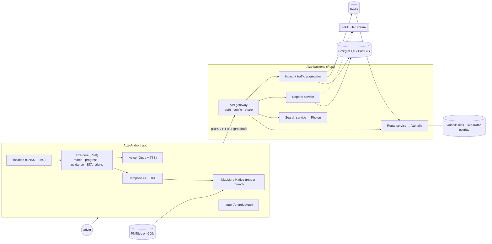
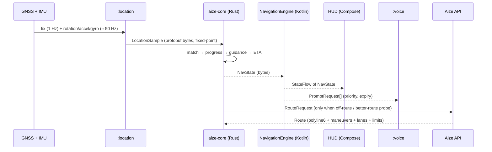

<!-- SOURCE TEMPLATE for docs/02-aize-build-plan.md. Relative links here are written for the rendered location (docs/). Edit this file and tasks in plan_wbs.py, then re-render (see README) — do not edit the rendered file by hand. -->
# 02 · Aize — build plan (derived from the Waze 5.22.90.123 teardown)

> **Status:** plan v1 · written 2026-10-22 · **Inputs:** [`01-waze-apk-structure-report.md`](01-waze-apk-structure-report.md), the community voice-pack schema, primary documentation checked on the day (Waze developer portal, Android for Cars, MapLibre Native changelog).  
> **Nothing in this plan requires — or uses — Waze's private servers, code, images, sounds or fonts.** See §2 and §7.

---

## 0 · Executive summary

**Aize** is a community-driven, voice-guided navigation app for Android with a **purple identity**, the same interaction model, layout, shape and motion *language* as Waze, and an engineering approach chosen for one thing above all: **it must never feel laggy.**

**What the teardown proved (doc 01):** Waze is not "a Java app that is fast"; it is a thin Kotlin shell around a 73 MB C++ core compiled with PGO+BOLT+LTO, drawing the map on its own render thread from a raw `Surface`, rendering on demand, passing typed protobuf across a coarse JNI boundary, and shipping an ART baseline profile. Aize copies that *architecture of speed* — not its assets.

| # | Decision | In one line |
|---|---|---|
| 1 | **Kotlin + Jetpack Compose** shell, **Rust core**, **MapLibre Native** renderer | Native everywhere that matters; UI never runs hot-path logic |
| 2 | **Valhalla + Planetiler/PMTiles + Photon** behind Aize's own **Rust (Axum/Tonic) API** | Open data, live-traffic-capable routing, no dependency on Waze/Google backends |
| 3 | **Own data, own API** — the Waze private API is **not used** | ToS/legal/security reasons (§7); only Waze's *public* interfaces are touched (deep links) |
| 4 | **Purple design system** generated from tokens; contrast-audited | `design/tokens`, `design/preview` (already in this repo) |
| 5 | **Performance is a CI gate**: budgets in §9, Macrobenchmark + baseline profiles from week 0 | "Not laggy" is measured, not hoped for |
| 6 | **MVP first**: 337 person-days; full v1.0: 653 person-days over 100 tasks (§10) | Phased, dependency-aware, ±40 % |
| 7 | **Voice** is prompt-ID based, TTS-backed, and can import user-owned packs in the community's file schema | No celebrity/UGC audio is bundled (§8) |
| 8 | **Android Auto** is designed in from the start (headless navigation service, Car App Library) | The nav engine must outlive any Activity |

**Already in this repository (done):** the two documents, the reproducible analysis pipeline (`analysis/`), the REA skill wrapper + install notes (`analysis/rea-skill/`), the purple design tokens + contrast audit + visual specimen (`design/`), the importable backlog (`docs/backlog.csv`), and the **Blender 3D asset pipeline with its rendered, verified output** (`assets3d/` — pointer, three vehicle skins, nine map pins; §6.9).  
**Not yet created (by design):** Android/Rust/backend code. Phase P0 (§10) starts it; the walking skeleton is its exit criterion. No app code has been compiled or tested yet — this plan does not claim otherwise. The 3D assets are verified against Blender ground truth and a Python reference of the runtime algorithm; they have **not** been drawn on a phone yet (P2-05/P2-07).


### Decisions I need from you (the plan is parameterised on these)

| # | Question | Default used in this plan | Why it matters |
|---|---|---|---|
| D1 | **Pilot region** (OSM extract, speed limits, voice language) | Malaysia–Singapore–Brunei extract + English/Malay | Data volume, geocoder tuning, first voice pack |
| D2 | Team size & calendar target | 7-person reference team (§15) | Phase overlap, hiring |
| D3 | MVP scope sign-off (§1) | As tabulated | Where the first release stops |
| D4 | Business model stance (ads at launch? subscription? none?) | None at launch | Privacy posture, SDK choices |
| D5 | Licence for the Aize repo | *unspecified* (all rights reserved until you choose) | Contributor rules, NOTICE |
| D6 | Brand: logo, domain (`aize.app`?), store name | Placeholder | Deep links/App Links (P3-09) |
| D7 | minSdk | 29 (the same as Waze 5.22.90) | Foreground-service/location rules, device coverage |
| D8 | OK to use a paid routing API as a *fallback provider* behind the interface? | No | Cost vs. launch-region quality |
| D9 | OK to run a **Large VM** (3× cost) for the deeper full-APK reverse-engineering pass (doc 01 §17)? | No | Optional extra detail only; the plan does not depend on it |

---

## 1 · Product definition and scope

**Vision.** Drive with the crowd: live road conditions, community reports, calm turn-by-turn guidance, on a screen that is fast and pleasant at 3 a.m. and in bright sun.

**Primary users.** Daily commuters and ride-hail/delivery drivers in the pilot region who currently choose between a heavyweight incumbent and a plain map.

| Capability | MVP | v1.0 (public beta) | v1.x | Notes |
|---|:---:|:---:|:---:|---|
| Purple map, day/night (auto), 60 fps pan/zoom | ✅ | ✅ | | P2 |
| Search (autocomplete, categories, recents), home/work/favourites | ✅ | ✅ | | P3 |
| Route preview, ≤ 3 alternatives, ETAs, tolls | ✅ | ✅ | | P3 |
| Turn-by-turn, lanes, reroute, speed limit, speedometer | ✅ | ✅ | | P4 |
| Voice guidance (TTS + recorded pack), modes off/alerts/brief/smart/full | ✅ (TTS) | ✅ (recorded) | custom packs | P4 |
| Community reports: police, hazard, accident, closure, camera, jam | ✅ (basic) | ✅ | gas, map issue, place | P5 |
| Alerts on route + "faster route" suggestions | ✅ | ✅ | | P5 |
| Live traffic from Aize users | | ✅ | | P5 (needs user density — see risk R2) |
| Accounts, sync, history | | ✅ | | P6 |
| Planned drives, ETA sharing, notifications | | ✅ | | P6 |
| Android Auto | | ✅ | | P7 |
| Offline maps | | | ✅ | P2-12 |
| Parking, gas prices, EV chargers | | | ✅ | P6-06 |
| Gamification, avatars/vehicle skins | | basic | ✅ | P5-10 |
| iOS, tablets polish, voice assistant | | | later | Rust core is shared; assistant after v1 |

**What "MVP" means here:** a *closed alpha* — feature-complete for one real commute in the pilot region, **not store-ready**. Store readiness needs P6–P9 (accounts, polish, hardening, compliance, beta).

**Non-goals for v1:** carpooling, in-app advertising, social feed, a voice assistant, iOS, publishing to any third party's private feeds.

---

## 2 · Guardrails — what we copy, what we do not

### 2.1 Fidelity matrix ("same UI, same animation, same design" — done legally)

| Aspect | Waze (observed in doc 01) | Aize | Why |
|---|---|---|---|
| Screen structure & flows | map → search → place card → route preview → navigation HUD → reports (§10 of doc 01) | **Same** structure and interaction model | Functional UX is not protectable; users expect it |
| HUD layout | top instruction banner, bottom ETA bar/control panel, speed bubble + limit sign, report FAB, recenter, compass | **Same** placement and behaviour | |
| Shape & elevation numbers | button radii 18/24/32 dp, alert 16 dp, elevations 0/1/3/6/8/12 dp | **Same** numbers (design tokens) | Measurements, not artwork |
| Motion timings & easings | 100/150/200/300/500/700 ms; `silky_entrance` (0.2, 0.7, −0.01, 1), `silky_exit` (0.9, 0.01, 0.99, 0.75); pop-in 100/200/300 ms | **Same** numeric tokens | Numbers, not assets |
| Primary colour | Blue `#0099FF` / `#33CCFF` | **Purple** `#8937F1` (light) / `#CCB9FE` (dark) | Your requirement; avoids brand confusion |
| Traffic/report colour semantics | police blue, hazard amber, jam red, closure orange | **Same meanings, Aize's own hex values** | Conventional meaning |
| Typeface | Proxima Nova (commercial) + Roboto | **Figtree** (SIL OFL) + Roboto | Licence |
| Icons | ~3,000 raster PNG | **New vector icon set** (SVG → ImageVector) | Copyright; also smaller/faster |
| Mascot, "moods", 3-D cars | 131 mood PNGs, 10 car `.obj` | **New original** avatars + vehicles | Copyright/trademark |
| Voices & earcons | EN/HE recordings; Nuance TTS voices | **New recordings**; Android TTS; import-your-own | Copyright; celebrity/UGC rights |
| Lottie / Godot scenes | 53 Lottie, Godot overlay pack | **New** Lottie/Rive + MapLibre layers with the same timing | Copyright |
| Map style | Lua skin, 49 categories, blue/grey | **New** style JSON, lavender-tinted neutrals, same layer logic | |
| UI text | `lang.eng` 11 k keys | **Original wording** | Copyright |
| Name & marks | "Waze", "Wazer", "FreeMap" | **"Aize"** — no Waze marks anywhere | Trademark |
| Backend/API | private RT/gRPC services | **Aize API** | ToS, security |

A **design-review gate** compares Aize recordings against *the Aize spec*, never against Waze captures, so nothing is copied pixel-by-pixel.

### 2.2 Compliance checklist (engineering view — not legal advice)

- [ ] Trademark/name clearance for "Aize" and the logo (P0-06).
- [ ] `scripts/check-no-third-party-assets`: fails CI if a file hash matches the Waze asset inventory in `analysis/data/apk_files.csv`, or a font/audio/image file lacks a licence entry.
- [ ] Licence inventory: MapLibre (BSD-2), Valhalla (MIT), Planetiler (Apache-2.0), Photon (Apache-2.0), Figtree (OFL-1.1), Roboto (Apache-2.0), Lottie (Apache-2.0), OSM data (ODbL — attribution + share-alike on derived databases). `cargo-deny` + Gradle licence report in CI.
- [ ] **`pipeeeeees/waze-voicepack-links` is GPL-3.0**: used as a *reference for file names only*; no code copied (copying would impose GPL on Aize).
- [ ] Privacy: location is sensitive personal data; design to the strictest applicable regime (PDPA Malaysia, GDPR, CCPA) — consent, minimisation, retention, export/delete (§13).
- [ ] Google Play: background-location declaration + video, foreground-service (`location`) declaration, Data-safety form (P9-03).

---

## 3 · What the teardown tells us → requirements

| # | Teardown finding (doc 01) | Requirement for Aize | Plan ref |
|---|---|---|---|
| 1 | Native core `libwaze.so` 73 MB; Java shell is thin (§0, §6) | Hot paths in a native core (Rust); UI holds no navigation logic | ADR-02, P4 |
| 2 | JNI = 102 classes with `native` methods (649 natives, mostly `*NativeManager` facades); **protobuf for structured payloads**; fixed-point position, one `byte[]` per fix (§7) | Few coarse FFI calls with typed payloads | ADR-03, P4-06 |
| 3 | Native renderer on a raw `Surface`, own EGL context, boolean-returning `nativeRender()` suggesting on-demand frames (inferred), post-frame callbacks (§7.1) | Surface-backed native renderer; frames only when something changed | ADR-04, P2-01/-10 |
| 4 | Map camera API: centerOnMe, overview, margins/insets, user-location offset, dark overlay w/ highlight, ETA-label placement (§7.1) | `MapController` with the same verbs | P2-04, P2-06 |
| 5 | Multiple canvases addressed by tag (main, closure, preview, car) (§7.1) | Renderer must support several map instances (phone, car, preview) | P7-02 |
| 6 | Overlays (pins, puck, route shaders, pulse) in a Godot scene graph with ETC2 textures (§8.2) | GPU layers in the map engine; compressed sprite atlases; no game engine | P2-05/-06/-07 |
| 7 | Lua skin: 49 categories × 94 zoom overrides, day/night palettes (§8.1) | Zoom-aware style generator; day/night via `global-state` | P2-02, P2-11 |
| 8 | Hybrid UI; main screen/ETA bar/settings are Compose (§9.1) | 100 % Compose, strong-skipping, stable models | ADR-05, P1 |
| 9 | Motion tokens + `silky` curves + pop-in choreography (§9.6) | Motion kit from tokens; RenderThread-friendly | P1-05 |
| 10 | Raster-heavy icons (3,073 PNG), 131 MB universal APK, 2 ABIs (§2.1, §16) | Vectors, per-ABI AAB, arm64-only → ≤ 45 MB download | P8-06 |
| 11 | PGO+BOLT+LTO+MLGO native build; baseline profile shipped (§2, §16) | LTO/PGO for Rust; baseline + startup profiles in CI | P0-09, P4-13, P8-06 |
| 12 | Raw `LocationManager` + IMU + mock flag + car-GPS source; watchdog (§7.1) | Provider abstraction, sensor inputs, mock/ext source tagging | P2-08 |
| 13 | Request queue with priorities executed by OkHttp; gRPC from native (§7.1, §13) | Prioritised cancellable scheduler; gRPC/protobuf API | ADR-13, P5 |
| 14 | Voice: recorded sets (43 community names + 16 extras), TTS keys (314), custom-prompt recorder (§12) | Prompt-ID voice system, TTS fallback, importer/recorder | §8, P4-08/-10 |
| 15 | Android Auto: `WazeCarAppService`, ~1.3 k classes, `NAVIGATION_TEMPLATES` (§4, §15) | Headless nav service + `:auto` (current templates, §5.2) | P4-12, P7 |
| 16 | Settings tree ids (54 seen), report taxonomy, search categories/providers (§11) | v1 settings subset, report taxonomy, category chips | Appx C, P5-12, P3-01 |
| 17 | `supportsRtl=false`, legacy `AsyncTask`, `largeHeap=true` (§2, §5) | Beat it: RTL-ready, coroutines only, no `largeHeap` | P1-11 |

---

## 4 · Technology decisions (ADRs)

| ID | Decision | Choice | Why (performance / teardown) | Rejected | Revisit when |
|---|---|---|---|---|---|
| ADR-01 | Platform | **Native Android (Kotlin)**; iOS later via the shared Rust core | Map surface, sensors, foreground service and Android Auto are platform-bound; Waze itself is native shell + native core | Flutter / React Native / KMP-UI | iOS becomes a goal |
| ADR-02 | Core language | **Rust** (`aize-core`): matching, progress, guidance, ETA, alerts look-ahead, probe batching | No GC pauses or JIT warm-up in the 1–10 Hz hot loop; memory-safe (a navigation library must not UAF); one language with the backend (shared `aize-proto`) | Kotlin-only (GC/JIT in hot path), C++ (safety), Go (FFI/GC) | Profiling shows no gain vs Kotlin for a given module |
| ADR-03 | FFI | **UniFFI** + protobuf byte payloads for bulk data | Mirrors Waze's coarse-grained, typed JNI; avoids hand-written JNI and per-field calls | Hand-rolled JNI | UniFFI overhead measurable in P4-13 |
| ADR-04 | Map engine | **MapLibre Native** Android (the changelog on `main` lists 13.7.1 — pin the latest *released* version from Maven Central in P0-03) in **SurfaceView** mode; benchmark the **Vulkan** artifact (`android-sdk-vulkan`) vs OpenGL ES on the device matrix; PMTiles supported natively | GPU vector rendering on a dedicated thread, on-demand frames, offline cache, expression-driven styling, `global-state` toggling, per-frame stats (`OnDidFinishRenderingFrameWithStatsListener`) | Google Maps SDK (cost/ToS/styling limits), Mapbox (licence), custom wgpu engine (cost), embedding a game engine like Waze (size/complexity) | Custom effects can't be done with style layers → try the experimental *plugin API* (custom layer types) |
| ADR-05 | UI toolkit | **Jetpack Compose + Material 3** (heavily themed), strong skipping, immutable UI state | Waze's own main screen/ETA bar are Compose; Views only for the map host | Views/XML | — |
| ADR-06 | DI | **Hilt** (compile-time) | No runtime reflection or service lookup at startup (Waze appears to use a Koin-style runtime container) | Koin | Build-time cost dominates |
| ADR-07 | State | **UDF/MVI**: `StateFlow` of immutable state, one-shot effects via channels | Predictable recomposition, testable | MVVM with mutable LiveData | — |
| ADR-08 | Storage | **Room** (user data), **DataStore** (settings); Rust core keeps hot caches in memory-mapped files | Keeps SQLite off the navigation hot path | Room everywhere | — |
| ADR-09 | Routing | **Valhalla** (self-hosted) | Time-dependent + live-traffic tile updates, map-matching, many costings, MIT | OSRM (weak live traffic), GraphHopper (viable alternative) | Quality gap vs incumbents on the pilot region |
| ADR-10 | Tiles | **OpenMapTiles-schema vector tiles via Planetiler → PMTiles** on object storage/CDN | Single-file archive, cheap to host on object storage/CDN; MapLibre Native has supported PMTiles sources since 11.7.0 (remote range-request behaviour and cache hit-rate to be confirmed in the P0-08 spike) | Raster tiles; paid tile APIs as primary | Region > 20 GB |
| ADR-11 | Geocoding/POI | **Photon** (OSM) + on-device FTS for recents/favourites | Fast, self-hosted, Apache-2.0 | Nominatim-only (slow autocomplete) | Pelias if ranking needs exceed Photon |
| ADR-12 | Backend | **Rust (Axum + Tonic)**, PostgreSQL/PostGIS, Redis, NATS JetStream, S3-compatible storage, OpenTelemetry; Docker Compose → Kubernetes | Low memory/latency per probe; shares types with the core | Go/Node | Team skills |
| ADR-13 | Wire protocol | **gRPC/protobuf over HTTP/2**; evaluate Cronet for HTTP/3 | Same typed contract style as Waze; streaming uploads/alerts | REST/JSON | Proxy constraints |
| ADR-14 | Voice | Prompt-ID system; **Opus** packs + Android TTS fallback; `USAGE_ASSISTANCE_NAVIGATION_GUIDANCE` + focus ducking | Small assets, no overlap, system-correct ducking | Bundled celebrity packs | — |
| ADR-15 | Animation | Compose animations from motion tokens; **Lottie** (hardware render) only for rich vector sequences; Rive optional; **no game engine**; 3D-looking assets are pre-rendered (ADR-21) | Waze's 11.9 MB Godot pack + 8 MB CJK font is avoidable | Godot/Unity overlays | A 3-D effect needs it |
| ADR-16 | Typeface | **Figtree** + Roboto fallback, subset and bundled | Open licence; no downloadable-font latency at startup | Proxima Nova (commercial) | Brand typeface commissioned |
| ADR-17 | Auth | OIDC + passkeys (Credential Manager); guest mode default | Low friction, no password storage | Password-only | — |
| ADR-18 | Build & size | R8 full mode, baseline + startup profiles, resource shrinking, **per-ABI AAB, arm64-v8a only** (+x86_64 for emulators) | Waze ships two ABIs (≈ 61 MB zipped native) | Universal APK | A device class needs armv7 |
| ADR-19 | Telemetry | Opt-in, aggregated, self-hosted; crash reporter chosen in P0-10 | Privacy-first | Ad-tech SDKs | — |
| ADR-21 | 3D assets | **Blender-rendered sprites** (pointer, vehicle skins: pitch x heading grid + one affine warp + pitch blend) and **single-cell billboards** (pins); the exported glTF is the real-time fallback | No 3D rendering, no extra GL pipeline and no per-frame allocation on the phone; Cycles gives soft shadow, bevel highlights and global illumination a real-time shader would only fake; every asset is gated by measured error against true renders (`assets3d/RESULTS.md`) | Real-time glTF renderer (another pipeline to keep in sync; kept as the fallback), importing third-party models (licence) | A model needs exact views at any angle or run-time recolouring |
| ADR-20 | Testing | Paparazzi/Roborazzi, Macrobenchmark + Perfetto, JankStats, proptest, criterion, GPX replay | Performance and correctness are testable offline | Manual QA only | — |

---

## 5 · Architecture

### 5.1 System context



### 5.2 Android modules (Gradle)

```text
:app                 Application, DI graph, navigation host, splash
:core:designsystem   tokens → theme, components, motion kit        (P1)
:core:ui             HUD components, previews, screenshot tests     (P1)
:core:model          immutable domain/UI models (Kotlin)
:core:network        gRPC client, request scheduler (priorities, cancel)
:core:storage        Room, DataStore
:core:navigation-api interfaces + generated UniFFI bindings         (P4)
:feature:map         MapLibre host, MapController, style, overlays   (P2)
:feature:location    providers, permissions, sensors, service        (P2)
:feature:search      autocomplete, categories, recents/favourites    (P3)
:feature:route       preview, alternatives, turn list                (P3)
:feature:navigation  HUD wiring, lanes, speed, camera warnings       (P4)
:feature:voice       prompt scheduler, audio focus, packs, recorder  (P4)
:feature:reports     report flow, alerts, confirmations              (P5)
:feature:settings    settings DSL + screens                          (P1)
:feature:account     auth, sync, share, planned drives               (P6)
:feature:auto        Car App Library: CarAppService + templates      (P7)
:benchmark           Macrobenchmark + baseline-profile generator     (P0)
:design-catalog      component gallery for screenshot tests          (P1)
```

**Car App Library — use current templates.** Android for Cars documents that `MapTemplate`, `PlaceListNavigationTemplate` and `RoutePreviewNavigationTemplate` are **deprecated since Car App API level 7**; Aize uses `NavigationTemplate` (active guidance) and `MapWithContentTemplate` (search, lists, route preview). The service must declare `androidx.car.app.category.NAVIGATION`, the `androidx.car.app.NAVIGATION_TEMPLATES` and `ACCESS_SURFACE` permissions (the same ones observed in Waze's manifest), handle navigation intents (quality item NF-6) and publish state through `NavigationManager`.

### 5.3 Threading and frame model

| Thread | Owner | Work | Rules |
|---|---|---|---|
| Main/UI | Compose | composition, layout, draw of HUD, input | No I/O; no FFI call > 0.5 ms; read frequently-changing state only in the *draw* phase (`graphicsLayer {}` lambdas, `drawBehind`) |
| RenderThread (HWUI) | Android | `graphicsLayer` alpha/translation/scale/rotation animations | Prefer RenderThread-friendly properties for all HUD motion |
| Map render | MapLibre | GL/Vulkan draw; tile decode on workers | Never block; batch style mutations; **no per-frame allocations**; render only when dirty |
| Core nav loop | Rust | match → progress → guidance → ETA at 1–10 Hz | Single-threaded event loop, bounded queue, allocation-free steady state |
| Core workers | Rust | route decode, index build, alert queries | Lower priority, cancellable |
| IO | gRPC/OkHttp (Cronet evaluated) | network | Prioritised queue (live alerts > reroute > tiles > telemetry), cancel-all-by-queue |
| Audio | AudioTrack/TTS | playback | Next prompt pre-buffered; focus with ducking |

### 5.4 Navigation loop



### 5.5 Core crate layout (Rust workspace `core/`)

```text
aize-geo        geodesy (haversine/ENU), polyline5/6 codec, bbox/R-tree helpers
aize-route      route model, spatial index, cumulative distances, maneuver anchors, speed-limit segments
aize-match      HMM map matcher (corridor candidates), free-matching hooks, dead reckoning
aize-guidance   maneuver timeline, speed-adaptive triggers, lanes, roundabout counting, arrival
aize-eta        free-flow + live + historical speeds, smoothing
aize-alerts     look-ahead over route buffer (R-tree), dedup, expiry
aize-probe      probe batching, privacy trimming, upload scheduling hints
aize-proto      prost-generated types shared with backend (single source: proto/)
aize-ffi        UniFFI surface: Engine::new(config), push_location(bytes), set_route(bytes), poll_state()->bytes
```

**FFI rules:** ≤ 3 calls per fix; payloads are protobuf bytes; no callbacks from Rust to Kotlin on the hot path (poll or channel); all Kotlin-visible types immutable; fuzz every decoder (`cargo fuzz`).

**Release profile:** `opt-level = 3`, `lto = "fat"`, `codegen-units = 1`, `panic = "abort"`, `strip = true`; PGO from recorded drive traces (P4-13); evaluate BOLT after PGO.

### 5.6 Provider ports (swap data sources without touching UI)

```kotlin
interface RoutingProvider   { suspend fun routes(req: RouteRequest): RouteSet }
interface GeocodingProvider { suspend fun suggest(q: String, bias: LatLng, mode: SearchMode): List<Place> }
interface TrafficProvider   { fun segmentSpeeds(bbox: BBox): Flow<SpeedDelta> }
interface ReportsProvider   { fun nearby(bbox: BBox): Flow<ReportDelta>; suspend fun create(r: NewReport): ReportId }
interface WazeInterop       { fun openInWaze(dest: LatLng, navigate: Boolean) }   // public deep link only
```

Default bindings call the Aize API. A commercial or partner provider can be added later behind the same interface **only with a written agreement** (decision D8).

---

## 6 · Design system — "Aize Purple"

Source of truth: [`design/tokens/aize-purple.tokens.json`](../design/tokens/aize-purple.tokens.json), generated by `design/generate_tokens.py` (OKLCH tone ladders, gamut-mapped). Contrast: **87/87 contrast pairs pass (0 required failures)** — see [`CONTRAST.md`](../design/tokens/CONTRAST.md). Specimen above: `design/preview/aize-theme-preview.png`.

### 6.1 Palette

| Step | Purple (brand) | Lilac (secondary) | Mint (tertiary) | Neutral (lavender-tinted) |
|---|---|---|---|---|
| 50 | `#F7F5FE` | `#FCF4FE` | `#F0F9F7` | `#F7F5FE` |
| 100 | `#EEE9FF` | `#F7E6FC` | `#DFF1EE` | `#EEEBF7` |
| 200 | `#E0D5FE` | `#F0CFF9` | `#C2E5DF` | `#DDDAE6` |
| 300 | `#CCB9FE` | `#E3B0F1` | `#9AD3CB` | `#C6C4CF` |
| 400 | `#B492FF` | `#D189E4` | `#65BBB0` | `#AAA7B2` |
| 500 | `#9F66FE` | `#BC62D3` | `#24A296` | `#8E8C96` |
| 600 | `#8937F1` | `#A23FBB` | `#04857A` | `#74717B` |
| 700 | `#6F23C9` | `#852D9A` | `#016B62` | `#5D5A64` |
| 800 | `#56179E` | `#672078` | `#01524B` | `#47454E` |
| 900 | `#3E0B75` | `#4B1358` | `#003A35` | `#323039` |
| 950 | `#27034F` | `#30083A` | `#002421` | `#1F1D25` |

### 6.2 Theme roles

| Role | Light | Dark |
|---|---|---|
| `primary` | `#8937F1` | `#CCB9FE` |
| `onPrimary` | `#FFFFFF` | `#3E0B75` |
| `primaryContainer` | `#EEE9FF` | `#56179E` |
| `onPrimaryContainer` | `#3E0B75` | `#EEE9FF` |
| `secondary` | `#852D9A` | `#E3B0F1` |
| `tertiary` | `#016B62` | `#9AD3CB` |
| `background` | `#F7F5FE` | `#0C0A10` |
| `onBackground` | `#1F1D25` | `#EEEBF7` |
| `surface` | `#FFFFFF` | `#1F1D25` |
| `onSurface` | `#1F1D25` | `#EEEBF7` |
| `surfaceVariant` | `#EEEBF7` | `#323039` |
| `onSurfaceVariant` | `#5D5A64` | `#C6C4CF` |
| `outline` | `#8E8C96` | `#8E8C96` |
| `outlineVariant` | `#DDDAE6` | `#47454E` |
| `error` | `#D6111C` | `#FEAEA4` |
| `success` | `#056F31` | `#9CD6A8` |
| `warning` | `#7A5403` | `#E4C088` |
| `info` | `#0270DA` | `#9FC9FF` |

### 6.3 Functional colours (traffic and report types)

Traffic and report colours keep conventional meaning (green→red, police-blue, hazard-amber) but use Aize's own values; they are **always paired with an icon or label**, never colour alone (colour-blind safe). Dark-mode variants are lighter so they pass contrast on dark surfaces.

| Semantic | Light | Dark |
|---|---|---|
| traffic · free | `#038A3E` | `#6ABF7E` |
| traffic · light | `#B98206` | `#D29F4A` |
| traffic · moderate | `#D56E03` | `#EC8F4A` |
| traffic · heavy | `#F04B44` | `#FE7C70` |
| traffic · standstill | `#630005` | `#D6111C` |
| report · police | `#0270DA` | `#9FC9FF` |
| report · hazard | `#B98206` | `#D29F4A` |
| report · accident | `#D6111C` | `#FE7C70` |
| report · jam | `#AD5904` | `#EC8F4A` |
| report · closure | `#6C3502` | `#D56E03` |
| report · camera | `#74717B` | `#AAA7B2` |
| report · gas | `#038A3E` | `#6ABF7E` |
| report · place | `#BC62D3` | `#E3B0F1` |
| report · chat | `#04857A` | `#65BBB0` |
| report · map issue | `#5D5A64` | `#AAA7B2` |

### 6.4 Map and route styling

The base map is a calm, lavender-tinted neutral so the purple route pops; the selected route is `primary`, alternatives are neutral, the passed part dims, congestion is overlaid as traffic colour.

| Map element | Light | Dark |
|---|---|---|
| background | `#F3F1F7` | `#16131C` |
| land | `#F3F1F7` | `#16131C` |
| water | `#CFE0F2` | `#17283A` |
| park | `#DCEBD8` | `#1C2A22` |
| building | `#E6E2EE` | `#221E2B` |
| roadMinor | `#FFFFFF` | `#2C2738` |
| roadMinorCasing | `#D9D4E4` | `#1B1722` |
| roadMajor | `#FFFFFF` | `#3A3448` |
| roadMajorCasing | `#C3BCD3` | `#1B1722` |
| highway | `#FBF9FF` | `#4A4260` |
| highwayCasing | `#A89FBF` | `#1B1722` |
| label | `#3F3A4D` | `#CFC8DE` |
| labelHalo | `#FFFFFF` | `#16131C` |

| Route element | Light | Dark |
|---|---|---|
| selected | `#8937F1` | `#CCB9FE` |
| selectedCasing | `#FFFFFF` | `#0C0A10` |
| alternative | `#8E8C96` | `#AAA7B2` |
| alternativeCasing | `#FFFFFF` | `#0C0A10` |
| passed | `#C6C4CF` | `#5D5A64` |
| navArrow | `#6F23C9` | `#E0D5FE` |

### 6.5 Typography, shape, elevation, spacing

- **Type:** Figtree (400/600/700/800) with Roboto fallback. Scale (size/line-height sp · weight): display 48/56·700 · headline 32/40 & 28/36·700 · title 22/28 & 18/24·600 · body 16/24 & 14/20·400 · label 14/20 & 11/16·600 · **nav instruction 28/32·700 · nav distance 40/44·800 · ETA 24/28·800 · speedometer 32/36·800**.
- **Radius:** 4 · 8 · 12 · 16 · 24 dp; buttons **18 / 24 / 32** (small/normal/large), sheets 24, alerts 16, pill = full.
- **Elevation:** 0 · 1 · 3 · 6 · 8 · 12 dp. **Spacing:** 2 · 4 · 8 · 12 · 16 · 24 · 32 · 48 dp. Touch target ≥ 48 dp.

### 6.6 Motion specification

| Token | Value | Use |
|---|---|---|
| duration.instant / fast / base / moderate / slow / deliberate | 100 / 150 / 200 / 300 / 500 / 700 ms | tooltips & pop / sheet slide / fades & page push / page transitions / sheet down & tooltips / sheet up |
| easing.standard | cubic-bézier(0.4, 0, 0.2, 1) | default |
| easing.decelerate / accelerate | (0, 0, 0.2, 1) / (0.4, 0, 1, 1) | enter / exit |
| easing.silkyIn / silkyOut | (0.2, 0.7, −0.01, 1) / (0.9, 0.01, 0.99, 1→0.75) | large entrances/exits (camera moves, sheets) |
| spring.popIn | stiffness 380, damping 0.62 | dialog/alert overshoot |

**Choreography (from observed resources, re-implemented):** *alert pop-in* — alpha 100 ms, scale 200 ms then 300 ms, starting 300 ms after the event is on the route; *dialog pop-in* — alpha 100 + scale 200 with overshoot; *bottom sheet* — 150 ms slide; *sheet up* 700 ms `silkyIn`, *sheet down* 500 ms; *page push/pop* 200 ms decelerate/accelerate; *spinner* 600 ms linear; **reduced motion** replaces transforms with 100 ms cross-fades and disables looping animations.

**Rules:** animate only `alpha`, `translation*`, `scale*`, `rotation` (RenderThread-friendly); never animate layout size during navigation; no animation may allocate per frame; every transition has a benchmark (P8-01).

### 6.7 HUD component specs

| Component | Behaviour & size | Source in teardown |
|---|---|---|
| Instruction banner | top, `primary` container, min 96 dp; arrow 44 dp + distance (40/44) + street; lane strip below when lanes known; next-next maneuver chip; pushes in with `silkyIn` | `instruction_view`, `navbar`, `getNavigationLanes` |
| ETA bar | bottom card 72 dp; ETA (24/28) · distance · arrival clock · traffic dot; expands to control panel (mute, route overview, add stop, end) | `eta_main_bar_layout`, `eta_control_panel_layout` |
| Speed bubble + limit sign | 60 dp bubble + 46 dp sign; limit blinks softly when exceeded by > 5 % | `speedometer`, Godot `Speedometer` |
| Report FAB | 56 dp, `primary`; long-press = voice report; press feedback 100 ms; idle shimmer (reduced-motion off) | `report_menu_button` Lottie, `map_report_button_view` |
| Alert pill | pill on the map at the event; pop-in choreography; tap = confirm/dismiss sheet | `pop_in_event_on_route`, `alerter_popup` |
| Route cards (preview) | up to 3; selected = elevated 8 dp with primary outline; alternatives neutral; ETA tags on the map placed by declutter algorithm | `trip_overview_route_card`, `nativeGenerateEtaLabelPositions` |
| Search bar & chips | 56 dp field; category chips (gas, parking, food, coffee, shopping, hotel, health, bank, police, car services) | `search_conf` categories |
| Bottom sheet | peek 120 dp / half / full; 150 ms slide | `bottom_sheet_slide_duration` |
| Recenter / compass | 44 dp buttons; recenter fades in after 3 s of manual pan | `bottom_recenter_bar`, `compass_button` |

### 6.8 Icons, illustration, sound

- **Icons:** ~60 core SVGs on a 24 dp grid (nav arrows, 8 lane arrows, report types, POI categories); VectorDrawable/ImageVector only; any glyph borrowed from Material Symbols (Apache-2.0) is logged in the licence table.
- **Avatars/vehicles:** ≥ 10 original vehicle icons (sedan, SUV, motorbike, taxi, truck, EV, etc.) and a small avatar set (P5-10).
- **Earcons:** original `ping`, report start/end, points, mic on/off/ok/error (§8.2); ≤ 80 KB total.

### 6.9 3D assets — the Blender pipeline (implemented)

Waze draws its pointer, vehicle skins and alert pins as 3D scenes at run time (an embedded Godot pack, doc 01 §8.2). Aize renders **original** models once, offline, in Blender, and draws sprites. Everything below is in [`assets3d/`](../assets3d/README.md); the numbers are generated from the pipeline output ([`RESULTS.md`](../assets3d/RESULTS.md)).

| Family | Assets | Frames each | Size at 3x (xxhdpi) | Drawn as |
|---|---|---|---:|---|
| Pointer | `arrow`, `puck` | 216 / 9 | 1,725 KiB + 80 KiB | two bracketing pitch buckets, one affine warp each, blended |
| Vehicle skins | `car_sedan`, `car_suv`, `car_taxi` | 120 (5 pitches x 24 headings) | 1,120-1,182 KiB each | same; delivered as on-demand packs |
| Map pins | 9 pins (accident, camera, closure, destination, gas, hazard, jam, parking, police) | 1 | 6-7 KiB each | one cell, unrotated, contact shadow as a map layer |

**How a sprite is drawn.** Nearest heading bucket; the two pitch buckets that bracket the camera pitch are each warped to the true pitch and residual heading by *one affine matrix* and blended by the pitch fraction (a single draw whenever the pitch is on a bucket). The warp is exact for the horizontal plane at the rim height `h`, which is calibrated **in image space** against true Blender renders, because minimising the maximum vertex error picked a plane that scored *worst* by eye (the outline matters, not the interior ridge). Pins are viewport-aligned billboards: one cell, no warp, contact shadow as a map-aligned circle layer.

**Design rule that makes it cheap:** the camera presets (overview 0°, browse 30°, drive 45°, navigate 60°) are the sprite's pitch buckets, so every steady state is on-grid and the only error left is the heading residual; transitions are blended.

**Measured, not assumed.** The warp maths is unit-tested against independent vector maths (0.03 px), the Android forward matrix to 3e-14 px, the camera model against a calibration target (anchor < 0.3 px, disc area vs cos(pitch) < 0.1 %), and every asset against true renders of off-grid views (mid-bucket pitches × half-step headings, the worst case). For the **arrow**, the visible outline (the rim) of a reconstructed off-grid view is within 0.56 dp of its geometrically true position at every pitch and heading, the image matches a true Blender render at 30.4 dB mean PSNR (worst view 22.4 dB), and the image change when the pitch crosses a bucket is 0.0076 RMS. **Cars are less exact**: 26-27 dB mean PSNR, with the wheels and underbody up to 3.4 dp off in the single-bucket fallback, because a car has real parallax between its wheels and its roof that one re-projection plane cannot serve; a blend shows slight ghosting at glass, wheels and tail-lights (`assets3d/README.md`, section Cars).


Colours come from the design tokens (pins have their own contrast-audited palette), so a token change re-renders the family in CI (P1-12). Not done and not claimed: an Android implementation (P2-05/P2-07), on-device frame-time measurements, a dark-theme pin variant, and the hatch/van skins.

---

## 7 · Data and API strategy — the "Waze API" question

You asked for the app to use "the Waze API based on the APK". The teardown shows what that would really mean, and why the plan takes a different route.

### 7.1 What Waze exposes publicly (verified on [developers.google.com/waze](https://developers.google.com/waze), 2026-10-22)

| Public program | What it is | Use in Aize |
|---|---|---|
| **Waze Deep Links** | `https://waze.com/ul?…` and `waze://` links to open a place or start navigation in the Waze app | Optional "Open in Waze" share target (`WazeInterop`); Aize defines its own mirror format `aize.app/ul?…` |
| **Waze Audio Kit** | Partner programme to put audio apps inside Waze | Not applicable (Aize is not an audio partner) |
| **Waze Transport SDK** | Per the portal: integrate an app with Waze for a navigation experience for users and trip data for the company | Not applicable (Aize navigates itself) |
| **Waze iFrame** | Embed the Waze **Live Map** in a website | Not used in the app |
| **Waze Data Feeds** | *Partner* feeds that **supply** closures/incidents/working-vehicle info **to** Waze | Not applicable; Aize may later offer its own feed programme |

### 7.2 What the APK shows is *not* a public API

Doc 01 §13: the app talks to **private, authenticated** services (real-time server, API gateway, gRPC, ~2,700 embedded `.proto` schemas including Google-internal routing/snapping/geostore messages). Using them from another app would mean impersonating the official client against a service whose terms forbid it, with certificate/attestation and account-ban risk, no stability guarantee, and a material legal exposure for you. The reverse-engineering therefore informs **what capabilities and data models are needed**, not **how to call Waze**. This report deliberately contains no tokens, keys, request recipes or signing details.

### 7.3 Capability map — Waze capability → Aize source

| Waze capability | Aize source | Phase |
|---|---|---|
| Base map tiles | OSM → Planetiler → PMTiles (MapLibre ≥ 11.7 reads PMTiles) | P2 |
| Routing, alternatives, reroute | Valhalla (+ Aize live-speed overlay) | P3–P4 |
| Live traffic | Aize probes → aggregator → Valhalla traffic tiles + vector overlay | P5 |
| Reports & alerts | Aize reports service | P5 |
| Search & POIs | Photon + OSM POIs (Overture later) | P3 |
| Speed limits & cameras | OSM `maxspeed`, enforcement nodes, community reports | P4-14 |
| Voices | Aize prompt set + TTS | P4 |
| ETA sharing / planned drives | Aize API | P6 |

### 7.4 Aize API v1 (gRPC, one `proto/` source shared by app, core and backend)

| Service | Methods | Notes |
|---|---|---|
| `RouteService` | `GetRoutes`, `Reroute`, `GetRouteTraffic` | proxies Valhalla; adds live speeds and report-aware avoidance |
| `SearchService` | `Autocomplete`, `Geocode`, `Reverse`, `PoiAlongRoute` | around-you vs along-route |
| `ReportService` | `Create`, `Vote`, `Comment`, `StreamNearby`, `StreamAlongRoute` | delta streaming |
| `TrafficService` | `UploadProbes` (client-stream), `GetSegmentSpeeds` | k-anonymity thresholds |
| `ShareService` | `CreateShare`, `UpdateShare`, `StopShare` | expiring tokens |
| `ConfigService` | `GetConfig` | feature flags, limits, region packs |
| `AccountService` | OIDC exchange, delete/export | guest-first |

Message sketches and SQL are in Appendix D.

### 7.5 Privacy-by-design for location data

Rotating anonymous trip IDs (never linked to the account); trim the first/last 200 m or 30 s of every trip; upload only when navigating or opted in; k ≥ 5 distinct devices before any segment speed is published; 30-day raw-probe retention, aggregates kept; export + delete endpoints; no advertising ID; all of it testable (P9-02).

---

## 8 · Voice system — Aize-VP v1

You asked to use the community voice-pack archive. It is used **as a schema reference** (file names and size limits), because its audio lives on Waze's servers, is user-generated or celebrity-owned, and the repository itself is GPL-3.0.

### 8.1 Design

```text
NavState ─▶ GuidanceEngine ─▶ PromptRequest{id, params, priority, expiresAt}
                                   │
                  PromptResolver ──┤  pack has id?  ──▶ PackPlayer (Opus/MP3/OGG file)
                                   └─ else ──────────▶ TtsPlayer (Android TTS, prefetched phrase cache)
                                   ▼
                   AudioFocus(GAIN_TRANSIENT_MAY_DUCK, USAGE_ASSISTANCE_NAVIGATION_GUIDANCE) → output
```

Rules: one prompt at a time; higher priority pre-empts lower; stale prompts (past `expiresAt` or maneuver already passed) are dropped; no more than one alert prompt per 8 s; pre-buffer the next prompt; honour call state and mute modes **off / alerts / brief / smart / full** (the six mode earcons exist in the teardown).

### 8.2 Prompt catalogue (51 spoken + 22 earcons) and mapping to the community schema

| Group | Aize IDs | Community file (43-name schema) | Trigger |
|---|---|---|---|
| Distances (metric) | `dist_200m`, `dist_400m`, `dist_800m`, `dist_1km`, `dist_1_5km` | `200meters`, `400meters`, `800meters`, `1000meters`, `1500meters` | approach distance bucket nearest below remaining distance |
| Distances (imperial) | `dist_0_1mi`, `dist_0_25mi`, `dist_0_5mi`, `dist_1mi` | `200`, `400`, `800`, `1500` | same, locale = imperial |
| Connector | `and_then` | `AndThen` | next maneuver < 150 m after this one |
| Maneuvers | `turn_left`, `turn_right`, `keep_left`, `keep_right`, `straight`, `uturn`, `exit_left`, `exit_right`, `roundabout` | `TurnLeft`, `TurnRight`, `KeepLeft`, `KeepRight`, `Straight`, `uturn`, `ExitLeft`, `ExitRight`, `Roundabout` | prepare / approach / now |
| Roundabout exits | `roundabout_exit_1` … `roundabout_exit_7` | `First` … `Seventh` | on entering the roundabout |
| Arrival | `arrive` | `Arrive` | within arrival radius |
| Alerts | `alert_police`, `alert_accident`, `alert_hazard`, `alert_traffic`, `alert_speed_camera`, `alert_red_light_camera` | `Police`, `ApproachAccident`, `ApproachHazard`, `ApproachTraffic`, `ApproachSpeedCam`, `ApproachRedLightCam` | alert enters look-ahead window |
| **Aize-only alerts** | `alert_closure`, `alert_school_zone`, `alert_railroad`, `alert_speed_bump`, `alert_pothole`, `alert_stopped_vehicle` | — | same |
| Session | `start_1` … `start_9`, `reroute`, `recalculating`, `faster_route` | `StartDrive1`…`9`, `TickerPoints` (chime), —, — | on start (random variant) / off-route / better route |
| Earcons (22) | `ping`, `ping_2`, `click`, `click_long`, `reminder`, `report_start`, `report_end`, `points`, `speed_limit`, `message`, `bonus`, `alert_chime`, `mic_on`, `mic_off`, `mic_ok`, `mic_error`, `mode_off`, `mode_alerts`, `mode_beep`, `mode_brief`, `mode_smart`, `mode_full` | `ping`, `ping2`, `click`, `click_long`, `reminder`, `rec_start`, `rec_end`, `points_animation`, `speed_limit`, `message_ticker`, `bonus`, `alert_1`, `conversational_*` (×4), `voice_guidance_*` (×6) | UI events |

### 8.3 Trigger distances (initial values, tuned in the simulator — P4-04)

`prepare = clamp(speed × 20 s, 200 m, 2 km)` · `approach = clamp(speed × 8 s, 80 m, 600 m)` · `now = speed × 2 s` · lane guidance appears at `max(approach, 400 m)`. Alert look-ahead: `clamp(speed × 12 s, 150 m, 1.5 km)`.

### 8.4 Pack format (`aize-vp/1`) and import

```json
{
  "format": "aize-vp/1",
  "id": "8f0c…uuid", "name": "Aize Default (English)", "language": "en",
  "author": "Aize", "license": "proprietary | CC-BY-4.0 | user-owned",
  "audio": { "codec": "opus", "channels": 1, "sampleRate": 24000, "bitrate": 24000 },
  "prompts": { "turn_left": "turn_left.opus", "dist_200m": "dist_200m.opus" },
  "fallback": "tts"
}
```

- **Budget:** default pack ≤ 1.5 MB (Opus 24 kbps mono; loudness −16 LUFS). The community schema's limit for Waze custom packs is 0.8 MB total — Aize's importer accepts larger packs but warns.
- **Importer:** accepts a zip/tar.gz of files named in the community schema (`TurnLeft.mp3`, …), maps names → IDs with the table above, validates (file type, size, duration ≤ 6 s), keeps the original codec (no on-device transcoding), requires a licence field, and stores packs privately. Missing prompts fall back to TTS.
- **Recorder (P4-10):** in-app recorder writes Opus (the teardown shows Waze ships an Opus encoder for the same purpose), per-prompt re-record, preview, export.

### 8.5 What Aize will not do

No bundling or redistribution of celebrity or community-uploaded audio; no scraping of Waze's voice CDN; no uploading packs to Waze's servers; no community pack store in v1 (needs rights management first).

---

## 9 · Performance engineering plan

### 9.1 Budgets (initial; calibrate against the P0-09 baseline, then ratchet)

| Metric | Low-tier | Mid-tier (reference) | High-tier | Measured by |
|---|---|---|---|---|
| Cold start → interactive map (TTID/TTFD) | ≤ 2.0 s | **≤ 1.2 s** | ≤ 0.9 s | Macrobenchmark `StartupMode.COLD` p50/p90 |
| Warm start | ≤ 600 ms | ≤ 400 ms | ≤ 300 ms | Macrobenchmark |
| Map pan/zoom frame time | p95 ≤ 20 ms | **p95 ≤ 16.7 ms** | p95 ≤ 8.3 ms (120 Hz) | Macrobenchmark + MapLibre frame stats |
| Jank during nav HUD (frames over budget) | < 2 % | **< 1 %** | < 0.5 % | JankStats / FrameTimingMetric |
| Location → NavState | p95 ≤ 8 ms | **p95 ≤ 5 ms** | p95 ≤ 3 ms | criterion + on-device trace |
| `aize-core` CPU during guidance | ≤ 6 % of one core | **≤ 3 %** | ≤ 2 % | Perfetto per-thread CPU |
| Process CPU during guidance (screen on) | ≤ 25 % | **≤ 15 %** | ≤ 10 % | Perfetto CPU counters (of total device CPU) |
| Memory (PSS) in navigation | ≤ 350 MB | **≤ 300 MB** | ≤ 400 MB | `dumpsys meminfo` in soak test |
| Battery, nav 1 h, screen on, 50 % brightness | ≤ 10 % | **≤ 7 %** | ≤ 6 % | Power profiler / Battery Historian |
| Cellular data, nav 1 h | ≤ 18 MB tiles + ≤ 1.5 MB probes/alerts | same | same | Network profiler |
| Download size (AAB, arm64) | **≤ 45 MB** | | | `bundletool get-size` in CI |
| Crash-free sessions / ANR rate | ≥ 99.5 % / < 0.1 % | | | Play vitals, beta |

*For reference, Waze 5.22.90.123 is a 131 MB universal APK; its arm64 native libraries alone are 31.9 MB zipped.* Reference devices (P0-09): one **low** (≈ 4 GB, 60 Hz, entry SoC), one **mid** (Pixel 6a / Galaxy A5x class), one **high** (flagship, 120 Hz).

### 9.2 Techniques by layer

| Layer | Do | Don't |
|---|---|---|
| **Startup** | Android 12 splash; App Startup with lazy initialisers; Hilt (no reflection); **Baseline Profile + Startup Profile** (R8 DEX layout) regenerated every release; defer SDKs/telemetry until after first frame; keep `Application.onCreate` < 30 ms | Heavy work in `onCreate`; runtime DI; Jackson/Gson reflection on the launch path |
| **Rendering (map)** | SurfaceView mode; render only when dirty; one style, mutate sources not layers; symbol/circle/line layers with data-driven expressions; ETC2/ASTC-compressed sprite atlases; `global-state` for day/night; limit visible layers/zoom (Waze needs 94 zoom overrides — we use interpolate expressions) | Per-frame style changes; huge GeoJSON sources; Views stacked over the map with transparency |
| **UI (Compose)** | Stable/immutable state (`ImmutableList`), strong skipping, `remember`/`derivedStateOf`, keys in lazy lists, read fast-changing state in draw/`graphicsLayer`, fixed HUD sizes during navigation, vector icons only, `Modifier.drawWithCache` | Recomposing the HUD at GPS rate; animating layout; lambdas capturing unstable state |
| **Animation** | Tokens; RenderThread-friendly properties; Lottie hardware mode with cached compositions; reduced-motion | Animating size/padding; GIF/PNG sequences; per-frame allocations |
| **Core (Rust)** | Allocation-free steady state; preallocated buffers; R-tree/cumulative-distance binary search; incremental HMM with beam ≤ 8; fixed-point positions; PGO + LTO; `criterion` + `dhat` gates | Locks in the loop; JSON; per-fix heap churn |
| **FFI** | ≤ 3 calls per fix; protobuf bytes; poll/channel instead of callbacks | Per-field JNI calls; boxing in the hot path |
| **Network** | HTTP/2 multiplexing (HTTP/3 via Cronet evaluated); priority queue with cancel-by-queue; delta streams; zstd/Brotli; PMTiles range requests with disk cache; batch probes (5–10 s) | Polling; chatty REST; tile re-download on style change |
| **Memory** | Sprite/bitmap budgets, `ImageDecoder` downscale, LeakCanary in debug, tile cache cap | `largeHeap`; caching decoded bitmaps unbounded |
| **Battery** | Adaptive location rates (1 Hz nav, ≤ 0.2 Hz idle), batched sensors, idle render cap when camera static, pause rendering when screen off while keeping voice guidance, OLED-friendly dark map | Wake-locks beyond the foreground service; continuous 60 fps when nothing moves |
| **Size** | R8 full mode, resource shrinking, per-ABI/density/language AAB, WebP/AVIF, Opus, vectors, no engine, strip + `--gc-sections` | Universal APK, bundled CJK font, duplicate assets (Waze has 118 duplicate groups) |

### 9.3 Tooling and CI gates

- **Every PR:** unit tests, lint, licence check, contrast audit, screenshot tests, `cargo clippy/test`, size diff report.
- **Nightly on real devices (Firebase Test Lab or an in-house rack):** startup, map-pan, nav-HUD, 30-min simulated-drive Macrobenchmarks; Perfetto traces archived; **fail if p50 startup +5 %, p95 frame +10 %, or APK +1 MB** versus the last green baseline.
- **Release:** regenerate baseline/startup profiles; PGO rebuild; battery and memory soak (1 h); field metrics via opt-in JankStats/Play vitals.
- **Local:** `./gradlew :benchmark:connectedCheck`, `scripts/perfetto-nav.sh`, StrictMode + LeakCanary in debug builds.

### 9.4 Performance definition of done (every feature)

1. Has a benchmark or trace; budget met on the **mid** reference device.
2. No main-thread work > 4 ms per frame; no per-frame allocation (allocation tracker clean).
3. Works with reduced motion and font scale 1.3.
4. Size delta reported; > 100 KB needs justification.

---

## 10 · Work breakdown — 100 tasks

How to read: tasks are checklists with an ID, roles, person-days (pd), dependencies, and a measurable *Done when*. 🔹MVP marks the first-release subset. The same data is in [`backlog.csv`](backlog.csv) for import into GitHub Projects.

| Phase | Weeks* | Tasks | MVP person-days | All person-days | Goal |
|---|---|---:|---:|---:|---|
| **P0** Foundations & decisions | W0–W2 | 11 (9 MVP) | 29 | 33 | Everything needed so feature work never waits on tooling, data, or legal. |
| **P1** Design system & app shell | W2–W5 | 12 (10 MVP) | 65 | 76 | The Aize look, feel and motion exist as reusable, tested components before any screen is built. |
| **P2** Map & location | W4–W8 | 13 (11 MVP) | 64 | 76 | A map that pans/zooms at 60 fps on a mid-range phone and a location pipeline that is accurate and frugal. |
| **P3** Search, places & routing | W7–W12 | 11 (8 MVP) | 53 | 72 | From 'where to?' to a chosen route: search, place card, route alternatives, deep links. |
| **P4** Navigation engine & voice | W10–W16 | 14 (10 MVP) | 84 | 110 | Turn-by-turn that is correct, calm and audible: matching, progress, reroute, lanes, prompts, simulator. |
| **P5** Live traffic & community | W14–W22 | 12 (5 MVP) | 42 | 101 | The Waze-like heart: probe-based traffic, user reports, alerts on route, reroute suggestions. |
| **P6** Planning, sharing & accounts | W20–W26 | 7 (0 MVP) | 0 | 53 | Make it a daily driver: accounts, planned drives, ETA sharing, history, notifications. |
| **P7** Android Auto | W22–W28 | 5 (0 MVP) | 0 | 36 | Same navigation core on the car screen using the Car App Library. |
| **P8** Polish, accessibility & performance hardening | W24–W30 | 8 (0 MVP) | 0 | 48 | Every animation matches the motion spec; every budget in §9 is met; every locale is checked. |
| **P9** Hardening & launch | W28–W34 | 7 (0 MVP) | 0 | 48 | Security, privacy, store compliance, field tests, beta, launch. |
| **Total** | | 100 (53 MVP) | **337** | **653** | |

\* Calendar weeks assume the 7-person team in §15 working in parallel; phases overlap on purpose (dependencies are listed per task).

| Scenario | People | Effective pd / month | MVP (months) | v1.0 public beta (months) |
|---|---:|---:|---:|---:|
| Solo + AI pair-programming | 1 | 16 | 21.1 | 40.8 |
| Small team | 3 | 48 | 7.0 | 13.6 |
| Reference team (§15) | 7 | 112 | 3.0 | 5.8 |

Formula: months = person-days ÷ (people × 16). 16 effective pd/person-month already discounts meetings, reviews and context switching (20 working days × 0.8). Estimates are ±40 %; the MVP/v1 split is in the task list. Parallelism is capped by dependencies, so the 7-person figure is a lower bound, not a promise.

### P0 — Foundations & decisions  ·  W0–W2

**Goal.** Everything needed so feature work never waits on tooling, data, or legal.  
**Exit criteria.** Walking skeleton runs in CI: purple MapLibre map + live location puck + a Valhalla route drawn; baseline perf numbers recorded; ADRs merged.  
**Effort.** 33 pd total, of which 29 pd MVP.

- [ ] **P0-01** 🔹MVP Decision workshop: pilot region, minSdk, ABIs, repo licence, brand assets, domain, monetisation stance → ADR files  
  _PM · 2 pd_ → **Done when:** ADR-001…ADR-006 merged in docs/adr
- [ ] **P0-02** 🔹MVP Monorepo scaffold: Gradle (KTS + version catalog), Rust workspaces (core, backend), buf/protobuf module, docs, design  
  _AND/RST · 3 pd · needs P0-01_ → **Done when:** `./gradlew assembleDebug` and `cargo test --workspace` pass from a clean clone
- [ ] **P0-03** 🔹MVP Pin toolchains: JDK 21, AGP, Kotlin 2.x + Compose compiler, NDK (≥ r27), Rust stable + android targets, cargo-ndk, buf, Valhalla/Planetiler/Photon container images  
  _AND/RST/OPS · 2 pd · needs P0-02_ → **Done when:** `docs/dev-setup.md` reproduces the environment in < 30 min on a fresh machine
- [ ] **P0-04** 🔹MVP CI: lint (ktlint/detekt, clippy, rustfmt), unit tests, assemble, cargo-deny (licences), dependency review, caching  
  _OPS · 3 pd · needs P0-02_ → **Done when:** PR checks < 12 min; red on any licence violation
- [ ] **P0-05** 🔹MVP Design-token pipeline: tokens JSON (exists: design/tokens) → Compose theme + MapLibre palette; contrast audit as CI gate  
  _AND/DES · 3 pd · needs P0-02_ → **Done when:** Changing a token changes app + map; CI fails if a required contrast pair < threshold
- [ ] **P0-06** 🔹MVP Legal baseline: third-party licence inventory + NOTICE, trademark/name clearance for 'Aize' and logo, privacy-policy skeleton, 'no Waze assets' policy + checker script  
  _PM · 3 pd · needs P0-01_ → **Done when:** Clearance memo filed; `scripts/check-no-third-party-assets` runs in CI
- [ ] **P0-07** 🔹MVP Data pipeline v0 for the pilot region: OSM extract → Planetiler → PMTiles; Valhalla tile build; Photon import; docker-compose dev stack  
  _OPS/BE · 5 pd · needs P0-03_ → **Done when:** `docker compose up` serves tiles, routes and geocodes the pilot region locally
- [ ] **P0-08** 🔹MVP Walking skeleton: Compose app + MapLibre purple style + location puck + hard-coded Valhalla route drawn  
  _AND · 5 pd · needs P0-05, P0-07_ → **Done when:** Debug APK built by CI shows the route on a purple map
- [ ] **P0-09** 🔹MVP Performance harness: Macrobenchmark module, Baseline-Profile generator module, Perfetto capture scripts, JankStats in debug; first numbers committed  
  _AND · 3 pd · needs P0-08_ → **Done when:** `benchmarks/results/baseline.json` committed; gate script compares future runs
- [ ] **P0-10** Crash/telemetry scaffolding (privacy-first, opt-in), remote feature-flag client, build-config for staging/prod  
  _AND/BE · 2 pd · needs P0-02_ → **Done when:** Flags toggle a hidden screen; crash test event arrives
- [ ] **P0-11** Security baseline: secrets handling (no keys in repo), signing config, dependency pinning, SAST in CI  
  _OPS · 2 pd · needs P0-04_ → **Done when:** Secret scanner + SAST required checks

### P1 — Design system & app shell  ·  W2–W5

**Goal.** The Aize look, feel and motion exist as reusable, tested components before any screen is built.  
**Exit criteria.** Component catalogue app + screenshot tests green in light/dark/1.3× font; onboarding & permission flows demo-able; contrast gate in CI.  
**Effort.** 76 pd total, of which 65 pd MVP.

- [ ] **P1-01** 🔹MVP Compose theme from tokens (light/dark/dynamic-off), typography (Figtree subset + Roboto fallback), shapes, elevation, spacing  
  _AND · 4 pd · needs P0-05_ → **Done when:** Theme preview matches design/preview; fonts licence-checked
- [ ] **P1-02** 🔹MVP Icon set v1 (~60): nav arrows, lane arrows, report types, POI categories, UI glyphs — SVG → ImageVector on a 24 dp grid  
  _DES · 8 pd · needs P0-05_ → **Done when:** Icons delivered as SVG + generated Kotlin; none derived from third-party sets with incompatible licences
- [ ] **P1-03** 🔹MVP Component library v1: buttons (S/M/L radii 18/24/32), icon buttons, chips/pills, cards, dialogs, bottom sheet (peek/half/full, 150 ms slide), snackbar, text fields, switches, list rows, segmented control, tooltip  
  _AND · 10 pd · needs P1-01_ → **Done when:** All components have previews, a11y labels, 48 dp targets
- [ ] **P1-04** 🔹MVP Navigation HUD components (stateless): instruction banner + lane strip, ETA bar (compact/expanded), speed bubble + limit sign, report FAB, recenter button, compass, alert pill (pop-in), arrival card  
  _AND/DES · 14 pd · needs P1-03_ → **Done when:** Each renders from a plain state object; no state held inside
- [ ] **P1-05** 🔹MVP Motion kit: easing/duration tokens as AnimationSpecs, popIn/sheet/page transitions, reduced-motion replacement, RenderThread-friendly (graphicsLayer) variants  
  _AND · 3 pd · needs P1-01_ → **Done when:** All animations read tokens; reduced-motion toggle verified
- [ ] **P1-06** Original Lottie/Rive assets: splash, report button idle/press, points/confetti, loaders (skeleton), mic listening/speaking states  
  _DES · 8 pd · needs P1-05_ → **Done when:** Assets ≤ 40 KB each, 60 fps on mid-range device in benchmark
- [ ] **P1-07** 🔹MVP Design-catalogue module + screenshot tests (Paparazzi/Roborazzi) for every component × light/dark × font-scale 1.3 × RTL  
  _AND · 5 pd · needs P1-04_ → **Done when:** Golden images checked in; CI fails on pixel diffs
- [ ] **P1-08** 🔹MVP App shell: single-Activity + type-safe Navigation, Android 12 splash + animated icon, onboarding, permission rationale flows (precise location → background → notifications → mic), consent screen  
  _AND · 8 pd · needs P1-03_ → **Done when:** Cold-start to onboarding ≤ 1.2 s on reference mid-range device
- [ ] **P1-09** 🔹MVP Settings framework: declarative tree DSL (id path, type, search, deep link), DataStore persistence; seed with the v1 subset (Appendix C)  
  _AND · 5 pd · needs P1-03_ → **Done when:** Adding a setting = one DSL entry; settings searchable
- [ ] **P1-10** 🔹MVP Accessibility baseline: TalkBack semantics, large fonts, colour-blind-safe traffic cues (icon/pattern + colour), contrast gate, reduced motion  
  _AND/DES · 5 pd · needs P1-04_ → **Done when:** Axe/Accessibility Scanner clean on catalogue screens
- [ ] **P1-12** 🔹MVP 3D asset pipeline in CI: pinned, checksum-verified Blender 4.5 LTS; `assets3d/build_all.sh`; the verification gates (camera anchor/pitch, clip, brand colour, WebP round-trip, silhouette/raised/image/pop, size budget) as a required check; sprite sheets and manifests published as build artifacts  
  _OPS/AND · 3 pd · needs P0-04, P1-01_ → **Done when:** A token change re-renders the pointer family in CI and the gates are green; `assets3d/RESULTS.md` regenerates
- [ ] **P1-11** i18n pipeline: Android resources + Weblate/Crowdin, pseudo-locales, RTL enabled (supportsRtl=true), plural/units formatting  
  _AND · 3 pd · needs P1-08_ → **Done when:** App runs in en, ms + en-XA pseudo locale without truncation

### P2 — Map & location  ·  W4–W8

**Goal.** A map that pans/zooms at 60 fps on a mid-range phone and a location pipeline that is accurate and frugal.  
**Exit criteria.** p95 frame time ≤ 16.7 ms during pan/zoom on the reference mid-range device; puck/route/pins render correctly day & night; location survives screen-off for 30 min.  
**Effort.** 76 pd total, of which 64 pd MVP.

- [ ] **P2-01** 🔹MVP `:map` module: MapLibre Native (SurfaceView mode, Vulkan/OpenGL artifact decision), lifecycle, style loading, tile cache config, frame-stats hook  
  _AND · 5 pd · needs P0-08_ → **Done when:** Map survives rotation/background; frame stats exposed to benchmarks
- [ ] **P2-02** 🔹MVP Style generator: day/night MapLibre style JSON from tokens — categories analogous to the 49 Waze layers (freeway/primary/secondary/street/alley/private/trail/ramp, rail, ferry, water, parks, buildings, parking, cities, labels + shields) with zoom-interpolated width/colour/label size; golden-image tests  
  _AND/DES · 8 pd · needs P2-01, P0-05_ → **Done when:** Style renders without warnings; screenshots of 6 reference cities approved by design
- [ ] **P2-03** 🔹MVP Tile pipeline hardening: Planetiler profile (only needed layers), PMTiles on object storage + CDN, attribution (OSM ODbL), weekly refresh job  
  _BE/OPS · 5 pd · needs P0-07_ → **Done when:** Tiles for the region ≤ 1.5 GB, p95 tile TTFB ≤ 80 ms from CDN
- [ ] **P2-04** 🔹MVP `MapController` API (mirrors observed Waze camera API): centerOnMe/Position, showOverview(route), compass modes, margins/insets for HUD, user-location offset, zoom in/out, speed-adaptive zoom/tilt, animated with silky easings; camera presets (overview 0 deg, browse 30, drive 45, navigate 60) are the pointer sprite's pitch buckets, so every steady state is on-grid  
  _AND · 6 pd · needs P2-01, P1-05_ → **Done when:** Camera never fights user gestures; insets verified with HUD on 3 screen sizes
- [ ] **P2-05** 🔹MVP Pointer overlay (`PointerOverlay` composable) over the map: arrow / puck / car-skin sprites from `assets3d` - two pitch buckets warped to the true pitch/yaw by one affine matrix (see `assets3d/README.md#runtime-algorithm`), blended by pitch, dissolve on a heading-bucket change; positioned by the map projection; 60 fps dead-reckoned interpolation between GPS fixes; accuracy circle as a map layer  
  _AND · 7 pd · needs P2-01, P1-12, P1-05_ → **Done when:** Matches `assets3d/tools/simulate_runtime.py` on its golden views within 0.5 dp; draw cost <= 0.3 ms p95; no allocation per frame (allocation tracker)
- [ ] **P2-06** 🔹MVP Route line rendering: casing + fill, progress-aware 'passed' dimming (line-gradient), traffic-coloured segments, unselected alternatives, tap-to-select, ETA labels on alternatives (declutter in Rust)  
  _AND/RST · 8 pd · needs P2-01, P3-07_ → **Done when:** 3 routes render and select smoothly; labels never overlap
- [ ] **P2-07** 🔹MVP Map pins: the nine `assets3d` billboard pins (police, hazard, accident, jam, closure, camera, gas, parking, destination) drawn unrotated at their anchor, contact shadow as a map-aligned circle layer (`circle-pitch-alignment: map`), clustering, zoom visibility, pop-in animation from the motion tokens; home/work/favourite/search pins added to the same pipeline  
  _AND/DES · 6 pd · needs P2-01, P1-12_ → **Done when:** 1 000 pins pan at 60 fps; pins keep their screen size and orientation at every pitch and bearing
- [ ] **P2-08** 🔹MVP `:location`: provider abstraction (Fused vs raw GNSS), permission state machine, rotation-vector/accelerometer/gyro inputs, mock-location flagging, accuracy filtering, adaptive rates, car-GPS hook; emits protobuf LocationSample  
  _AND · 8 pd · needs P0-02_ → **Done when:** Works with permission changes mid-trip; battery budget test passes
- [ ] **P2-09** 🔹MVP Navigation foreground service (location type), ETA notification, Android 14+ compliance, background-location justification flow  
  _AND · 4 pd · needs P2-08_ → **Done when:** Survives 60 min screen-off on 3 OEM skins
- [ ] **P2-10** 🔹MVP Gesture & rendering tuning: tile cache sizing, overdraw audit, 'map pan' Macrobenchmark with p95 gate  
  _AND · 4 pd · needs P2-05, P2-07_ → **Done when:** p95 frame ≤ 16.7 ms (60 Hz) on reference mid-range device
- [ ] **P2-11** 🔹MVP Auto day/night (time, sunrise/sunset, ambient light) via style `global-state` toggle (no style reload)  
  _AND · 3 pd · needs P2-02_ → **Done when:** Switch < 100 ms, no flash
- [ ] **P2-13** Vehicle skins: sedan, taxi and SUV from `assets3d` as on-demand asset packs (Play Asset Delivery), skin picker with live preview, hatch and van rendered with the same pipeline, per-skin licence entry  
  _AND/DES · 6 pd · needs P2-05_ → **Done when:** A skin downloads on demand (<= 4 MB at the device's density) and replaces the pointer without a restart
- [ ] **P2-12** Offline regions v0: download bbox/zoom subset of PMTiles + routing tiles; storage manager UI  
  _AND/BE · 6 pd · needs P2-03_ → **Done when:** Region works in airplane mode (map + search by saved places)

### P3 — Search, places & routing  ·  W7–W12

**Goal.** From 'where to?' to a chosen route: search, place card, route alternatives, deep links.  
**Exit criteria.** A user can search, preview 3 routes with ETAs and tap Go; geo:/google.navigation:/aize:// links work; search p95 ≤ 300 ms server-side.  
**Effort.** 72 pd total, of which 53 pd MVP.

- [ ] **P3-01** 🔹MVP Search domain + UI: debounced autocomplete, category chips (gas, parking, food, coffee, shopping, hotel, hospital/pharmacy, bank, police, car services), recents, favourites (home/work/custom), around-you vs along-route  
  _AND · 10 pd · needs P1-03, P3-02_ → **Done when:** Typing → first result ≤ 250 ms p95 end-to-end; offline recents work
- [ ] **P3-02** 🔹MVP Geocoding backend: Photon deployment, ranking tweaks (distance bias, language), reverse geocode, rate limits, cache  
  _BE · 6 pd · needs P0-07_ → **Done when:** Top-3 hit-rate ≥ 90 % on 200 hand-labelled local queries
- [ ] **P3-03** POI data: OSM POI extraction → search index, opening hours parsing, category mapping (Overture as later enrichment)  
  _BE/OPS · 6 pd · needs P3-02_ → **Done when:** Category search returns relevant POIs within 5 km in < 200 ms
- [ ] **P3-04** 🔹MVP Place card (location preview): name/address/distance/ETA, actions (Go, Save, Share, Call), photos slot  
  _AND · 6 pd · needs P3-01_ → **Done when:** Opens < 150 ms from result tap; a11y labels
- [ ] **P3-05** 🔹MVP Routing service on Valhalla: costing profiles (car, motorcycle, taxi/HOV), options (avoid tolls/highways/ferries/unpaved), ≤ 3 alternatives, response mapper to `Route` proto (polyline6, legs, maneuvers, lanes, speed limits, tolls)  
  _BE · 10 pd · needs P0-07_ → **Done when:** p95 route (≤ 50 km) ≤ 400 ms; alternatives ≥ 20 % different
- [ ] **P3-06** 🔹MVP Route preview (trip overview): ≤ 3 routes with ETA/distance/toll, colour-coded alternatives, details sheet with turn list, 'start' CTA  
  _AND · 8 pd · needs P2-06, P3-05_ → **Done when:** Selecting a route animates camera with `silkyIn` ≤ 500 ms
- [ ] **P3-07** 🔹MVP Route model in core (Rust): decode, simplify, spatial index, cumulative distances, maneuver anchors, speed-limit segments, lane arrays  
  _RST · 6 pd · needs P0-02_ → **Done when:** Property tests; decode 100 km route ≤ 3 ms
- [ ] **P3-08** Favourites/recents storage (Room) + sync API  
  _AND/BE · 8 pd · needs P3-01_ → **Done when:** Edits on device A appear on device B ≤ 5 s
- [ ] **P3-09** 🔹MVP Deep links & intents: `geo:`, `google.navigation:`, `aize://`, `https://aize.app/ul?…` (mirrors public waze.com/ul format), App Links verification  
  _AND · 3 pd · needs P3-06_ → **Done when:** Intent test matrix green; assistant launch works
- [ ] **P3-10** Share destination link + landing page  
  _BE/AND · 5 pd · needs P3-09_ → **Done when:** Link opens app or web fallback
- [ ] **P3-11** 🔹MVP Units/locale: km/mi, 12/24 h, number formats, right-hand/left-hand traffic cues, country packs for speed-limit defaults  
  _AND/RST · 4 pd · needs P3-07_ → **Done when:** Unit tests per locale; voice uses locale units

### P4 — Navigation engine & voice  ·  W10–W16

**Goal.** Turn-by-turn that is correct, calm and audible: matching, progress, reroute, lanes, prompts, simulator.  
**Exit criteria.** 50 recorded drives replay with ≥ 98 % on-route matching, ≤ 1 false reroute per 100 km, nav loop ≤ 5 ms p95; full voice guidance incl. ducking; simulator mode.  
**Effort.** 110 pd total, of which 84 pd MVP.

- [ ] **P4-01** 🔹MVP Core: map matching v1 — HMM over candidate segments in the route corridor; free-matching fallback via server `trace_attributes` when off-route  
  _RST · 12 pd · needs P3-07_ → **Done when:** ≥ 98 % correct segment on 50-drive corpus; ≤ 2 ms per fix p95
- [ ] **P4-02** 🔹MVP Core: route-progress tracker — projection, distance to next maneuver, remaining distance/time, hysteresis, tunnels (dead reckoning), loops/U-turns  
  _RST · 8 pd · needs P4-01_ → **Done when:** Replay corpus produces monotonic progress; tunnel test passes
- [ ] **P4-03** 🔹MVP Core: off-route detection & reroute policy — accuracy-aware thresholds, heading mismatch, debounce, request rate-limit, rejoin logic, better-route suggestions  
  _RST · 8 pd · needs P4-02_ → **Done when:** ≤ 1 false reroute / 100 km; reroute decision ≤ 1.5 s after deviation
- [ ] **P4-04** 🔹MVP Core: guidance engine — maneuver timeline, speed-adaptive prepare/approach/now triggers, lane-guidance early display, roundabout exits, speed-limit & camera zones, arrival, parking-suggestion trigger  
  _RST · 10 pd · needs P4-02_ → **Done when:** Trigger distances unit-tested at 30/60/100/130 km/h
- [ ] **P4-05** 🔹MVP ETA engine: free-flow + live + historical speeds, smoothing (update only when |Δ| ≥ 30 s or 5 %), arrival clock formatting  
  _RST · 6 pd · needs P4-02_ → **Done when:** ETA never oscillates > 1 min/min in replays
- [ ] **P4-06** 🔹MVP UniFFI bindings + Kotlin `NavigationEngine` exposing `Flow<NavState>`; dedicated core thread; zero-copy byte payloads  
  _RST/AND · 6 pd · needs P4-01_ → **Done when:** Location-in → state-out ≤ 5 ms p95 on reference device
- [ ] **P4-07** 🔹MVP Navigation UI wiring: HUD ← NavState, lane view, next-next maneuver, recenter logic, speedometer + limit sign (OSM maxspeed + country defaults), traffic bar, camera warnings  
  _AND · 12 pd · needs P4-06, P1-04_ → **Done when:** No jank (p99 ≤ 24 ms) during 30-min simulated drive
- [ ] **P4-08** 🔹MVP `:voice` engine: prompt catalogue (§8), scheduler (priority queue, de-dup, interruption rules), audio focus + ducking (navigation-guidance usage), BT/car routing, modes (off/alerts/brief/smart/full), TTS fallback with prefetch cache  
  _AND/RST · 12 pd · needs P4-04_ → **Done when:** No overlapping prompts in 100-trip simulation; ducking verified with music apps
- [ ] **P4-09** Aize voice v1 recording: studio-recorded original prompt set (en + local language), loudness −16 LUFS, Opus 24 kbps mono  
  _AUD · 8 pd · needs P4-08_ → **Done when:** Pack ≤ 1.5 MB, listening test ≥ 4/5 clarity
- [ ] **P4-10** Voice-pack importer + custom-prompt recorder (Opus), manifest validation, per-pack licence field  
  _AND · 8 pd · needs P4-08_ → **Done when:** User-recorded pack plays; malformed pack rejected safely
- [ ] **P4-11** 🔹MVP Simulation harness: GPX/NMEA replay with speed multiplier, route-following simulator, scenarios (missed turn, tunnel, GPS jump, U-turn)  
  _AND/RST · 6 pd · needs P4-02_ → **Done when:** Demo mode runnable from debug menu; scenarios used in CI
- [ ] **P4-12** 🔹MVP Make navigation headless: engine + voice run in a foreground service independent of any Activity (prerequisite for Android Auto)  
  _AND · 4 pd · needs P4-06, P2-09_ → **Done when:** Navigation continues with UI destroyed
- [ ] **P4-13** Hot-path performance: allocation-free loop (dhat), criterion benches, PGO build job from recorded traces, battery script  
  _RST · 5 pd · needs P4-04_ → **Done when:** `aize-core` ≤ 3 % of one big core during guidance and whole-process CPU within the §9 budget
- [ ] **P4-14** Speed-limit & camera data pipeline: OSM maxspeed/enforcement nodes → tiles/route annotations; country default tables  
  _BE/RST · 5 pd · needs P3-05_ → **Done when:** Limit shown on ≥ 85 % of pilot-region primary roads

### P5 — Live traffic & community  ·  W14–W22

**Goal.** The Waze-like heart: probe-based traffic, user reports, alerts on route, reroute suggestions.  
**Exit criteria.** Reports created/confirmed/expired end-to-end; alerts pop on route with voice; probe → traffic tile latency ≤ 90 s p95; abuse controls active.  
**Effort.** 101 pd total, of which 42 pd MVP.

- [ ] **P5-01** Backend ingest: gRPC client-streaming probe upload, auth, rotating anonymous trip IDs, batching, validation (speed/accuracy bounds, mock rejection)  
  _BE · 10 pd · needs P0-07_ → **Done when:** 10 k probes/s on one node, p99 ≤ 50 ms
- [ ] **P5-02** Traffic aggregator: probes → edge IDs (matcher), per-edge speed (t-digest medians over 2/5/15-min windows), k ≥ 5 distinct devices, jam detection, output Valhalla live-traffic tiles + vector overlay  
  _BE/RST · 15 pd · needs P5-01, P3-05_ → **Done when:** Probe → routable traffic ≤ 90 s p95; speed MAE ≤ 12 km/h vs ground truth
- [ ] **P5-03** 🔹MVP Reports service: create/confirm/dismiss/comment, PostGIS + S2/H3 index, TTL per type, reputation weighting, dedup/clustering, moderation queue, rate limits  
  _BE · 12 pd · needs P0-07_ → **Done when:** Nearby query p95 ≤ 60 ms with 1 M active reports
- [ ] **P5-04** 🔹MVP Alert fan-out: viewport + route-corridor queries, delta streaming (protobuf), ETag/backoff  
  _BE · 6 pd · needs P5-03_ → **Done when:** Alert visible on other devices ≤ 5 s p95
- [ ] **P5-05** 🔹MVP Client report flow: menu grid → subtype → details (≤ 3 taps), voice report, photo attach, confirm/'still there?' prompts, offline queue  
  _AND · 12 pd · needs P1-04, P5-03_ → **Done when:** Median report time ≤ 4 s; works offline
- [ ] **P5-06** 🔹MVP Client alerts on route: look-ahead (R-tree on route buffer), alert pill pop-in (token timings), voice prompt, dismiss gestures, 'saves N min, avoids closure' reroute card  
  _AND/RST · 8 pd · needs P5-04, P4-04_ → **Done when:** Alert appears at configured distance ±10 % at 30–130 km/h
- [ ] **P5-07** Client traffic layer + traffic-aware routing/ETA hookup; coloured route segments; traffic bar  
  _AND · 6 pd · needs P5-02, P4-05_ → **Done when:** ETA error ≤ 10 % on congested test routes
- [ ] **P5-08** Probe uploader: batching (5–10 s), WorkManager fallback, battery/network constraints, privacy trimming (drop first/last 200 m or 30 s), opt-out  
  _AND/RST · 6 pd · needs P5-01_ → **Done when:** ≤ 1.5 MB/h cellular; opt-out stops uploads immediately
- [ ] **P5-09** Moderation & anti-abuse: velocity checks, reputation, spatial-temporal consensus, optional Play Integrity, admin console  
  _BE · 8 pd · needs P5-03_ → **Done when:** Spam test set blocked ≥ 95 %
- [ ] **P5-10** Gamification v0: points for reports/confirmations, levels, original avatars/vehicle icons  
  _AND/DES · 8 pd · needs P5-05_ → **Done when:** Points ledger consistent; no dark patterns
- [ ] **P5-11** Load & chaos tests: 50 k concurrent probes, report storms, region fail-over; cost model  
  _BE/QA · 6 pd · needs P5-02, P5-04_ → **Done when:** SLO dashboard green under load
- [ ] **P5-12** 🔹MVP Community guidelines, report taxonomy & icons, appeals flow  
  _PM/DES · 4 pd · needs P5-03_ → **Done when:** Guidelines published; taxonomy mapped to icons

### P6 — Planning, sharing & accounts  ·  W20–W26

**Goal.** Make it a daily driver: accounts, planned drives, ETA sharing, history, notifications.  
**Exit criteria.** Account + sync live; ETA share link opens a live page; planned-drive 'leave now' notification fires correctly.  
**Effort.** 53 pd total, of which 0 pd MVP.

- [ ] **P6-01** Accounts: OIDC, passkeys via Credential Manager, guest mode, delete-account/export flows  
  _BE/AND · 10 pd · needs P0-07_ → **Done when:** Sign-up → sync → delete works end-to-end
- [ ] **P6-02** Planned drives: manual create + optional calendar (scoped permission), leave-time notifications from traffic forecast  
  _AND/BE · 10 pd · needs P6-01, P5-07_ → **Done when:** Notification fires within ±2 min of computed leave time
- [ ] **P6-03** ETA sharing: live link, viewer web page, expiry, privacy controls, arrival notification  
  _AND/BE · 10 pd · needs P6-01_ → **Done when:** Viewer updates ≤ 5 s; link revocable
- [ ] **P6-04** History & drive stats, favourites sync polish  
  _AND/BE · 6 pd · needs P6-01_ → **Done when:** History can be disabled and wiped
- [ ] **P6-05** Notifications: channels (navigation, reminders, social), FCM/UnifiedPush  
  _AND/BE · 4 pd · needs P6-01_ → **Done when:** Channel settings respected
- [ ] **P6-06** Parking, gas prices & EV: POI sources, gas-type & connector preferences  
  _AND/BE · 10 pd · needs P3-03_ → **Done when:** Preferences filter results correctly
- [ ] **P6-07** Inbox (system messages) + in-app feedback  
  _AND · 3 pd · needs P6-05_ → **Done when:** Message render + dismiss

### P7 — Android Auto  ·  W22–W28

**Goal.** Same navigation core on the car screen using the Car App Library.  
**Exit criteria.** Passes Android Auto navigation quality checks in the Desktop Head Unit; route preview, guidance, search, reports usable from the car.  
**Effort.** 36 pd total, of which 0 pd MVP.

- [ ] **P7-01** `:auto` module: CarAppService with `androidx.car.app.category.NAVIGATION`, Session, NavigationTemplate + MapWithContentTemplate screens, NavigationManager metadata  
  _AND · 12 pd · needs P4-12_ → **Done when:** Runs in Desktop Head Unit; route + guidance visible
- [ ] **P7-02** Surface rendering via SurfaceCallback into MapLibre, car insets/sizes  
  _AND · 8 pd · needs P7-01, P2-01_ → **Done when:** 30 fps stable on DHU; no leaks on connect/disconnect
- [ ] **P7-03** Car input: search, favourites, quick report actions within driver-distraction limits  
  _AND · 6 pd · needs P7-01_ → **Done when:** No template violations in host logs
- [ ] **P7-04** Car audio/GPS: guidance on car speakers, car-GPS source  
  _AND · 4 pd · needs P7-01_ → **Done when:** Prompts audible, source tagged `external`
- [ ] **P7-05** Quality checklist (navigation category), DHU test plan, Play review prep  
  _QA · 6 pd · needs P7-03_ → **Done when:** All applicable car-quality items pass

### P8 — Polish, accessibility & performance hardening  ·  W24–W30

**Goal.** Every animation matches the motion spec; every budget in §9 is met; every locale is checked.  
**Exit criteria.** All CI perf gates green on 3 reference devices; TalkBack audit clean; AAB per-ABI download ≤ 45 MB.  
**Effort.** 48 pd total, of which 0 pd MVP.

- [ ] **P8-01** Animation QA against motion spec: frame-time traces per transition, fix deviations  
  _AND/DES · 6 pd · needs P4-07_ → **Done when:** Every transition within ±1 frame of spec
- [ ] **P8-02** Haptics + original earcon set (ping, report, points, mic)  
  _AUD/DES · 5 pd · needs P4-08_ → **Done when:** Earcons ≤ 80 KB total
- [ ] **P8-03** Tablets/foldables/landscape (window-size classes)  
  _AND · 6 pd · needs P4-07_ → **Done when:** Layouts verified on 4 form factors
- [ ] **P8-04** Localisation: en, ms, id, zh + RTL (ar/he) QA  
  _QA · 8 pd · needs P1-11_ → **Done when:** No truncation/overlap in screenshots
- [ ] **P8-05** Accessibility audit (TalkBack, Switch Access, font scale 2.0)  
  _QA · 5 pd · needs P4-07_ → **Done when:** No blocking issues
- [ ] **P8-06** Size/startup hardening: startup profile + baseline profile regeneration, R8 full mode, resource shrinking, per-ABI AAB, image/audio audit  
  _AND · 8 pd · needs P4-07_ → **Done when:** Cold start ≤ 1.2 s; download ≤ 45 MB
- [ ] **P8-07** Battery pass: location rates, wake-locks, idle render cap, sensor batching  
  _AND/RST · 6 pd · needs P4-13_ → **Done when:** ≤ 7 %/h with screen on (reference device)
- [ ] **P8-08** Memory pass: LeakCanary, sprite/bitmap budgets, ANR watch  
  _AND · 4 pd · needs P4-07_ → **Done when:** RSS ≤ 300 MB during nav; no leaks in 1-h soak

### P9 — Hardening & launch  ·  W28–W34

**Goal.** Security, privacy, store compliance, field tests, beta, launch.  
**Exit criteria.** Closed beta crash-free ≥ 99.5 %, field-test report accepted, store listings approved, runbooks + on-call ready.  
**Effort.** 48 pd total, of which 0 pd MVP.

- [ ] **P9-01** Security review: threat model, MASVS-L1 checklist, API authz tests, rate limits, secrets management  
  _BE/QA · 8 pd · needs P5-09, P6-01_ → **Done when:** No high/critical findings open
- [ ] **P9-02** Privacy: DPIA, retention jobs, export/delete endpoints, consent logs, privacy labels  
  _PM/BE · 6 pd · needs P6-01_ → **Done when:** Retention verified by automated test
- [ ] **P9-03** Play Console: data-safety form, foreground-service & background-location declarations (+video), listing, content rating  
  _PM · 4 pd · needs P9-02_ → **Done when:** Store review passed
- [ ] **P9-04** Observability & SLOs: dashboards, alerts, runbooks, on-call  
  _OPS · 6 pd · needs P5-11_ → **Done when:** Game-day exercise completed
- [ ] **P9-05** Closed beta (200) → open beta; feedback loop; crash-free ≥ 99.5 % gate  
  _QA/PM · 10 pd · needs P8-06_ → **Done when:** Gate met 14 days running
- [ ] **P9-06** Field-test campaign: 50 drives across road types; metrics report (match accuracy, false reroutes, ETA error, battery)  
  _QA · 8 pd · needs P4-13, P5-07_ → **Done when:** Targets in §12 met
- [ ] **P9-07** Launch: site, press kit, support docs, community guidelines  
  _PM · 6 pd · needs P9-03_ → **Done when:** Public listing live


### Optional follow-up reverse-engineering (RE) backlog

| ID | Question | How (REA) | Needs |
|---|---|---|---|
| RE-01 | Full-APK JADX pass: map host view, `Choreographer` use, canvas swapping, start-up sequence | `inspect-android-class/-method` on the whole APK | ≥ 3 GiB VM (decision D9) |
| RE-02 | Decode Godot `.scn` scenes (animation tracks for pin pop/pulse) to copy *timing*, not assets | `inspect-artifact` on PCK once REA `main` support ships, or extend `pck_scan.py` | none |
| RE-03 | Extract protobuf descriptors to understand data-model shapes (`Lanes`, `Model`) | parse `protodesc_cold` | none; **not** used against servers |
| RE-04 | Compare future Waze releases (new features/screens) | rerun pipeline, diff `analysis/data` | new APK |
| RE-05 | Measure Waze's frame pacing/battery on a device for benchmark targets | Perfetto on a physical phone (dynamic, outside REA's static scope) | device + your approval |

---

## 11 · Repository layout and conventions

```text
Aize/
├─ README.md
├─ docs/                 01 structure report · 02 this plan · backlog.csv · _src/ (generators) · adr/ (created in P0-01)
├─ analysis/             tools/ (pipeline) · data/ (derived JSON/CSV; no Waze assets)
├─ design/               tokens/ · preview/ · generate_tokens.py · render_preview.py
├─ assets3d/             Blender scripts · sprite packing/verification tools · dist/ (sheets, manifests, glb) · RESULTS.md · preview/
├─ proto/                single protobuf source (app + core + backend)            (P0-02)
├─ core/                 Rust workspace: aize-geo … aize-ffi                       (P3–P5)
├─ android/              Gradle project: :app, :core:*, :feature:*, :benchmark     (P0–P8)
├─ backend/              Rust workspace: api, ingest, traffic, reports; deploy/    (P3–P6)
├─ data/                 pipelines: planetiler, valhalla, photon, speed-limits     (P0, P2)
├─ scripts/              check-no-third-party-assets, perfetto-nav.sh, release     (P0)
└─ .github/workflows/    ci.yml, nightly-perf.yml, release.yml                     (P0)
```

Conventions: trunk-based with short-lived branches; Conventional Commits; every ADR is a file; each module owns a README with its budgets; generated code (UniFFI, protobuf, tokens) is never hand-edited; **no file from a Waze APK enters the repo** (CI-enforced).

---

## 12 · Testing and quality plan

| Level | What | Tooling |
|---|---|---|
| Unit | Kotlin domain, Rust crates (property tests for geometry/matching), prompt scheduler | JUnit5, Turbine, proptest |
| Golden | Every component × light/dark × font 1.3 × RTL; map style snapshots for 6 cities | Paparazzi/Roborazzi, MapLibre snapshotter |
| Replay | **50-drive corpus** (GPX/NMEA) across urban canyon, tunnel, highway, roundabout, parking; deterministic simulator | `aize-sim`, CI |
| Instrumented | permissions, foreground service, deep links, Car App in DHU | AndroidX Test, Gradle Managed Devices |
| Performance | startup, pan, HUD, 30-min drive, battery, memory | Macrobenchmark, Perfetto, JankStats |
| Backend | contract tests, load (50 k probes), chaos, spatial query latency | k6, testcontainers |
| Field | 50 real drives, 3 devices, 3 carriers | Field kit + report template |

**Quality targets (initial):** on-route match ≥ 98 %; ≤ 1 false reroute / 100 km; reroute decision ≤ 1.5 s; ETA error ≤ 10 % on congested routes; speed-limit coverage ≥ 85 % of primary roads in the pilot region; report precision ≥ 80 % (confirmed within 2 h); crash-free ≥ 99.5 %.

---

## 13 · Security, privacy and compliance checklist

- [ ] Threat model (STRIDE) for app, API, probe pipeline; MASVS-L1 checklist (P9-01).
- [ ] TLS everywhere, certificate pinning with backup pins (optional), no cleartext (matches the observed `usesCleartextTraffic=false`).
- [ ] No secrets in the repo; keys via CI secret store; per-environment config.
- [ ] Least-privilege permissions: **do not request** contacts, phone state, profile, sync, or `SYSTEM_ALERT_WINDOW` in v1 (Waze requests all of them — doc 01 §4.1); calendar only when planned drives are enabled; mic only for voice report/recorder; camera only for photo reports.
- [ ] Data minimisation & retention (§7.5); export/delete endpoints; consent log.
- [ ] Anti-abuse: rate limits, reputation, spatial-temporal consensus (P5-09).
- [ ] Driver-safety UX: ≤ 2 s glance rule; voice-first reporting; lock out text entry while moving; large touch targets.
- [ ] Open-source compliance: SBOM per release, licence report, NOTICE.

---

## 14 · Risks and mitigations

| # | Risk | Likelihood / impact | Mitigation |
|---|---|---|---|
| R1 | Map/POI data quality in the pilot region | M / H | Pick region with good OSM coverage; data-QA sprint; in-app "map issue" reports feed an OSM-fix queue |
| R2 | **Live-traffic cold start** (no users → no probes) | H / H | Historical speeds + OSM limits first; reports-based incidents; seed with fleet partners / drive campaigns; show traffic only when confidence ≥ threshold |
| R3 | Routing quality below incumbents | M / H | Tune Valhalla costing; time-dependent speeds; offline benchmark vs a commercial router **for evaluation only**; ratchet by field metrics |
| R4 | IP/ToS exposure from "same as Waze" | M / H | §2 guardrails, CI asset checker, no private API, original assets, counsel review before launch |
| R5 | Battery/thermal complaints | M / H | Budgets, adaptive rates, idle render cap, early battery tests on 3 devices |
| R6 | OEM background-kill/foreground-service quirks | H / M | Foreground service with location type, battery-optimisation guidance per OEM, watchdog + restore |
| R7 | Android Auto review/quality failures | M / M | Build to the official navigation checklist from P4-12; DHU in CI |
| R8 | Scope creep ("Waze has everything") | H / M | MVP gate; backlog triage by evidence (doc 01) and user value |
| R9 | Abuse/spam in reports | M / M | Reputation, rate limits, moderation queue, shadow-ban tooling |
| R10 | Tile/routing hosting cost | M / M | PMTiles + CDN, caching, self-host, per-region scaling plan |
| R11 | Rust/Kotlin FFI complexity | M / M | UniFFI, coarse API, fuzzing, contract tests |
| R12 | MapLibre custom-effect limits (puck glow, pulse) | M / L | Start with style layers; spike the plugin API; fall back to animated symbol/circle layers |
| R13 | Team capacity | M / H | Parallel tracks (app / core / backend), MVP first, clear dependency graph |
| R14 | Legal/privacy for location data | M / H | Privacy-by-design (§7.5), DPIA, consent, retention automation, local counsel |

---

## 15 · Timeline, staffing and cost drivers

**Reference team (7):** 3 Android/Kotlin · 1 Rust core · 1 backend/data (Rust, Valhalla) · 1 designer (+ contract audio) · 1 QA/DevOps. Elapsed time per scenario is in the table under §10; the dependency chain that sets the lower bound is **P0 → P3-07 → P4-01…04 → P4-06/-07 → P5**.

**Why the calendar is longer than the arithmetic:** the table under §10 gives a *lower bound* (person-days ÷ capacity). The milestones below are longer because of the dependency chain, the 14-day beta gate and field-test campaigns that cannot be parallelised.

**Milestones (reference team):** M0 walking skeleton (end W2) · M1 design system + map (W8) · M2 search + route preview (W12) · **M3 MVP drive** (W16) · M4 live traffic + reports (W22) · M5 accounts/share/planned drives (W26) · M6 Android Auto (W28) · **M7 public beta** (W34).

**Cost drivers (order of magnitude, monthly, pilot region):** tile/CDN egress (PMTiles), 2–3 small VMs for API/Valhalla/Photon, PostGIS + Redis, object storage, observability, device lab, Play/dev accounts, voice talent (one-off). Estimate in P0-01 once the region and expected MAU are fixed.

---

## 16 · First ten working days

| Day | Output |
|---|---|
| 1 | Decision workshop (D1–D9) → ADR files; repo licence chosen; brand placeholder |
| 2 | Monorepo scaffold, toolchain pins, `docs/dev-setup.md` |
| 3 | CI skeleton (lint/test/assemble/licence), secret scanning |
| 4 | Data stack: OSM extract, Planetiler → PMTiles, Valhalla tiles, Photon import (Docker Compose) |
| 5 | Token pipeline → Compose theme + MapLibre palette; contrast gate in CI |
| 6–7 | Walking skeleton: purple map, location puck, Valhalla route polyline |
| 8 | Macrobenchmark + baseline-profile modules; first startup/pan numbers committed |
| 9 | Legal baseline: licence inventory, "no Waze assets" checker, trademark search |
| 10 | Demo + retro; freeze P1 backlog; re-estimate with measured velocity |

---

## Appendix A — Waze subsystem → Aize module (complete map)

| Waze subsystem (doc 01) | Aize module | Approach |
|---|---|---|
| `libwaze.so` core (`waze/src`, `cpp_modules/*`) | `core/` Rust workspace | Re-implement capabilities; own protobuf schema |
| `WazeRenderer`/`WazeMapRenderer`/`NativeCanvasRenderer` (surface, render-on-dirty) | `:feature:map` on MapLibre Native | SurfaceView, dirty-flag rendering |
| `MainCanvasDelegatorImpl`, `WazeMapNativeManager` camera API | `MapController` | Same verbs (centerOnMe, overview, insets, offset, ETA labels) |
| `MainCanvasSwapperNativeManager`, generic canvases | multi-instance map host | Phone map, car map, preview map |
| Godot overlay scenes (alert pins, puck, shaders, pulse) | Blender-rendered sprites and billboards (`assets3d`) + MapLibre style layers (+ plugin-API spike for pulses) | No engine; original models |
| Lua skin (49 categories, day/night) | `style-gen` | Zoom-interpolated expressions, `global-state` |
| `LocationSensorListener` + `NativeLocationJNI` | `:feature:location` + `LocationSample` proto | Fixed-point, IMU, mock/ext source flags |
| `NavigationServiceNativeManager`, `NavigationInfoNativeManager` | `aize-guidance` + `NavigationEngine` | Items, lanes, meters-to-cross, nearing-dest, reroute suggestion |
| `RtAlertsNativeManager`, `AlerterNativeManager`, `WazeAsksNativeManager` | `:feature:reports`, `aize-alerts` | Reports, alerts on route, "still there?" questions |
| `SoundNativeManager`, `TtsNativeManager`, `VoicesNativeManager` | `:feature:voice` | Prompt IDs, packs, TTS keys, recorder |
| `PlacesNativeManager`, `FavoritesNativeManager`, `SearchV2` | `:feature:search` | Photon + local FTS, categories, along-route |
| `PlannedDriveNativeManager` + calendar | `:feature:account` planned drives | Scoped calendar access |
| `MoodManager` (258 keys, 131 PNG), cars (10 `.obj`) | avatars/vehicles (original) | P5-10 |
| `SettingsNativeManager`, settings tree (54 ids) | `:feature:settings` DSL | Appendix C |
| `ConfigManager`/`PreferencesConfigNativeManager` | `ConfigService` + flags | Self-hosted flags |
| `NetworkManager`, `GrpcCallerNativeManager` | `:core:network` | gRPC + prioritised scheduler |
| `car_lib.*`, `WazeCarAppService` | `:feature:auto` | Current Car App templates |
| `sdk.*` (Audio Kit/`SdkService`) | — | Not needed |
| `stats`/`insights` telemetry (764 event protos) | opt-in aggregated telemetry | Minimal, privacy-first |
| `OfflineNativeManager` | offline regions (v1.x) | PMTiles + routing tiles |
| `copilot`, `google_assistant`, conversational earcons | later | Voice assistant after v1 |

## Appendix B — Waze screens → Aize screens

| # | Waze screen (doc 01 §10) | Aize | Priority | Differences |
|:---:|---|---|:---:|---|
| 1 | Splash | Splash + animated icon | MVP | Original Lottie |
| 2 | Onboarding/consent/login | Onboarding + permission rationale + guest | MVP | Guest-first; no contacts/phone permissions |
| 3 | Main map | Main map + HUD | MVP | Same layout, purple |
| 4 | Search / autocomplete | Search v1 | MVP | Photon-backed |
| 5 | Place card | Place card | MVP | |
| 6 | Route preview | Route preview (≤ 3) | MVP | |
| 7 | Navigation HUD | Navigation HUD | MVP | |
| 8 | Alerts on route | Alert pills + prompts | MVP | |
| 9 | Report menu & flows | Report menu | MVP (basic) | ≤ 3 taps; voice report |
| 10 | Alert comments | Confirm/dismiss/comment | v1.0 | |
| 11 | Arrival | Arrival card | MVP | Parking suggestion v1.x |
| 12 | Planned drives | Planned drives | v1.0 | |
| 13 | Favourites/history | Favourites/history | MVP / v1.0 | |
| 14 | Share ETA | Share ETA | v1.0 | |
| 15 | Settings tree | Settings (subset) | MVP | Appendix C |
| 16 | Voice selection / custom prompts | Voice settings + recorder | v1.0 | |
| 17 | Moods/profile/points | Profile + avatars | v1.x | Original |
| 18 | Inbox | Inbox | v1.x | |
| 19 | Audio apps panel | — | later | Needs Audio Kit partnership |
| 20 | Speech recognition | Voice search/report | v1.x | |
| 21 | Android Auto | Android Auto | v1.0 | |
| 22 | Gas/EV | Gas/EV | v1.x | |
| 23 | Debug | Hidden debug menu | MVP | |

## Appendix C — Settings subset for v1 (derived from the 54 observed ids)

```text
Map display › Map mode (auto/day/night) · Vehicle icon · Speedometer · Reports on map › Alert on: police, hazards, closures, cameras, permanent hazards
   (railroad, school zones, speed bumps, sharp curve, narrow bridge, toll booth, traffic lights, lane ending, complex merge/intersection)
Driving preferences › Navigation: avoid tolls / highways / ferries / unpaved · Vehicle type · Gas type (v1.x) · EV profile (v1.x) · Music controls (later)
Voice › Guidance mode (off / alerts / brief / smart / full) · Voice (Aize default / imported) · Search by voice (v1.x)
Notifications & reminders › Planned drive · Reminders
General › Language · Units (km / mi) · Trip suggestions
Account & privacy › Account & login · Share anonymous traffic data (opt-out) · Drive history · Export / delete data
```

## Appendix D — Sketches (to be finalised in P0-02 / P3-05 / P5)

```proto
syntax = "proto3";
package aize.v1;

message LatLonE7 { sint32 lat_e7 = 1; sint32 lon_e7 = 2; }          // fixed-point degrees × 1e7

message LocationSample {
  LatLonE7 position = 1; sint32 altitude_cm = 2;
  uint64 gps_time_ms = 3; uint32 accuracy_cm = 4;
  uint32 speed_mm_s = 5; uint32 speed_accuracy_mm_s = 6;
  uint32 bearing_deg = 7; uint32 bearing_accuracy_deg = 8;
  enum Source { SOURCE_UNSPECIFIED = 0; DEVICE = 1; EXTERNAL = 2; }
  Source source = 9; bool mock = 10;
  repeated float accelerometer = 11 [packed = true];                 // 3 floats, optional
  repeated float gyroscope = 12 [packed = true];
  repeated float compass = 13 [packed = true];
}

message ProbeBatch {                                                 // client-stream upload unit
  bytes trip_id = 1;                                                 // rotating, anonymous
  repeated LocationSample samples = 2; uint32 interval_ms = 3;
}

enum ReportType { REPORT_UNSPECIFIED = 0; POLICE = 1; HAZARD = 2; ACCIDENT = 3; JAM = 4; CLOSURE = 5; CAMERA = 6; GAS = 7; MAP_ISSUE = 8; PLACE = 9; }

message Report {
  bytes id = 1; ReportType type = 2; string subtype = 3; LatLonE7 position = 4;
  uint32 bearing_deg = 5; uint64 created_ms = 6; uint64 expires_ms = 7;
  sint32 confidence = 8;                                             // weighted votes
}

message RouteRequest { LatLonE7 origin = 1; LatLonE7 destination = 2; repeated LatLonE7 via = 3;
  string costing = 4; bool avoid_tolls = 5; bool avoid_highways = 6; bool avoid_ferries = 7; bool avoid_unpaved = 8; uint32 alternatives = 9; }

message Maneuver { uint32 index = 1; string type = 2; string street = 3; uint32 distance_m = 4; uint32 time_s = 5; repeated Lane lanes = 6; }
message Lane { uint32 directions_mask = 1; bool valid = 2; bool active = 3; }
message Route { bytes id = 1; string polyline6 = 2; repeated Maneuver maneuvers = 3; uint32 distance_m = 4; uint32 time_s = 5; uint32 toll_cents = 6; repeated SpeedLimitSegment limits = 7; }
message SpeedLimitSegment { uint32 from_m = 1; uint32 to_m = 2; uint32 limit_kph = 3; }
```

```sql
-- PostGIS (Reports + share links + edge speeds)
CREATE TABLE reports (
  id uuid PRIMARY KEY, type smallint NOT NULL, subtype text, geom geography(Point,4326) NOT NULL,
  bearing smallint, created_at timestamptz NOT NULL DEFAULT now(), expires_at timestamptz NOT NULL,
  score int NOT NULL DEFAULT 1, reporter_hash bytea NOT NULL, status smallint NOT NULL DEFAULT 0);
CREATE INDEX reports_geom_gix ON reports USING gist (geom);
CREATE INDEX reports_active_ix ON reports (expires_at) WHERE status = 0;

CREATE TABLE edge_speed_5min (edge_id bigint NOT NULL, bucket timestamptz NOT NULL, p50_kph real NOT NULL, samples int NOT NULL, devices int NOT NULL,
  PRIMARY KEY (edge_id, bucket));

CREATE TABLE shares (token text PRIMARY KEY, trip_id uuid, expires_at timestamptz NOT NULL, last_pos geography(Point,4326), eta timestamptz);
```

## Appendix E — Sources and versions checked

- Waze developer portal — Deep Links, Audio Kit, Transport SDK, iFrame, Data Feeds: <https://developers.google.com/waze> (fetched 2026-10-22).
- Android for Cars — navigation apps (category, templates, deprecations, NF-6): <https://developer.android.com/training/cars/apps/navigation> (fetched 2026-10-22).
- MapLibre Native Android changelog on `main` (top entry 13.7.1 — release status not verified: Vulkan/OpenGL artifacts, PMTiles from assets, plugin API, `global-state`, frame stats): <https://github.com/maplibre/maplibre-native/blob/main/platform/android/CHANGELOG.md> (fetched 2026-10-22).
- Community voice-pack schema (GPL-3.0; reference only): <https://github.com/pipeeeeees/waze-voicepack-links> (`mp3_upload/valid_waze_filenames.txt`, `mp3_upload/readme.md`).
- REA — Reverse Engineer Anything: <https://github.com/morluto/rea> (`rea-agents` 6.7.0, repo `933af60`).
- Evidence for every teardown claim: doc 01 and `analysis/data/`.
