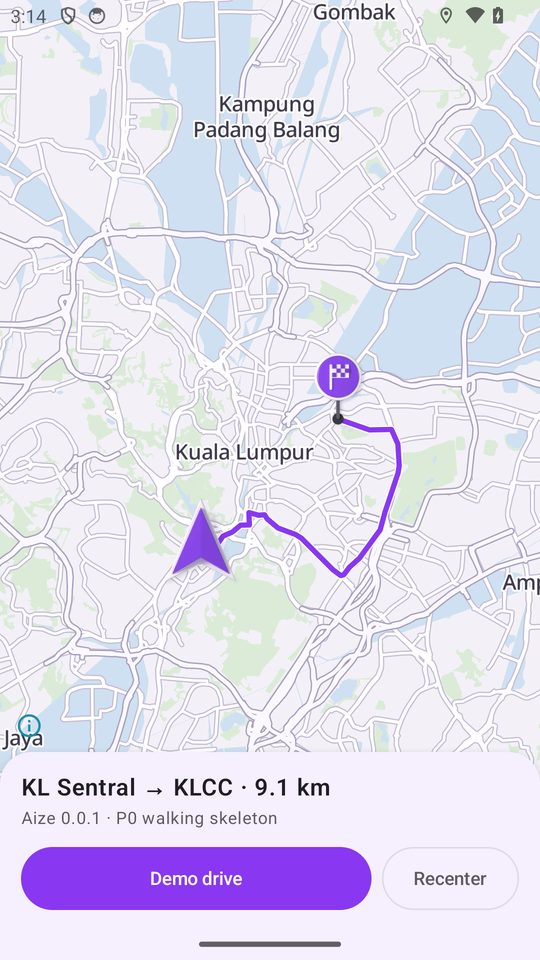
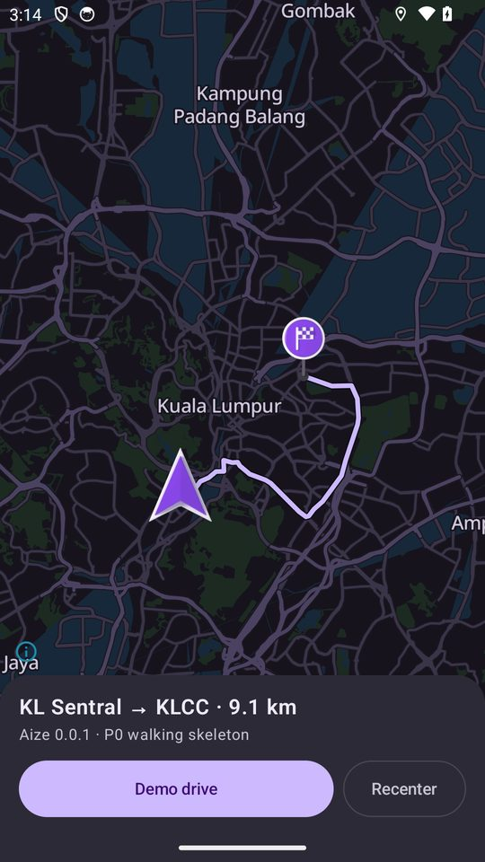
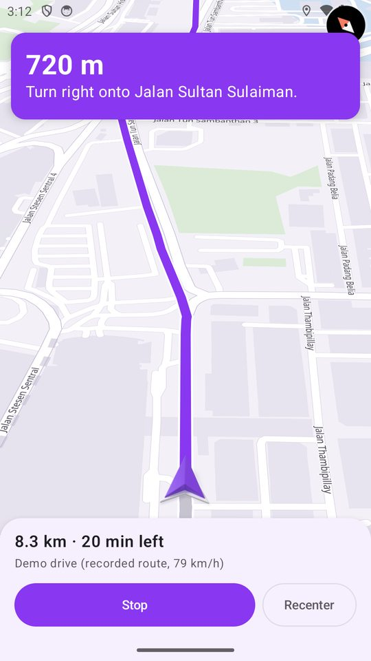

# P0 — closed

> **0.4.0-p0.** P0's exit criterion is a walking skeleton, and that has been running since 0.1.0. What this file records is the *rest* of P0: the scaffolding a project needs before feature work is cheap — repository, licence, CI, a Rust core, protobuf contract, performance harness, telemetry hooks, signing. Nine of eleven tasks are done; two are honest partials with the missing piece named.

## What P0 added on top of the skeleton

| Task | Result |
|---|---|
| P0-01 Decisions | `docs/adr/d-decisions.md` — D1 pilot region, D4 no ads, D5 **GPL-3.0-or-later**, D7 minSdk 26; 21 ADR files with a status line saying whether the repo actually does it |
| P0-02 Monorepo | Gradle KTS + version catalog, `core/aize-core` and `backend/aize-api` Rust workspaces, `proto/` with two linted messages, design pipeline, CI |
| P0-03 Toolchains | Pinned and documented in `docs/dev-setup.md`: Gradle 9.8.2, AGP 9.4.1, Kotlin 2.4.21, compileSdk 37, Rust stable 1.99.1, buf 1.75.0, JDK 17 |
| P0-04 CI | Four jobs — Android (token drift, no-Waze gate, 24 unit tests, debug build, R8 release build), Rust (fmt, clippy with `-D warnings`, tests), proto (buf lint/build), security (CodeQL) |
| P0-05 Tokens | Already done; `--check` is a CI gate |
| P0-06 Legal | `LICENSE` (GPL-3.0), `NOTICE.md` updated, `docs/PRIVACY.md` skeleton, `scripts/check_no_waze_assets.py` fails the build on borrowed assets, trademarks or foreign package ids |
| P0-08 Skeleton | Already done |
| P0-09 Performance | `benchmark/` macrobenchmark module, `JankStats` in debug, `scripts/perfetto-capture.sh`, `scripts/baseline-profile.sh`, first numbers in `docs/verification/p0-perf.md` |
| P0-10 Telemetry | Opt-in `Telemetry` (no-op until enabled, logcat sink, nothing leaves the device) and `FeatureFlags` that fall back to defaults on any parse failure |
| P0-11 Security | Release signing read from environment variables only; R8 release APK (47 MB) and AAB built; CodeQL |

## The two partials, precisely

* **P0-07 — own basemap tiles.** Valhalla and search are built and running from OSM data, but the basemap is still the downloaded Protomaps KL extract. `server/dev/docker-compose.yml` now describes the Planetiler → PMTiles step; it has never been executed, because this machine has no Docker. That is P2-03's work with a real machine.
* **P0-11 — dependency integrity.** Versions are pinned in the version catalog, but there is no `verification-metadata.xml` and no secrets scan. Both are cheap to add and belong before the first external contributor; noted in the roadmap rather than pretended.

## Numbers

| | |
|---|---|
| Unit tests | **24** JVM tests (`OffRoute` 6, `Polyline` 4, `Route` 4, `RouteClient` 3, `SearchClient` 3, `FeatureFlags` 4) |
| Rust tests | **6** (`aize-core` 5, `aize-api` 1), clippy clean with warnings as errors |
| Cold start, TTID | 3 541 ms median on the software-rendered emulator (budget 1 200 ms on a mid-tier phone) — `docs/verification/p0-perf.md` |
| Release build | 47 MB unsigned APK, R8 + resource shrinking |
| Repository licence | GPL-3.0-or-later |

## What has not changed

The app is the same navigation app it was at 0.3.0: purple map, live Valhalla routing, re-routing, search and a turn-by-turn banner. P0 did not add user-facing features, and the honest gap list from the previous revision still applies — no voice, no foreground service, no place card, no reports, no offline packs, no accounts.

Plan reference: `docs/02-aize-build-plan.md`, phase P0 (exit criterion: a *walking skeleton* — purple MapLibre map, a location puck, a route drawn).

**Result: the walking skeleton runs.** A debug APK was built and exercised on an Android 14 (API 34, x86_64) emulator; evidence below. It is a skeleton, not a navigation product: it follows a *recorded* route and has no router, search or voice.

## What the APK does (0.0.1-p0)

| Capability | State |
|---|---|
| Purple basemap (light + dark) from a bundled PMTiles file, MapLibre Native 13.7.1, glyphs bundled | works |
| Style and Compose colours generated from `design/tokens/aize-purple.tokens.json` (`design/generate_android.py`, `--check` is the CI gate) | works |
| Route drawn from a recorded Valhalla response (KL Sentral → KLCC, 9.1 km, 14 maneuvers), casing + line + greyed "passed" part | works |
| Location puck = the Blender-rendered arrow sprite (24 headings, nearest bucket + residual rotation; pitch 0° and 45° sheets) | works |
| Destination pin = the Blender-rendered pin sprite | works |
| Real GPS fix (Android `LocationManager`) moves the puck | works (emulator `geo fix`) |
| Demo drive: heading-up follow camera at 45° pitch, instruction banner, distance/ETA left | works |
| Dark theme follows the system | works |
| OSM attribution visible (ODbL) | works |
| 8 JVM unit tests (polyline codec, route geometry, guidance) | pass |

## What is **not** done (honest list)

* **P0-07 data stack** — Valhalla now runs Dockerless (see update above). Planetiler (own tiles) and Photon (search) are still not done; the basemap is still the bundled KL extract.
* **Rust core (`aize-core`, UniFFI, cargo-ndk)** — no Rust toolchain on the VM. Polyline decoding and route geometry are plain Kotlin for now (same unit tests will become the contract for the Rust port).
* **JDK 21** — the VM has JDK 17; the project targets 17 (a deviation from the plan, harmless for P0).
* **Two-bucket sprite blend (P2-05)** — only nearest-pitch/yaw is used; pitch animation can pop between sheets.
* **Hatch / van vehicle skins** — not rendered; the puck is the arrow only. No car skin selector.
* **Glyph coverage** — Latin only (code points 0–511). Thai/CJK/Arabic labels fall back to missing glyphs (logged as `Failed to load glyph range`).
* **Release build** — `release` is configured (R8, shrink) but not built or signed; the shared APK is debug-signed.
* **Real routing, search, reports, voice, offline packs, accounts** — all later phases.
* **Performance** — measured only on a software-rendered emulator; no device/GPU numbers.

## Build and run

```bash
scripts/fetch-dev-tiles.sh            # needs the `pmtiles` CLI; writes data/dev/assets/tiles/kuala-lumpur.pmtiles (gitignored)
python3 design/generate_android.py    # only after editing tokens; commit the result
./gradlew :app:testDebugUnitTest :app:assembleDebug
adb install -r app/build/outputs/apk/debug/app-debug.apk
```

Without the tile file the app still builds and starts, and shows "This build has no bundled map data".
Toolchain used: Gradle 9.8.2, AGP 9.4.1, Kotlin 2.4.21, Compose BOM 2026.09.00, compileSdk 37 (required by current AndroidX), minSdk 26, targetSdk 36.

To try it on an emulator: grant location (`adb shell pm grant app.aize android.permission.ACCESS_FINE_LOCATION`), send a position with `adb emu geo fix 101.6862 3.1343`, tap **Demo drive**.

## Verification evidence

Emulator: Android 14 google_apis x86_64, swiftshader software GL, 1080×1920. Screens (downscaled):

| Overview, light, GPS fix at KL Sentral | Overview, dark | Demo drive (heading-up, 45°) |
|---|---|---|
|  |  |  |

Bugs found by running it (and fixed): attribution button hidden behind the bottom sheet; compass under the instruction banner; `guidanceAt` never reported the final "arrive" maneuver; Kotlin nested-comment trap in KDoc paths.
