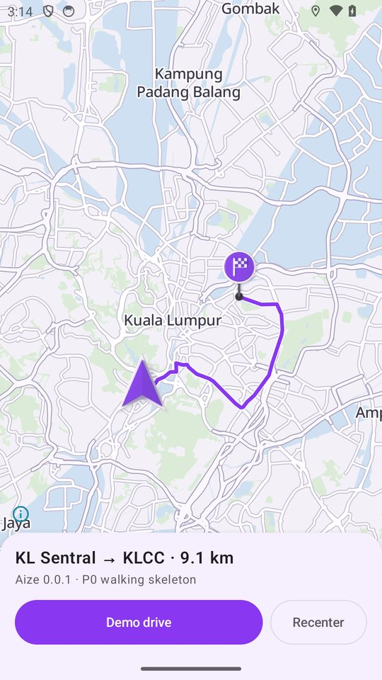
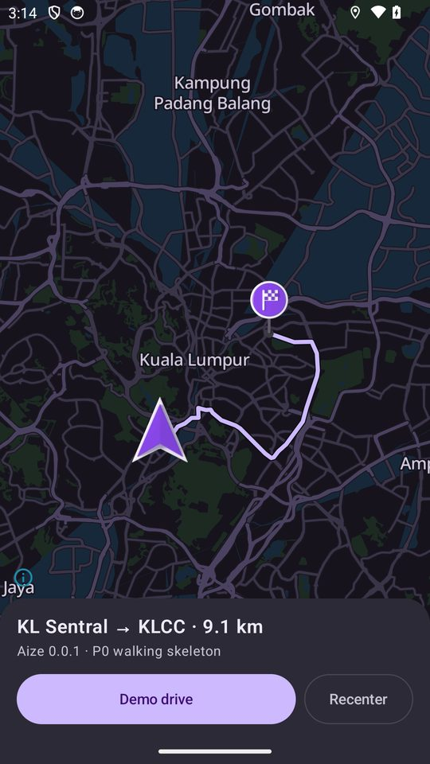
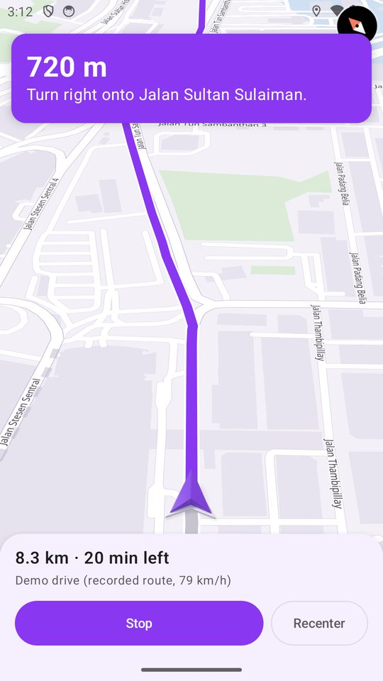

# P0 — Foundations: what is built, what is not

Plan reference: `docs/02-aize-build-plan.md`, phase P0 (exit criterion: a *walking skeleton* — purple MapLibre map, a location puck, a route drawn).

**Result: the walking skeleton runs.** A debug APK was built and exercised on an Android 14 (API 34, x86_64) emulator; evidence below. It is a skeleton, not a navigation product: it follows a *recorded* route and has no router, search or voice.

## What the APK does (0.0.1-p0)

| Capability | State |
|---|---|
| Purple basemap (light + dark) from a bundled PMTiles file, MapLibre Native 13.7.1, glyphs bundled | works |
| Style and Compose colours generated from `design/tokens/aize-purple.tokens.json` (`design/generate_android.py`, `--check` is the CI gate) | works |
| Route drawn from a recorded Valhalla response (KL Sentral → KLCC, 9.1 km, 14 maneuvers), casing + line + greyed "passed" part | works |
| Location puck = the Blender-rendered arrow sprite (24 headings, nearest bucket + residual rotation; pitch 0° and 45° sheets) | works |
| Destination pin = the Blender-rendered pin sprite | works |
| Real GPS fix (Android `LocationManager`) moves the puck | works (emulator `geo fix`) |
| Demo drive: heading-up follow camera at 45° pitch, instruction banner, distance/ETA left | works |
| Dark theme follows the system | works |
| OSM attribution visible (ODbL) | works |
| 8 JVM unit tests (polyline codec, route geometry, guidance) | pass |

## What is **not** done (honest list)

* **P0-07 data stack (Docker: Valhalla, Planetiler, Photon)** — Docker is not available on the build VM; nothing was stubbed. The route is a one-off recorded response; the app never calls a router.
* **Rust core (`aize-core`, UniFFI, cargo-ndk)** — no Rust toolchain on the VM. Polyline decoding and route geometry are plain Kotlin for now (same unit tests will become the contract for the Rust port).
* **JDK 21** — the VM has JDK 17; the project targets 17 (a deviation from the plan, harmless for P0).
* **Two-bucket sprite blend (P2-05)** — only nearest-pitch/yaw is used; pitch animation can pop between sheets.
* **Hatch / van vehicle skins** — not rendered; the puck is the arrow only. No car skin selector.
* **Glyph coverage** — Latin only (code points 0–511). Thai/CJK/Arabic labels fall back to missing glyphs (logged as `Failed to load glyph range`).
* **Release build** — `release` is configured (R8, shrink) but not built or signed; the shared APK is debug-signed.
* **Real routing, search, reports, voice, offline packs, accounts** — all later phases.
* **Performance** — measured only on a software-rendered emulator; no device/GPU numbers.

## Build and run

```bash
scripts/fetch-dev-tiles.sh            # needs the `pmtiles` CLI; writes data/dev/assets/tiles/kuala-lumpur.pmtiles (gitignored)
python3 design/generate_android.py    # only after editing tokens; commit the result
./gradlew :app:testDebugUnitTest :app:assembleDebug
adb install -r app/build/outputs/apk/debug/app-debug.apk
```

Without the tile file the app still builds and starts, and shows "This build has no bundled map data".
Toolchain used: Gradle 9.8.2, AGP 9.4.1, Kotlin 2.4.21, Compose BOM 2026.09.00, compileSdk 37 (required by current AndroidX), minSdk 26, targetSdk 36.

To try it on an emulator: grant location (`adb shell pm grant app.aize android.permission.ACCESS_FINE_LOCATION`), send a position with `adb emu geo fix 101.6862 3.1343`, tap **Demo drive**.

## Verification evidence

Emulator: Android 14 google_apis x86_64, swiftshader software GL, 1080×1920. Screens (downscaled):

| Overview, light, GPS fix at KL Sentral | Overview, dark | Demo drive (heading-up, 45°) |
|---|---|---|
|  |  |  |

Bugs found by running it (and fixed): attribution button hidden behind the bottom sheet; compass under the instruction banner; `guidanceAt` never reported the final "arrive" maneuver; Kotlin nested-comment trap in KDoc paths.
